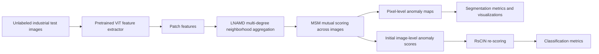
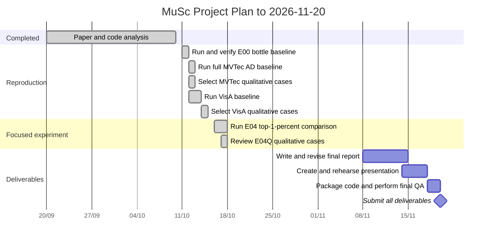

# MuSc Course Project Tracker

## Project Dashboard

| Field | Value |
|---|---|
| Course | CS2203.26.1 - Image Processing and Computer Vision |
| Project | Reproducing MuSc for Zero-Shot Anomaly Detection and Segmentation in Industrial Images |
| Primary paper | Li et al., ICLR 2024 |
| Computing environment | Google Colab GPU |
| Submission deadline | 2026-11-20 |
| Current status | Report, slides, code, and experiments are complete; backup demo video, rehearsal, access checks, and submission remain |
| Last updated | 2026-10-29 |

## Submission Deliverables

- [x] Final report in DOCX and PDF formats
- [x] Presentation slides
- [x] Source code with setup and execution instructions

The project does not include a poster.

## Project Objective

Reproduce the MuSc method for zero-shot industrial anomaly classification and segmentation. The project will explain the method, execute the official implementation on Google Colab, evaluate it on MVTec AD and VisA, compare the reproduced results with the paper, and analyze strengths, limitations, failure cases, and computational cost.

MuSc is training-free for the target dataset. The experimental work therefore focuses on environment setup, feature extraction, inference, evaluation, and reproducibility rather than model training.

## Scope

### Required scope

- Understand the MuSc architecture and the role of each component.
- Build a reproducible Google Colab workflow.
- Run a smoke test on one MVTec AD category.
- Evaluate all MVTec AD categories.
- Evaluate VisA after the MVTec AD pipeline is stable.
- Report image-level and pixel-level metrics.
- Compare reproduced and paper-reported results under matched configurations.
- Visualize successful predictions and representative failure cases.
- Submit the report, slides, and source code before the deadline.

### Optional scope

- Compare two supported pretrained backbones.
- Measure the contribution of RsCIN to image-level classification.
- Analyze sensitivity to one important MuSc configuration, such as neighborhood aggregation degrees.

### Out of scope

- Training a new foundation model.
- Building a production application or graphical user interface.
- Claiming a novel research contribution.
- Adding unrelated datasets before the required experiments are complete.

## Method Pipeline



Key components to explain in the report:

- **Pretrained ViT backbone:** extracts patch-level visual features using a supported CLIP, DINO, or DINOv2 encoder.
- **LNAMD:** aggregates local neighborhoods at multiple degrees to represent anomalies of different sizes.
- **MSM:** compares patches across unlabeled test images based on the assumption that normal patterns have many similar neighbors while anomalous patterns are rare.
- **RsCIN:** refines image-level anomaly scores using a constrained image-level neighborhood to reduce false positives.

## Evaluation Protocol

### Datasets

| Dataset | Role | Planned order | Status |
|---|---|---:|---|
| MVTec AD | Primary benchmark and first complete reproduction | 1 | Quantitative and qualitative reproduction complete |
| VisA | Second benchmark for cross-dataset validation | 2 | Quantitative and qualitative reproduction complete |

### Metrics

| Task | Required metrics |
|---|---|
| Image-level anomaly classification | AUROC, Average Precision, F1-max |
| Pixel-level anomaly segmentation | AUROC, Average Precision, F1-max, PRO |
| Computational analysis | Inference time, peak GPU memory when available |

### Reproducibility rules

- Record the exact Git commit of the MuSc implementation.
- Record the Colab GPU type, Python, CUDA, PyTorch, and package versions.
- Preserve every experiment configuration and command.
- Store metrics separately from qualitative images.
- Never overwrite an earlier experiment result. Create a new run directory instead.
- Compare results only when the dataset split, backbone, image size, and MuSc parameters match.
- Report deviations from the paper honestly rather than adjusting results manually.

## Milestone Schedule



## Work Breakdown and Checklists

### Phase 1 - Understand the paper and code

Target completion: 2026-09-30

- [x] Read the paper once for the overall problem, method, and conclusions.
- [x] Read it again and document the input, output, assumptions, and mathematical definitions.
- [x] Explain LNAMD, MSM, and RsCIN in original wording.
- [x] Identify how anomaly maps and image-level scores are calculated.
- [x] Map paper components to files and functions in the official repository.
- [x] Record the paper's dataset protocol, backbone, image size, and main hyperparameters.
- [x] List the main reported metrics that will be reproduced.

Phase artifact: [MuSc method note](2026-09-21-musc-method-note.md), based on the ICLR 2024 paper and official repository commit `b76b93da8bd3096a99964a96ae29d46f197a0651`.

Exit criterion: the method can be explained from input to output without relying on the paper's abstract.

### Phase 2 - Build the Colab reproduction environment

Target completion: 2026-10-13

- [x] Create a Colab notebook or documented Colab entry point.
- [x] Clone or upload the selected MuSc source revision.
- [x] Install pinned dependencies compatible with the current Colab runtime.
- [x] Download and verify MVTec AD.
- [x] Download model weights through the documented source.
- [x] Run inference on one MVTec AD category, starting with `bottle`.
- [x] Save one metrics file and several anomaly-map visualizations.
- [x] Restart the Colab runtime and verify that the setup works from a clean session.

Execution artifacts: [E00 Colab runbook](2026-10-11-musc-colab-e00-runbook.md), [Vietnamese E00 Colab guide](2026-10-11-huong-dan-colab-musc-e00.md), [Vietnamese E01 Colab guide](2026-10-11-huong-dan-colab-musc-e01.md), and [Vietnamese E02 VisA guide](2026-10-12-huong-dan-colab-musc-e02-visa.md).

Exit criterion: a fresh Colab session can reproduce the one-category smoke test by following the README.

### Phase 3 - Reproduce MVTec AD results

Target completion: 2026-10-23

- [x] Freeze the baseline configuration before the full run.
- [x] Run all MVTec AD categories.
- [x] Collect per-category and mean classification metrics.
- [x] Collect per-category and mean segmentation metrics.
- [x] Measure and preserve per-category subprocess runtime.
- [ ] Measure peak GPU memory if needed for the final computational comparison.
- [x] Compare reproduced values with the matching official repository table.
- [x] Localize and document material discrepancies without deleting the original run.
- [x] Select representative correct detections and failure cases.

Exit criterion: one complete MVTec AD result table and supporting visualizations are available.

### Phase 4 - Reproduce VisA results

Target completion: 2026-10-31

- [x] Download and preprocess VisA using the official procedure.
- [x] Verify dataset paths and split files.
- [x] Run all VisA categories with the frozen baseline configuration.
- [x] Collect classification and segmentation metrics.
- [x] Compare reproduced and reported results.
- [x] Select representative correct detections and failure cases.

Execution artifacts: [Vietnamese E02Q VisA qualitative guide](2026-10-14-huong-dan-colab-musc-e02q-visa.md) and [E02Q result note](2026-10-15-musc-e02q-result.md).

Exit criterion: one complete VisA result table and supporting visualizations are available.

### Phase 5 - Analysis and focused experiments

Target completion: 2026-11-09

- [x] Explain why mutual scoring can distinguish common normal patches from rare anomalous patches.
- [x] Compare performance across object and texture categories.
- [x] Analyze at least three failure cases.
- [x] Document Colab runtime, memory, and operational limitations.
- [x] Run a descriptive RsCIN comparison on the four selected VisA categories.
- [x] Run one controlled image-score aggregation comparison that answers a clear question.
- [x] Summarize strengths, weaknesses, and threats to reproducibility.

Exit criterion: every claim in the analysis is supported by a table, figure, log, or cited source.

### Phase 6 - Final report

Target completion: 2026-11-14

- [x] Member information and contribution assessment
- [x] Motivation and importance of industrial anomaly detection
- [x] Problem statement with explicit input and output
- [x] Background and related work
- [x] Detailed explanation of MuSc
- [x] Dataset and evaluation protocol
- [x] Implementation and Colab environment
- [x] Quantitative results
- [x] Qualitative results and failure analysis
- [x] Advantages, limitations, and lessons learned
- [x] Conclusion
- [x] References
- [x] Citation audit
- [x] Final PDF and DOCX rendering check

Report artifacts: [Vietnamese report source](2026-10-15-musc-final-report-draft-vi.md), [submission PDF](submission/2026-11-02-musc-final-report-vi.pdf), [submission DOCX](submission/2026-11-02-musc-final-report-vi.docx), ten accepted qualitative panels plus five corrected figure strips under `assets/musc-report/`, the [figure correction note](2026-11-02-musc-qualitative-figure-correction.md), and the [citation audit](2026-10-15-musc-citation-audit.md). The 17-page A4 PDF includes the E04 quantitative result and the E04Q positive-counterexample pair, passed visual inspection, and the DOCX archive passed structural validation. The 2026-10-16, 2026-10-17, and 2026-10-18 exports are retained as immutable earlier versions.

Exit criterion: the report contains all required course sections, reproducible experimental details, and properly cited sources.

### Phase 7 - Presentation slides

Target completion: 2026-11-17

- [x] Title and member contributions
- [x] Motivation
- [x] Problem definition
- [x] MuSc pipeline
- [x] LNAMD, MSM, and RsCIN
- [x] Dataset and metrics
- [x] Experimental setup
- [x] Main quantitative results
- [x] Qualitative results
- [x] Failure cases, strengths, and limitations
- [x] Conclusion and references
- [ ] Record and verify a backup demo video
- [ ] Rehearse within the assigned presentation time

Exit criterion: the slides tell a coherent story from problem to evidence and can be presented within the time limit.

Slide artifacts: [Vietnamese Beamer source](musc-presentation/2026-10-15-musc-reproduction-slides-vi.tex) and [compiled PDF](musc-presentation/2026-10-17-musc-reproduction-slides-vi.pdf). The 17-page PDF includes the E04/E04Q extension slide, compiles without layout warnings, and passed visual inspection. The earlier compiled PDF is retained. Rehearsal remains pending because the assigned presentation duration has not been confirmed.

### Phase 8 - Source code and submission package

Target completion: 2026-11-19

- [x] Provide a clear README with setup, dataset placement, and execution commands.
- [x] Include the E00 Colab notebook as the reproducible entry point.
- [x] Pin dependencies or document tested versions.
- [x] Include the frozen baseline configuration.
- [x] Include scripts for evaluation and result export.
- [x] Exclude datasets, model weights, secrets, and large generated files from the repository.
- [ ] Test all links in an incognito browser.
- [ ] Confirm that the report, slides, and source code are accessible.
- [ ] Submit no later than 2026-11-20.

Exit criterion: another student can follow the README in a fresh Colab session and reproduce the smoke test.

Source artifact: private repository `https://github.com/DiiKhanh/cs2203-musc-reproduction`, verified at commit `afb3986bb54c159d33b7f1a2a02698066f500d84`. Access for the instructor is not yet confirmed.

## Experiment Matrix

| ID | Question | Dataset and scope | Configuration | Required output | Status |
|---|---|---|---|---|---|
| E00 | Does the end-to-end pipeline run correctly? | MVTec AD `bottle` | Paper-aligned baseline | Metrics, anomaly maps, runtime log | Accepted on 2026-10-11 |
| E01 | Can the main MVTec AD results be reproduced? | MVTec AD, all categories | Frozen baseline | Per-category and mean metrics | Accepted on 2026-10-12; see [E01 result note](2026-10-12-musc-e01-result.md) |
| E01Q | Which cases illustrate MuSc's segmentation strengths and limitations? | MVTec AD `leather`, `transistor`, and `screw` | Frozen baseline with `whole_norm` visualization | Original, mask, heatmap, overlay, ranked case table | Accepted on 2026-10-12; see [E01Q result note](2026-10-12-musc-e01q-result.md) |
| E02 | Does the reproduction generalize to the second benchmark? | VisA, all categories | Frozen baseline | Per-category and mean metrics | Accepted on 2026-10-14 with documented image-level deviations; see [E02 result note](2026-10-14-musc-e02-result.md) |
| E02Q | Which VisA cases explain the image-level deviations and pixel-level reference inconsistency? | VisA `pcb2`, `pcb3`, `pcb4`, and `fryum` | Frozen baseline with `whole_norm` visualization and observational per-image score export | Original, mask, heatmap, overlay, RsCIN scores, ranked case table | Accepted on 2026-10-15; see [E02Q result note](2026-10-15-musc-e02q-result.md) |
| E03 | How much does RsCIN change image-level performance? | MVTec AD | Baseline with and without RsCIN | Classification comparison | Optional |
| E04 | Does top-1-percent mean pooling reduce sensitivity to an isolated noisy patch compared with maximum pooling? | MVTec AD, all 15 categories after a `bottle` continuity gate | Compute maximum and top-1-percent mean from the same anomaly maps; evaluate both with and without RsCIN | Image AUROC, AP, F1-max, paired category deltas, false-positive candidates, runtime | Accepted on 2026-10-17; the primary AUROC delta is -0.9529 points, so the hypothesis is not supported; see [E04 result note](2026-10-17-musc-e04-result.md) |
| E04Q | What spatial patterns explain the positive cases and the large `screw` degradation in E04? | MVTec AD `carpet`, `transistor`, and `screw`; nine cases fixed before heatmap review | Exact E04 patch with `whole_norm` visualization and score continuity checks | Nine panels, fixed case table, continuity report, mechanism and trade-off observations | Accepted on 2026-10-17; selected positive cases show maximum-driven normal responses, while `screw` shows object-wide activation and adverse score ordering; see [E04Q result note](2026-10-17-musc-e04q-result.md) |

## Result Tracking

Create one row after every completed run. Link to immutable result directories rather than replacing previous values.

| Run ID | Date | Experiment | Dataset | Git commit | Colab GPU | Configuration | Result path | Outcome | Notes |
|---|---|---|---|---|---|---|---|---|---|
| `20261011_161100_E00_mvtec_bottle_clip_l14_336_baseline` attempt 1 | 2026-10-11 | E00 | MVTec AD `bottle` | `b76b93d` | Tesla T4 | Paper-aligned baseline | `MyDrive/CS2203_MuSc/runs/20261011_161100_E00_mvtec_bottle_clip_l14_336_baseline/` | Failed before inference | Python resolved Hugging Face `datasets` instead of MuSc's local `datasets`; the console log was later replaced when the same run directory was reused |
| `20261011_161100_E00_mvtec_bottle_clip_l14_336_baseline` attempt 2 | 2026-10-11 | E00 | MVTec AD `bottle` | `b76b93d` | Tesla T4 | Paper-aligned baseline plus documented import compatibility fix | `MyDrive/CS2203_MuSc/runs/20261011_161100_E00_mvtec_bottle_clip_l14_336_baseline/` | Accepted | All 83 images processed; all seven metrics match the official repository after rounding; 83 anomaly maps saved; see [E00 result note](2026-10-11-musc-e00-result.md) |
| `20261012_074856_E01_mvtec_all_clip_l14_336_baseline` | 2026-10-12 | E01 | MVTec AD, all 15 categories | `b76b93d` | Tesla T4 | Frozen baseline with documented import and CPU memory compatibility patches | `MyDrive/CS2203_MuSc/runs/20261012_074856_E01_mvtec_all_clip_l14_336_baseline/` | Accepted with documented image-level deviations | All mean deltas are within 0.036 percentage points; all pixel-level category metrics are within 0.10; `pill` resumed successfully after a RAM crash; see [E01 result note](2026-10-12-musc-e01-result.md) |
| `20261012_151018_E01Q_mvtec_qualitative` | 2026-10-12 | E01Q | MVTec AD `leather`, `transistor`, and `screw` | `b76b93d` | Tesla T4 | Frozen baseline with `whole_norm` visualization | `MyDrive/CS2203_MuSc/runs/20261012_151018_E01Q_mvtec_qualitative/` | Accepted | 384 heatmaps and 18 selected cases; rerun metrics match E01 within `1.42e-14`; see [E01Q result note](2026-10-12-musc-e01q-result.md) |
| `20261012_171400_E02_visa_all_clip_l14_336_baseline` | 2026-10-12 to 2026-10-13 | E02 | VisA, all 12 categories | `b76b93d` | Tesla T4 | Frozen baseline with documented import and CPU memory compatibility patches | `MyDrive/CS2203_MuSc/runs/20261012_171400_E02_visa_all_clip_l14_336_baseline/` | Accepted with documented image-level deviations and a reference inconsistency | All pixel-level mean deltas are within 0.004 percentage points; the official `fryum` Pixel AUROC row conflicts with the official mean; `macaroni2` resumed successfully after an interrupted attempt; see [E02 result note](2026-10-14-musc-e02-result.md) |
| `20261014_050040_E02Q_visa_qualitative` | 2026-10-14 | E02Q | VisA `pcb2`, `pcb3`, `pcb4`, and `fryum` | `b76b93d` | Tesla T4 | Frozen baseline with `whole_norm` visualization and observational per-image score export | `MyDrive/CS2203_MuSc/runs/20261014_050040_E02Q_visa_qualitative/` | Accepted | 752 score records and recorded heatmaps, 24 complete selected panels, and metric continuity within `1.42e-14`; RsCIN improves three selected categories but degrades all three image metrics for `pcb3`; see [E02Q result note](2026-10-15-musc-e02q-result.md) |
| `20261016_102025_E04_mvtec_top1_pooling` | 2026-10-16 to 2026-10-17 | E04 | MVTec AD, all 15 categories | `b76b93d` | Tesla T4 | Maximum versus top-1-percent mean pooling, with and without RsCIN | `MyDrive/CS2203_MuSc/runs/20261016_102025_E04_mvtec_top1_pooling/` | Accepted; hypothesis not supported | All 15 categories and 1,725 images completed; `top1_rscin` reduces macro Image AUROC by 0.9529 points versus `max_rscin`; continuity with E01 is exact; see [E04 result note](2026-10-17-musc-e04-result.md) |
| `20261017_082619_E04Q_mvtec_pooling_qualitative` | 2026-10-17 | E04Q | MVTec AD `carpet`, `transistor`, and `screw` | `b76b93d` | Tesla T4 | Exact E04 scoring patch with `whole_norm` visualization and fixed qualitative cases | `MyDrive/CS2203_MuSc/runs/20261017_082619_E04Q_mvtec_pooling_qualitative/` | Accepted | 377 heatmaps recorded in category manifests, nine fixed panels, and per-image scores matching E04 within floating-point precision; see [E04Q result note](2026-10-17-musc-e04q-result.md) |

Recommended run naming convention:

```text
YYYYMMDD_<experiment-id>_<dataset>_<backbone>_<short-note>
```

## Decision Log

| Date | Decision | Rationale | Consequence |
|---|---|---|---|
| 2026-09-20 | Use MuSc as the reproduced method | It is a recent ICLR method, supports classification and segmentation, and is training-free on target datasets | The project focuses on inference and rigorous evaluation rather than model training |
| 2026-09-20 | Use MVTec AD before VisA | MVTec AD has a simpler initial workflow in the official implementation | The first complete baseline will be produced earlier |
| 2026-09-20 | Use Google Colab as the compute environment | It is the available GPU environment | Experiments must tolerate session limits and preserve outputs outside ephemeral storage |
| 2026-10-11 | Freeze the first smoke test at official commit `b76b93d` and the paper-aligned CLIP configuration | A controlled baseline is required before changing the pipeline | E00 uses the full MVTec AD `bottle` test split and stores immutable outputs in Google Drive |
| 2026-10-11 | Use top-1-percent mean pooling as the proposed focused extension | Maximum pooling can be sensitive to one noisy patch; the hypothesis can be tested by changing one aggregation step | The extension begins only after E00 and the full baseline are stable; segmentation claims remain outside this extension |
| 2026-10-11 | Add a documented Colab import compatibility fix | The upstream `datasets` directory conflicts with the installed Hugging Face package because it lacks `__init__.py` and the repository path is appended after external packages | Add an empty local `datasets/__init__.py`, prepend the MuSc root to `sys.path`, and preserve the patch in each run directory; the MuSc algorithm is unchanged |
| 2026-10-12 | Keep the Hugging Face dataset cache on Colab's local filesystem | DriveFS converted a Hugging Face cache link target into a 79-byte path pointer, so the cached object was not an XZ archive | Download and validate the MVTec archive in `/content`; keep experiment outputs on Google Drive |
| 2026-10-12 | Accept E01 with explicit image-level reproducibility caveats | All 15 categories completed, all mean deltas are below 0.036 percentage points, and all pixel-level category metrics are within 0.10; ten image-level comparisons exceed 0.10 | Use E01 as the quantitative baseline, disclose the RsCIN-localized deviations, and preserve the complete comparison table |
| 2026-10-12 | Accept E01Q as the MVTec qualitative evidence | Three categories completed with 384 heatmaps, 18 balanced cases, and metrics identical to E01 within floating-point noise | Use the selected leather, transistor, and screw panels to explain localization strengths, thin-defect failures, and object-wide responses |
| 2026-10-14 | Accept E02 with explicit image-level and reference-table caveats | All 12 categories completed; all pixel-level means are within 0.004 percentage points; image-level mean deltas reach 0.262; the printed `fryum` Pixel AUROC conflicts with the official mean | Use E02 as the VisA quantitative baseline, preserve all 25 raw alerts, and disclose the inferred reference typo rather than silently correcting it |
| 2026-10-15 | Accept E02Q as the VisA qualitative evidence | All four planned categories completed; 752 per-image score records and heatmaps were recorded; 24 balanced cases contain complete panels; rerun metrics match E02 within floating-point noise | Use the selected panels to explain diffuse object-wide responses, nuisance activation, the `pcb3` RsCIN degradation, and why high `fryum` Pixel AUROC does not imply tight localization |
| 2026-10-15 | Defer optional experiments until required deliverables are secure | The required quantitative and qualitative reproduction is complete, while the final report, source access, slides, and rendering checks remain unfinished | Do not run E03; reconsider E04 only after the report, source package, and presentation are complete |
| 2026-10-16 | Approve E04 as a controlled 2 x 2 comparison | Required deliverables are complete, and maximum versus top-1-percent mean can be compared from the same anomaly maps both with and without RsCIN | Run a `bottle` continuity gate first, then all 15 MVTec AD categories; preserve paired metrics and per-image scores |
| 2026-10-17 | Accept E04 as a complete negative quantitative result | The run completed all 15 categories with exact E01 continuity, but `top1_rscin` lowers macro Image AUROC by 0.9529 points and does not show a consistent paired-category advantage | Do not tune the pooling fraction after observing the result; report the negative outcome and retain all four score variants |
| 2026-10-17 | Fix the E04Q review set before viewing new heatmaps | `carpet` supplies a positive case, `transistor` supplies mixed behavior, and `screw` is the strongest counterexample; nine image paths were selected from E04 tables | Rerun only these three categories with visualization, keep the nine cases fixed, and require continuity with E04 |
| 2026-10-17 | Accept E04Q as the qualitative explanation of the E04 trade-off | All three planned categories completed with 377 recorded heatmaps, nine fixed panels, and score continuity within floating-point precision; the panels show both resolved maximum-driven responses and object-wide counterexamples | Keep the negative E04 conclusion, use E04Q only to explain the mechanism and trade-off, and integrate a small positive-counterexample pair into the report and presentation |

## Risk Register

| Risk | Likelihood | Impact | Mitigation | Trigger |
|---|---|---|---|---|
| Colab session disconnects or exhausts CPU RAM during evaluation | High | High | Resume from per-category `SUCCESS.json` files; release expired feature tensors before metric allocation; prefer a High RAM runtime while keeping `divide_num=1` | The runtime crashes or RAM usage approaches its limit during a large category |
| Dependency versions fail on the current Colab image | Medium | High | Pin a tested environment and document any required compatibility changes | Installation or import errors occur in a fresh runtime |
| Mutual scoring exceeds GPU memory | Medium | High | Use the repository's dataset division option, lower batch-related settings, and process categories separately | CUDA out-of-memory error |
| Reproduced metrics differ from the paper | Medium | Medium | Verify split, preprocessing, backbone, weights, image size, and configuration before interpreting the gap | A matched metric differs materially from the reference |
| Dataset or model download is slow or unavailable | Medium | Medium | Keep symlink-based Hugging Face caches in `/content`; store only ordinary files and experiment outputs on Google Drive; record the official source and revision | Repeated download failure or a cached file whose magic bytes contain a relative path |
| Writing starts too late | Low | High | Draft method and dataset sections while experiments run | Report outline is still empty on 2026-11-01 |
| Source link is inaccessible to the instructor | Low | High | Test viewer access in an incognito browser before submission | Link requires login or an access request |
| Live demo fails during the presentation | Medium | High | Record and verify a backup demo video that shows the complete demonstration flow | The backup video is still unavailable one week before the deadline |

## Immediate Next Actions

Complete these actions in order:

1. Record and verify the backup demo video.
2. Confirm the assigned presentation duration and rehearse the completed slide deck.
3. Grant the instructor access to the private source repository.
4. Test report, slide, Colab, source, and backup-video links from an authorized viewer account.
5. Perform the final submission review and submit all deliverables no later than 2026-11-20.

## Weekly Review Routine

At the end of each week:

- Update the dashboard status and `Last updated` date.
- Check completed tasks and move blocked tasks into the risk register.
- Add all completed runs to the result-tracking table.
- Record configuration decisions in the decision log.
- Confirm the single most important task for the next week.
- Check whether the schedule still protects 2026-11-18 and 2026-11-19 for final quality assurance.

## Definition of Done

The project is complete only when all conditions below are satisfied:

- [x] MuSc runs from a clean Google Colab session using documented instructions.
- [x] MVTec AD evaluation is complete.
- [x] VisA evaluation is complete or any justified scope change is documented before report finalization.
- [x] Quantitative results are traceable to immutable experiment outputs.
- [x] Qualitative examples include both successful and difficult predictions.
- [x] The report explains the architecture instead of only presenting repository output.
- [x] The report includes all course-required sections and citations.
- [ ] A verified backup demo video is available from the presentation device.
- [ ] The presentation has been rehearsed.
- [ ] Source code and Colab links work with viewer access.
- [ ] Report, slides, and source code are submitted by 2026-11-20.

## Primary References

1. Xurui Li, Ziming Huang, Feng Xue, and Yu Zhou. [MuSc: Zero-Shot Industrial Anomaly Classification and Segmentation with Mutual Scoring of the Unlabeled Images](https://openreview.net/pdf?id=AHgc5SMdtd). ICLR, 2024.
2. [Official MuSc PyTorch implementation](https://github.com/xrli-U/MuSc).
3. Paul Bergmann, Michael Fauser, David Sattlegger, and Carsten Steger. [MVTec AD: A Comprehensive Real-World Dataset for Unsupervised Anomaly Detection](https://openaccess.thecvf.com/content_CVPR_2019/html/Bergmann_MVTec_AD_--_A_Comprehensive_Real-World_Dataset_for_Unsupervised_Anomaly_CVPR_2019_paper.html). CVPR, 2019.
4. Yang Zou, Jongheon Jeong, Latha Pemula, Dongqing Zhang, and Onkar Dabeer. [SPot-the-Difference Self-Supervised Pre-training for Anomaly Detection and Segmentation](https://doi.org/10.1007/978-3-031-20056-4_23). ECCV, 2022.
