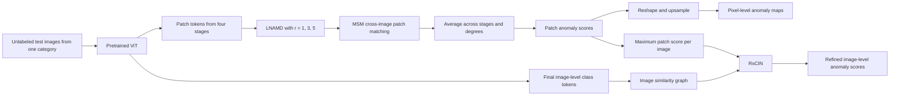

# MuSc Method Note

## Study Goal

This note explains MuSc from input to output and maps the paper's main components to the official implementation. It establishes the configuration that should be frozen before the first MVTec AD smoke test.

MuSc addresses zero-shot industrial anomaly classification and segmentation. It does not train on the target dataset and does not use text prompts. Instead, it jointly analyzes the unlabeled test images of one product category and uses their recurring visual patterns as implicit evidence of normality.

## Problem Definition

### Input

For one industrial product category, the input is an unlabeled test set

$$
D_u = \{I_i\}_{i=1}^{N},
$$

where the set may contain both normal and anomalous images. Ground-truth image labels and pixel masks are not used by MuSc during inference. They are used only after inference to compute evaluation metrics.

### Output

For every image $I_i$, MuSc produces:

1. A dense pixel-level anomaly map for anomaly segmentation.
2. An image-level anomaly score for anomaly classification.

Higher scores indicate greater evidence of an anomaly.

## Core Assumptions

MuSc is built on four assumptions:

1. Normal patterns recur across many industrial images of the same category.
2. Anomalous patterns are relatively rare and diverse, so an anomalous patch has fewer close matches in other images.
3. A fixed pretrained Vision Transformer provides patch features that preserve useful visual similarity without target-specific training.
4. Similar image-level features should usually correspond to similar image-level anomaly scores.

The first two assumptions drive the Mutual Scoring Mechanism. The fourth assumption drives RsCIN. Performance may degrade when normal appearance is highly diverse, when the same anomaly repeats frequently, or when orientation and scale vary enough to make corresponding patterns dissimilar.

## End-to-End Pipeline

The official implementation executes the pipeline independently for every product category. It does not compare patches from different categories such as `bottle` and `cable`.

## 1. Pretrained Feature Extraction

The paper uses OpenAI CLIP with the `ViT-L-14-336` architecture. Although the backbone name contains `336`, the paper resizes input images to $518 \times 518$.

The 24 transformer layers are divided into four stages of six layers. Patch tokens are extracted from the end of each stage. The current configuration stores these locations as zero-based indices `[5, 11, 17, 23]`; `models/musc.py` adds one before requesting layers 6, 12, 18, and 24 from the backbone.

Two feature types are retained:

- Patch tokens from four stages are used by LNAMD and MSM.
- The projected class token from the final layer is used by RsCIN.

No backbone parameter is updated during MuSc inference.

## 2. Local Neighborhood Aggregation with Multiple Degrees

### Purpose

A single patch scale is not equally suitable for every defect. Small neighborhoods preserve small anomalies, while larger neighborhoods provide more context for larger defects. LNAMD therefore creates multiple versions of each patch representation.

### Operation

For a stage $l$, the patch tokens are reshaped into their two-dimensional spatial grid. For each patch location, adaptive average pooling is applied over an $r \times r$ local neighborhood using

$$
r \in \{1, 3, 5\}.
$$

The output token for patch $m$, degree $r$, image $i$, and stage $l$ is denoted by

$$
\hat{p}_{i,l}^{m,r}.
$$

When $r=1$, no neighborhood aggregation occurs. A small $r$ retains localized details, while a large $r$ provides a broader representation but can smooth away small defects. MuSc preserves all three degrees and combines their scores later rather than selecting one scale globally.

### Code mapping

- `models/modules/_LNAMD.py`
  - `PatchMaker.patchify`: extracts padded local neighborhoods.
  - `MeanMapper.forward`: performs adaptive average pooling over each neighborhood.
  - `LNAMD._embed`: removes the class token, reconstructs the spatial grid, normalizes features, and returns aggregated features.
- `models/musc.py`
  - Iterates over `r_list`.
  - L2-normalizes the aggregated features.
  - Stores the features separately for each selected stage.

## 3. Mutual Scoring Mechanism

MSM assigns a score to every patch by comparing it with the patches of every other unlabeled image in the same category.

### Step 1: Score a patch against another image

For patch $m$ of image $I_i$, image $I_j$ assigns the minimum Euclidean distance to any of its patches:

$$
a_{i,l}^{m,r}(I_j)
=
\min_n
\left\|
\hat{p}_{i,l}^{m,r} - \hat{p}_{j,l}^{n,r}
\right\|_2,
\qquad j \ne i.
$$

A normal patch should find a close match in many other images and therefore receive many small distances. An anomalous patch should have fewer close matches and receive larger distances from most images.

### Step 2: Interval Average

For one patch, the cross-image distances form a scoring vector. MuSc sorts this vector and averages only the smallest 30 percent:

$$
a_{i,l}^{m,r}
=
\frac{1}{K}
\sum_{k=1}^{K}
a_{i,l}^{m,r}(I_{(k)}),
$$

where $I_{(k)}$ indexes the images producing the $K$ smallest scores.

This operation is more robust than averaging all images because normal appearance can vary. A normal patch only needs to find a sufficient group of similar normal patches. The ablation study reports that the lowest 30 percent provides the best overall balance on MVTec AD and VisA among the tested proportions.

### Step 3: Combine stages and neighborhood degrees

The final score for patch $m$ is the mean over all four ViT stages and all three aggregation degrees:

$$
a_i^m
=
\frac{1}{L}
\sum_{l=1}^{L}
\frac{1}{3}
\sum_{r \in \{1,3,5\}}
a_{i,l}^{m,r}.
$$

The vector of patch scores is reshaped into a two-dimensional grid and bilinearly upsampled to the input resolution. This produces the pixel-level anomaly map.

The initial image-level anomaly score is the maximum patch score:

$$
c_i = \max_m a_i^m.
$$

Using the maximum makes classification responsive to small defects, but it also makes the score sensitive to isolated noise. RsCIN is intended to correct this weakness.

### Code mapping

- `models/modules/_MSM.py`
  - `compute_scores_fast`: computes all pairwise patch distances with `torch.cdist`, takes the closest patch in each other image, selects the lowest score interval, and averages it.
  - `compute_scores_slow`: implements the same operation with lower peak memory and lower speed.
  - `MSM`: repeats the scoring process for every image.
- `models/musc.py`
  - Calls MSM for every selected feature stage and aggregation degree.
  - Averages stage scores, then averages degree scores.
  - Reshapes and upsamples patch scores into anomaly maps.
  - Uses the maximum anomaly-map value as the initial image-level score.

## 4. Re-scoring with Constrained Image-level Neighborhood

### Purpose

The maximum patch score may classify a normal image as anomalous because of a small noisy response. The paper observes that final-layer class tokens are less sensitive to this local noise. RsCIN therefore refines each image score using scores from visually similar images.

### Operation

Let $\mathcal{F}_i$ be the normalized class token for image $I_i$. The image similarity matrix is

$$
W_{i,j} = \mathcal{F}_i \cdot \mathcal{F}_j.
$$

For each neighborhood size $k$, a binary mask keeps only the $k$ most similar images. The retained similarity weights are row-normalized, and the corresponding anomaly scores are aggregated. The final score averages the original score with the results from multiple constrained neighborhoods:

$$
\hat{C}
=
\frac{
\sum_{M_k \in \mathcal{M}}
D^{-1}(M_k \odot W)C
+ C
}{K+1}.
$$

The paper uses neighborhood sizes `{2, 3}` for MVTec AD and `{8, 9}` for VisA. The current code passes `[1, 2, 3]` and `[1, 8, 9]`, respectively. In the implementation, the `k=1` window retains the image itself and represents the original self-score, making the code form consistent with the paper's explicit `+ C` term.

### Code mapping

- `models/modules/_RsCIN.py`
  - `MMO`: creates each top-$k$ similarity mask and computes normalized weighted scores.
  - `RsCIN`: normalizes initial scores, constructs the class-token similarity matrix, and applies MMO.
- `models/musc.py`
  - Selects the dataset-specific neighborhood list.
  - Applies RsCIN before image-level metric computation.
- `models/RsCIN_features/`
  - Contains the optional standalone version for applying RsCIN to scores from other methods.

## Paper-Aligned Baseline Configuration

| Item | Baseline value | Evidence location |
|---|---|---|
| Backbone | OpenAI CLIP `ViT-L-14-336` | Paper Section 4; `configs/musc.yaml` |
| Input resolution | `518 x 518` | Paper Section 4; `configs/musc.yaml` |
| Feature stages | Transformer layers 6, 12, 18, 24 | Paper Section 4 |
| Config layer indices | `[5, 11, 17, 23]` | `configs/musc.yaml`, stored zero-based |
| LNAMD degrees | `[1, 3, 5]` | Paper Sections 3.1 and 4.2 |
| MSM interval | Lowest 30 percent | Paper Sections 3.2 and 4.2 |
| MVTec AD RsCIN neighborhoods | `{2, 3}` plus self-score | Paper Sections 3.3 and 4 |
| VisA RsCIN neighborhoods | `{8, 9}` plus self-score | Paper Section 4 |
| Repository batch size | `4` | `configs/musc.yaml` |
| Dataset division | `divide_num = 1` for the full baseline | `configs/musc.yaml` |
| Category processing | One category at a time | `models/musc.py` |
| Reproduction seed | `42` | `examples/musc_main.py` |

## Evaluation Protocol

### Datasets

- **MVTec AD:** 15 categories, comprising 10 object categories and 5 texture categories.
- **VisA:** 12 object categories across three domains. The official repository requires preprocessing with `datasets/visa_preprocess.py`.

The first smoke test should use the full test split of the MVTec AD `bottle` category. Using only a few hand-selected images would change the mutual-scoring population and would not test the paper's intended inference setting.

### Metrics

| Level | Metrics |
|---|---|
| Image-level classification | AUROC, Average Precision, F1-max |
| Pixel-level segmentation | AUROC, Average Precision, F1-max, PRO |

The official implementation computes all four metrics in `utils/metrics.py`. PRO is integrated over false-positive rates below 0.3 using 200 threshold steps.

### Paper-reported reference results

| Dataset | Image AUROC | Image F1-max | Image AP | Pixel AUROC | Pixel F1-max | Pixel AP | PRO |
|---|---:|---:|---:|---:|---:|---:|---:|
| MVTec AD | 97.8 | 97.5 | 99.1 | 97.3 | 62.6 | 62.7 | 93.8 |
| VisA | 92.8 | 89.5 | 93.5 | 98.8 | 48.8 | 45.1 | 92.7 |

These values come from Table 1 of the ICLR 2024 paper. The category means currently shown in the repository README differ slightly, for example MVTec AD PRO is `93.45` in the README versus `93.8` in the paper. Reproduction results should therefore be compared against separately labeled paper and repository reference tables rather than treating them as identical.

## Official Repository Mapping

Official repository: <https://github.com/xrli-U/MuSc>

Snapshot inspected for this note:

- Commit: `b76b93da8bd3096a99964a96ae29d46f197a0651`
- Commit date: 2026-04-25
- Commit page: <https://github.com/xrli-U/MuSc/commit/b76b93da8bd3096a99964a96ae29d46f197a0651>

| Paper concept or experiment step | Official implementation location |
|---|---|
| Entry point and argument overrides | `examples/musc_main.py` |
| Default paper-aligned settings | `configs/musc.yaml` |
| End-to-end category loop | `models/musc.py` |
| CLIP, DINO, and DINOv2 backbones | `models/backbone/` |
| LNAMD | `models/modules/_LNAMD.py` |
| MSM | `models/modules/_MSM.py` |
| RsCIN in the main pipeline | `models/modules/_RsCIN.py` |
| Standalone RsCIN integration | `models/RsCIN_features/` |
| MVTec AD data loading | `datasets/mvtec.py` |
| VisA data loading and preprocessing | `datasets/visa.py`, `datasets/visa_preprocess.py` |
| AUROC, AP, F1-max, and PRO | `utils/metrics.py` |
| Command examples | `scripts/musc_mvtec_ad.sh`, `scripts/musc_visa.sh` |

## Reproduction Risks and Checks

1. **Repository revision:** The inspected `main` commit is newer than the ICLR 2024 paper. Every run must record its exact commit.
2. **Colab environment drift:** The README specifies Python 3.8, CUDA 11.7, PyTorch 2.0.1, torchvision 0.15.2, and torchaudio 2.0.2. Current Colab images may require a compatibility adjustment, which must be documented rather than silently changing the environment.
3. **Memory growth:** MSM compares patches across image pairs for every stage and degree. Time and memory grow with the number of images and patches. The paper reports 7,168 MB peak GPU memory and 998.8 ms per image on an RTX 3090 for the full MVTec setting with `ViT-L-14-336`.
4. **Dataset division trade-off:** Increasing `divide_num` reduces memory and runtime but changes the set of images available for mutual scoring. It should remain `1` for the first paper-aligned baseline unless Colab memory makes this impossible.
5. **Visualization normalization:** The repository defaults to per-image normalization for visualization. This can make a weak response look visually strong. Raw maps must be used for metrics, and `whole_norm` should be considered when comparing response strength across images.
6. **Small test subsets:** MSM averages the lowest 30 percent of scores from other images. A manually truncated smoke-test set may be too small or unrepresentative and can behave differently from the complete category test split.
7. **Orientation and scale:** The paper reports sensitivity to inconsistent object orientations and scales because the fixed backbone does not fully remove these variations.
8. **Repeated anomalies:** If the same defect is common across the unlabeled set, it can acquire close matches and violate the rarity assumption behind MSM.

## Interpretation and Limitations

MuSc is called zero-shot because it uses no labeled target examples, no target-specific training, and no text prompt. However, its prediction for one image depends on the other unlabeled test images. It is therefore useful to describe the inference procedure as transductive zero-shot anomaly detection when explaining the method in the report.

The method's main strengths are its lack of target training, its explicit use of multi-scale patch context, and its unified support for classification and segmentation. Its main limitations are dependence on the composition of the test set, quadratic-style cross-image and cross-patch comparison cost, sensitivity to repeated anomalies and normal variation, and reliance on the pretrained representation.

## Reproduction Progress as of 2026-10-12

E00 reproduced the paper-aligned MuSc baseline on the complete 83-image MVTec AD `bottle` test split. The run used official MuSc commit `b76b93d`, OpenAI CLIP `ViT-L-14-336`, input resolution 518, feature layers `[5, 11, 17, 23]`, LNAMD degrees `[1, 3, 5]`, `divide_num = 1`, and batch size 4.

| Level | Metric | Official repository | Reproduced E00 |
|---|---|---:|---:|
| Image | AUROC | 99.92 | 99.9206 |
| Image | F1-max | 99.21 | 99.2126 |
| Image | AP | 99.98 | 99.9752 |
| Pixel | AUROC | 98.48 | 98.4777 |
| Pixel | F1-max | 79.17 | 79.1740 |
| Pixel | AP | 83.04 | 83.0450 |
| Pixel | PRO | 96.10 | 96.1045 |

All metrics match the official repository after rounding to two decimal places. The run saved all 83 anomaly maps and completed on a Tesla T4 with the actual Colab environment recorded in the [E00 result note](2026-10-11-musc-e00-result.md).

The first attempt exposed an import collision between the installed Hugging Face `datasets` package and MuSc's local `datasets` directory. The documented compatibility fix adds `datasets/__init__.py` and prepends the MuSc repository root to `sys.path`. This changes import resolution only, and the numerical match confirms that the method output remains aligned with the reference.

E00 is accepted. E01 then used the same frozen method configuration to evaluate all 15 MVTec AD categories. It ran one category per subprocess and stored each attempt independently, which allowed the experiment to resume after Colab exhausted CPU RAM during the first `pill` attempt.

### E01 full MVTec AD result

| Level | Metric | Official repository mean | Reproduced E01 mean | Delta |
|---|---|---:|---:|---:|
| Image | AUROC | 97.77 | 97.734031 | -0.035969 |
| Image | F1-max | 97.37 | 97.405687 | +0.035687 |
| Image | AP | 99.07 | 99.052802 | -0.017198 |
| Pixel | AUROC | 97.11 | 97.114390 | +0.004390 |
| Pixel | F1-max | 62.16 | 62.157971 | -0.002029 |
| Pixel | AP | 62.26 | 62.261741 | +0.001741 |
| Pixel | PRO | 93.45 | 93.452960 | +0.002960 |

All 15 categories completed with `divide_num = 1`. Every mean metric is within 0.036 percentage points of the repository table, and every pixel-level category metric is within 0.10 percentage points. Ten image-level category-metric comparisons exceed 0.10, with the largest difference being `capsule` image F1-max at +0.813780 percentage points.

The larger deviations are localized to image-level scoring after RsCIN. A plausible explanation is sensitivity of class-token similarity rankings and `torch.topk` to the newer Colab software stack, but this has not been proven with an official-environment rerun. The deviations appear in categories completed both before and after the memory patch. The [E01 result note](2026-10-12-musc-e01-result.md) records the full evidence, recovery history, normalized semantic patch, and limitations.

### E01Q qualitative analysis

E01Q reran `leather`, `transistor`, and `screw` with `whole_norm` visualization. It produced 384 heatmaps and selected 18 balanced cases. All seven metrics for each category match E01 within approximately `1.42e-14` percentage points, so the visualization run preserves the quantitative baseline.

The panels show three distinct behaviors:

- `leather` defects usually produce compact peaks aligned with the masks.
- `transistor` has strong compact detections but weak localization for thin `cut_lead` defects, consistent with its low PRO.
- `screw` often produces object-wide responses for both anomalous and normal images, consistent with its weak image AUROC and pixel AP.

The [E01Q result note](2026-10-12-musc-e01q-result.md) records the selection protocol, representative cases, visual interpretation, and limits of using normalized saved heatmaps.

E01 is accepted as the quantitative MVTec AD baseline. Qualitative case selection remains incomplete because E01 intentionally disabled visualization to reduce Drive I/O.

## Knowledge Check for the Report and Presentation

The paper-understanding phase is complete only when the following questions can be answered without referring to the abstract:

1. Why does MuSc compare one patch with every other image instead of using only its nearest patch in the whole dataset?
2. Why does Interval Average use the lowest 30 percent rather than all cross-image scores?
3. How do $r=1$, $r=3$, and $r=5$ respond differently to anomaly size?
4. How is the pixel-level anomaly map converted into the initial image-level score?
5. Why can RsCIN reduce false positives, and when can it propagate an incorrect score?
6. Why would changing `divide_num` alter both computational cost and the statistical evidence available to MSM?
7. Why is the method zero-shot but still dependent on the test set as a whole?

## Next Implementation Step

Run E02 on VisA using the same frozen baseline and the [Vietnamese E02 guide](2026-10-12-huong-dan-colab-musc-e02-visa.md). After the VisA quantitative and qualitative evidence is complete, decide whether the schedule supports the optional RsCIN analysis and top-k image-scoring extension.

## Primary Sources

1. Xurui Li, Ziming Huang, Feng Xue, and Yu Zhou. "MuSc: Zero-Shot Industrial Anomaly Classification and Segmentation with Mutual Scoring of the Unlabeled Images." ICLR 2024. [OpenReview](https://openreview.net/forum?id=AHgc5SMdtd) | [ICLR Proceedings PDF](https://proceedings.iclr.cc/paper_files/paper/2024/file/096b1019463f34eb241e87cfce8dfe16-Paper-Conference.pdf) | [arXiv](https://arxiv.org/abs/2401.16753)
2. Xurui Li et al. [Official MuSc PyTorch implementation](https://github.com/xrli-U/MuSc), inspected at commit [`b76b93d`](https://github.com/xrli-U/MuSc/commit/b76b93da8bd3096a99964a96ae29d46f197a0651).
