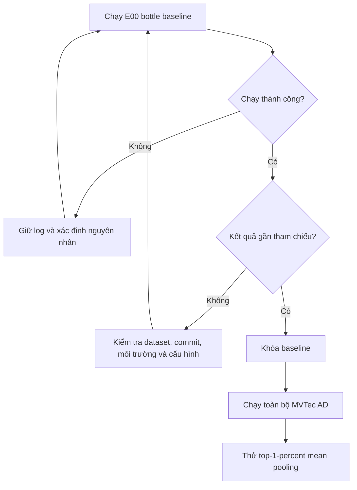

# Hướng dẫn chạy MuSc E00 trên Google Colab

## 1. Mục tiêu của lần chạy

Chạy lại MuSc gốc trên toàn bộ test split của lớp `bottle` thuộc MVTec AD. Đây là baseline bắt buộc trước khi thay đổi cách tính image-level anomaly score bằng top-k mean.

Sau lần chạy này cần thu được:

- Image-level AUROC, F1-max và AP.
- Pixel-level AUROC, F1-max, AP và PRO.
- File kết quả Excel.
- Các anomaly map.
- Thông tin môi trường Colab.
- Log đầy đủ của quá trình chạy.
- Bảng so sánh kết quả tái lập với kết quả tham chiếu.

## 2. Cấu hình baseline phải giữ nguyên

| Thành phần | Giá trị |
|---|---|
| MuSc commit | `b76b93da8bd3096a99964a96ae29d46f197a0651` |
| Dataset | MVTec AD |
| Category | `bottle` |
| Backbone | OpenAI CLIP `ViT-L-14-336` |
| Kích thước ảnh | `518 x 518` |
| Feature layers | `5 11 17 23` trong file cấu hình |
| LNAMD degrees | `1 3 5` |
| MSM interval | 30% khoảng cách nhỏ nhất |
| `divide_num` | `1` |
| Batch size | `4` |
| Seed | `42` |
| Visualization | `whole_norm` |

Không thay đổi các giá trị trên trong lần chạy E00. Nếu gặp lỗi, lưu lại log trước khi thử một cấu hình khác.

## 3. Chuẩn bị Colab

1. Mở một notebook mới tại <https://colab.research.google.com/>.
2. Chọn **Runtime > Change runtime type**.
3. Chọn **T4 GPU** hoặc GPU NVIDIA đang có sẵn.
4. Nhấn **Save**.
5. Tạo từng cell theo thứ tự bên dưới.

## 4. Chạy từng cell

### Cell 1 - Kết nối Google Drive và tạo thư mục lần chạy

```python
from google.colab import drive
drive.mount("/content/drive")

from datetime import datetime
from pathlib import Path
import os

UPSTREAM_COMMIT = "b76b93da8bd3096a99964a96ae29d46f197a0651"
DATA_ROOT = Path("/content/drive/MyDrive/datasets/mvtec_anomaly_detection")
DATA_SOURCE = "official_mvtec_manual_download"
PROJECT_ROOT = Path("/content/drive/MyDrive/CS2203_MuSc")
RUN_ID = datetime.now().strftime("%Y%m%d_%H%M%S_E00_mvtec_bottle_clip_l14_336_baseline")
RUN_ROOT = PROJECT_ROOT / "runs" / RUN_ID
OUTPUT_ROOT = RUN_ROOT / "output"

RUN_ROOT.mkdir(parents=True, exist_ok=False)
os.environ["MUSC_COMMIT"] = UPSTREAM_COMMIT
os.environ["MUSC_DATA_ROOT"] = str(DATA_ROOT)
os.environ["MUSC_RUN_ROOT"] = str(RUN_ROOT)
os.environ["MUSC_OUTPUT_ROOT"] = str(OUTPUT_ROOT)

print("Run ID:", RUN_ID)
print("Dataset:", DATA_ROOT)
print("Persistent output:", RUN_ROOT)
```

Mỗi lần chạy có một thư mục chứa timestamp riêng nên kết quả cũ không bị ghi đè.

### Cell 2 - Kiểm tra GPU và ghi nhận môi trường ban đầu

```python
import platform
import subprocess
import sys
import torch

assert torch.cuda.is_available(), "GPU chưa được bật. Hãy đổi Colab runtime sang GPU."

gpu_name = torch.cuda.get_device_name(0)
environment_text = "\n".join([
    f"python={sys.version}",
    f"platform={platform.platform()}",
    f"torch={torch.__version__}",
    f"cuda_runtime={torch.version.cuda}",
    f"gpu={gpu_name}",
    f"upstream_commit={UPSTREAM_COMMIT}",
])

print(environment_text)
(RUN_ROOT / "environment-before-install.txt").write_text(environment_text, encoding="utf-8")
subprocess.run(["nvidia-smi"], check=True)
```

Kết quả cần có tên GPU và `torch.cuda.is_available()` phải đúng.

### Cell 3 - Tải MVTec AD từ Hugging Face

Repository dưới đây là mirror cộng đồng, không phải repository chính thức của MVTec. Code sẽ ghi lại chính xác revision đã tải để bảo đảm truy vết nguồn dữ liệu.

```python
import os
import subprocess
import sys
from pathlib import Path

subprocess.run(
    [sys.executable, "-m", "pip", "install", "-q", "--upgrade", "huggingface_hub"],
    check=True,
)

from huggingface_hub import HfApi, hf_hub_download

HF_DATASET_REPO = "micguida1/mvtech_anomaly_detection"
HF_DATASET_REVISION = HfApi().dataset_info(HF_DATASET_REPO).sha
HF_CACHE = PROJECT_ROOT / "cache" / "huggingface"

archive_path = hf_hub_download(
    repo_id=HF_DATASET_REPO,
    repo_type="dataset",
    filename="mvtec_anomaly_detection.tar.xz",
    revision=HF_DATASET_REVISION,
    cache_dir=HF_CACHE,
)

extract_root = Path("/content/data")
extract_root.mkdir(parents=True, exist_ok=True)
subprocess.run(
    ["tar", "-xJf", archive_path, "-C", str(extract_root)],
    check=True,
)

expected_root = extract_root / "mvtec_anomaly_detection"
if expected_root.is_dir():
    DATA_ROOT = expected_root
else:
    candidates = [path.parent.parent for path in extract_root.rglob("bottle/test")]
    candidates = sorted(set(candidates))
    assert len(candidates) == 1, f"Không xác định được duy nhất dataset root: {candidates}"
    DATA_ROOT = candidates[0]

DATA_SOURCE = f"huggingface:{HF_DATASET_REPO}@{HF_DATASET_REVISION}"
os.environ["MUSC_DATA_ROOT"] = str(DATA_ROOT)

(RUN_ROOT / "dataset-source.txt").write_text(
    f"source={DATA_SOURCE}\narchive=mvtec_anomaly_detection.tar.xz\n",
    encoding="utf-8",
)

print("Dataset source:", DATA_SOURCE)
print("Extracted dataset:", DATA_ROOT)
```

Archive có kích thước khoảng 5.26 GB. File được cache trong Google Drive, còn dữ liệu được giải nén vào `/content/data` để MuSc đọc nhanh hơn. Khi Colab khởi động lại, archive vẫn còn trong Drive nhưng có thể phải giải nén lại.

Nếu bạn đã tải và giải nén MVTec AD thủ công vào Google Drive thì bỏ qua Cell 3.

### Cell 4 - Kiểm tra cấu trúc và số lượng ảnh `bottle`

```python
required_paths = [
    DATA_ROOT / "bottle" / "ground_truth",
    DATA_ROOT / "bottle" / "test",
    DATA_ROOT / "bottle" / "train",
]

for path in required_paths:
    assert path.is_dir(), f"Thiếu thư mục bắt buộc: {path}"

test_images = list((DATA_ROOT / "bottle" / "test").glob("*/*"))
assert test_images, "Không tìm thấy ảnh test của bottle."
assert len(test_images) == 83, f"Cần 83 ảnh test bottle, hiện có {len(test_images)}."
print(f"Đã tìm thấy {len(test_images)} ảnh test bottle.")
```

Phải có đúng 83 ảnh. Không chạy E00 bằng một nhóm ảnh được chọn thủ công vì MuSc sử dụng toàn bộ tập ảnh chưa gán nhãn để tính mutual scoring.

### Cell 5 - Clone MuSc và khóa đúng commit

```bash
%%bash
set -euo pipefail
rm -rf /content/MuSc
git clone https://github.com/xrli-U/MuSc.git /content/MuSc
cd /content/MuSc
git checkout --detach "$MUSC_COMMIT"
git rev-parse HEAD | tee "$MUSC_RUN_ROOT/upstream-commit.txt"
```

Kết quả cuối cell phải là:

```text
b76b93da8bd3096a99964a96ae29d46f197a0651
```

### Cell 6 - Cài các thư viện còn thiếu

```python
import subprocess
import sys

packages = [
    "ftfy==6.1.3",
    "openpyxl==3.1.2",
    "timm==0.9.12",
]
subprocess.run([sys.executable, "-m", "pip", "install", "-q", *packages], check=True)
```

Không ép Colab hạ PyTorch về `2.0.1` trong lần chạy đầu. Runtime Colab hiện tại có thể dùng Python và CUDA mới hơn. Ta giữ PyTorch có sẵn và ghi lại toàn bộ phiên bản thực tế.

### Cell 7 - Lưu phiên bản các thư viện

```python
import cv2
import ftfy
import openpyxl
import platform
import sklearn
import skimage
import sys
import timm
import torch
import torchvision

versions = {
    "python": sys.version,
    "platform": platform.platform(),
    "torch": torch.__version__,
    "torchvision": torchvision.__version__,
    "cuda_runtime": torch.version.cuda,
    "gpu": torch.cuda.get_device_name(0),
    "opencv": cv2.__version__,
    "ftfy": ftfy.__version__,
    "openpyxl": openpyxl.__version__,
    "scikit_learn": sklearn.__version__,
    "scikit_image": skimage.__version__,
    "timm": timm.__version__,
    "upstream_commit": UPSTREAM_COMMIT,
    "dataset_source": DATA_SOURCE,
}

environment_text = "\n".join(f"{key}={value}" for key, value in versions.items())
print(environment_text)
(RUN_ROOT / "environment.txt").write_text(environment_text, encoding="utf-8")
```

### Cell 8 - Tạo và lưu lệnh chạy baseline

```python
command = f"""python examples/musc_main.py \\
  --device 0 \\
  --data_path {DATA_ROOT} \\
  --dataset_name mvtec_ad \\
  --class_name bottle \\
  --backbone_name ViT-L-14-336 \\
  --pretrained openai \\
  --feature_layers 5 11 17 23 \\
  --img_resize 518 \\
  --divide_num 1 \\
  --r_list 1 3 5 \\
  --batch_size 4 \\
  --output_dir {OUTPUT_ROOT} \\
  --vis True \\
  --vis_type whole_norm \\
  --save_excel True"""

print(command)
(RUN_ROOT / "command.sh").write_text(
    "#!/usr/bin/env bash\nset -euo pipefail\n" + command + "\n",
    encoding="utf-8",
)
```

### Cell 8A - Sửa xung đột tên package `datasets` trên Colab

Colab có thể đã cài package Hugging Face `datasets`. MuSc cũng đặt mã nguồn đọc dữ liệu trong thư mục `datasets`, nhưng thư mục này thiếu `__init__.py` và entry point chỉ thêm repository vào cuối import path. Khi đó Python có thể chọn package Hugging Face thay vì `MuSc/datasets` và báo lỗi `No module named 'datasets.mvtec'`.

Cell này chỉ sửa cách Python tìm module. Nó không thay đổi backbone, anomaly score, dataset hoặc metrics.

```python
from pathlib import Path
import subprocess
import sys

repo_root = Path("/content/MuSc")
entrypoint = repo_root / "examples" / "musc_main.py"
local_package = repo_root / "datasets" / "__init__.py"

source = entrypoint.read_bytes()
old_line = b"sys.path.append(os.getcwd())"
new_line = b"sys.path.insert(0, os.getcwd())"

if old_line in source:
    entrypoint.write_bytes(source.replace(old_line, new_line, 1))
elif new_line not in source:
    raise RuntimeError("Không tìm thấy dòng sys.path mong đợi trong musc_main.py")

local_package.touch(exist_ok=True)

diagnostic = subprocess.run(
    [
        sys.executable,
        "-c",
        "import datasets; print(datasets.__file__); "
        "import datasets.mvtec; print('Đã import datasets.mvtec thành công')",
    ],
    cwd=repo_root,
    text=True,
    stdout=subprocess.PIPE,
    stderr=subprocess.STDOUT,
    check=True,
)
print(diagnostic.stdout)

resolved_package = Path(diagnostic.stdout.splitlines()[0]).resolve()
assert repo_root.resolve() in resolved_package.parents, (
    f"Python vẫn đang dùng package datasets bên ngoài MuSc: {resolved_package}"
)

git_status = subprocess.run(
    ["git", "status", "--short"],
    cwd=repo_root,
    text=True,
    stdout=subprocess.PIPE,
    check=True,
).stdout
git_diff = subprocess.run(
    ["git", "diff", "--", "examples/musc_main.py"],
    cwd=repo_root,
    text=True,
    stdout=subprocess.PIPE,
    check=True,
).stdout

(RUN_ROOT / "compatibility-fix.txt").write_text(
    "Reason: avoid collision with the Hugging Face datasets package.\n"
    "Effect on method: none; import resolution only.\n\n"
    + git_status
    + "\n"
    + git_diff,
    encoding="utf-8",
)
```

Output phải chứa đường dẫn tương tự:

```text
/content/MuSc/datasets/__init__.py
Đã import datasets.mvtec thành công
```

#### Nếu Cell 9 đã từng thất bại vì `datasets.mvtec`

Không chạy đè lên thư mục lần chạy thất bại. Sau khi Cell 8A chạy thành công, chạy cell phục hồi dưới đây để tạo một Run ID mới:

```python
from datetime import datetime
import os
import shutil

FAILED_RUN_ROOT = RUN_ROOT
RUN_ID = datetime.now().strftime("%Y%m%d_%H%M%S_E00_mvtec_bottle_clip_l14_336_importfix")
RUN_ROOT = PROJECT_ROOT / "runs" / RUN_ID
OUTPUT_ROOT = RUN_ROOT / "output"
RUN_ROOT.mkdir(parents=True, exist_ok=False)

os.environ["MUSC_RUN_ROOT"] = str(RUN_ROOT)
os.environ["MUSC_OUTPUT_ROOT"] = str(OUTPUT_ROOT)

(RUN_ROOT / "previous-failed-run.txt").write_text(
    f"previous_run={FAILED_RUN_ROOT}\n"
    "reason=external datasets package shadowed MuSc local datasets package\n",
    encoding="utf-8",
)
(RUN_ROOT / "dataset-source.txt").write_text(
    f"source={DATA_SOURCE}\narchive=mvtec_anomaly_detection.tar.xz\n",
    encoding="utf-8",
)
(RUN_ROOT / "upstream-commit.txt").write_text(
    f"{UPSTREAM_COMMIT}\n",
    encoding="utf-8",
)

old_fix_record = FAILED_RUN_ROOT / "compatibility-fix.txt"
if old_fix_record.is_file():
    shutil.copy2(old_fix_record, RUN_ROOT / "compatibility-fix.txt")

print("Giữ nguyên lần chạy thất bại tại:", FAILED_RUN_ROOT)
print("Lần chạy lại sẽ được lưu tại:", RUN_ROOT)
```

Sau cell phục hồi, chạy lại theo thứ tự:

1. Cell 7 để tạo `environment.txt` trong thư mục mới.
2. Cell 8 để tạo lại `command.sh` với `OUTPUT_ROOT` mới.
3. Cell 9 để chạy E00.

Không cần tải lại dataset, clone lại repository hoặc cài lại thư viện trong cùng Colab runtime.

### Cell 9 - Chạy E00 và ghi log

```python
import subprocess
import time

log_path = RUN_ROOT / "console.log"
started = time.time()

with log_path.open("w", encoding="utf-8") as log_file:
    process = subprocess.Popen(
        ["bash", str(RUN_ROOT / "command.sh")],
        cwd="/content/MuSc",
        text=True,
        stdout=subprocess.PIPE,
        stderr=subprocess.STDOUT,
        bufsize=1,
    )

    for line in process.stdout:
        print(line, end="")
        log_file.write(line)

    return_code = process.wait()

elapsed = time.time() - started
(RUN_ROOT / "elapsed-seconds.txt").write_text(f"{elapsed:.3f}\n", encoding="utf-8")
print(f"Thời gian chạy: {elapsed / 60:.2f} phút")

if return_code != 0:
    raise RuntimeError(
        f"MuSc kết thúc với mã lỗi {return_code}. "
        f"Hãy kiểm tra {log_path} trước khi đổi cấu hình."
    )
```

Ở lần chạy đầu, MuSc còn tải CLIP weights. Không đóng Colab trong lúc cell này đang chạy.

Nếu xuất hiện `CUDA out of memory`, không tự đổi `divide_num` ngay. Lưu `console.log` và gửi lại để phân tích trước.

### Cell 10 - Đọc file kết quả

```python
from IPython.display import display
import pandas as pd

result_file = OUTPUT_ROOT / "mvtec_ad" / "ViT-L-14-336" / "imagesize518" / "results.xlsx"
assert result_file.is_file(), f"Không tìm thấy file kết quả: {result_file}"

results = pd.read_excel(result_file)
display(results)

image_dir = OUTPUT_ROOT / "mvtec_ad" / "ViT-L-14-336" / "imagesize518" / "bottle"
image_files = sorted(path for path in image_dir.rglob("*") if path.is_file())

print("Số anomaly map đã lưu:", len(image_files))
print("Thư mục của lần chạy:", RUN_ROOT)
```

### Cell 11 - So sánh với kết quả tham chiếu

```python
import pandas as pd

reference = pd.DataFrame([{
    "category": "bottle",
    "auroc_px": 98.48,
    "f1_px": 79.17,
    "ap_px": 83.04,
    "aupro": 96.10,
    "auroc_sp": 99.92,
    "f1_sp": 99.21,
    "ap_sp": 99.98,
}])

reproduced = pd.read_excel(result_file).iloc[[0]].copy()
reproduced = reproduced.rename(columns={reproduced.columns[0]: "category"})
reproduced.insert(0, "source", "reproduced_E00")
reference.insert(0, "source", "official_repository")

comparison = pd.concat([reference, reproduced], ignore_index=True)
display(comparison)
comparison.to_csv(RUN_ROOT / "reference-comparison.csv", index=False)
```

Không thay số tái lập bằng số tham chiếu. Hai hàng phải được giữ riêng để báo cáo trung thực mức độ chênh lệch.

## 5. Kiểm tra E00 đã hoàn thành hay chưa

E00 đạt yêu cầu khi tất cả điều kiện sau đúng:

- [ ] Colab nhận GPU.
- [ ] Dataset có đủ 83 ảnh test `bottle`.
- [ ] MuSc đang ở đúng commit `b76b93d`.
- [ ] `console.log` không có exception hoặc CUDA out-of-memory.
- [ ] Có file `results.xlsx`.
- [ ] Có đủ bảy metrics và các giá trị không bằng 0.
- [ ] Có anomaly map trong thư mục output.
- [ ] Có `dataset-source.txt` ghi revision của Hugging Face mirror.
- [ ] Cell 8A xác nhận Python import `/content/MuSc/datasets/__init__.py`.
- [ ] Có `compatibility-fix.txt` ghi lại thay đổi dành cho Colab.
- [ ] Có `environment.txt`, `upstream-commit.txt`, `command.sh` và `console.log`.
- [ ] Có `reference-comparison.csv` với hai hàng riêng biệt.

## 6. Các file cần gửi lại sau khi chạy

Trong thư mục sau:

```text
MyDrive/CS2203_MuSc/runs/<RUN_ID>/
```

gửi lại bốn file:

```text
results.xlsx
reference-comparison.csv
environment.txt
console.log
```

Nếu chạy thất bại, gửi thêm ảnh chụp lỗi cuối cùng trên Colab và file `dataset-source.txt`.

## 7. Cách xử lý sau E00



Chưa sửa source code để thêm top-k mean trong E00. Kết quả baseline cần được xác nhận trước để thực nghiệm sau có đối chứng công bằng.

## 8. Nguồn tham khảo

1. Xurui Li, Ziming Huang, Feng Xue, and Yu Zhou. [MuSc: Zero-Shot Industrial Anomaly Classification and Segmentation with Mutual Scoring of the Unlabeled Images](https://openreview.net/forum?id=AHgc5SMdtd). ICLR 2024.
2. [Official MuSc repository](https://github.com/xrli-U/MuSc), commit [`b76b93d`](https://github.com/xrli-U/MuSc/commit/b76b93da8bd3096a99964a96ae29d46f197a0651).
3. [Official MVTec AD dataset page](https://www.mvtec.com/research-teaching/datasets/mvtec-ad).
4. [Hugging Face community mirror](https://huggingface.co/datasets/micguida1/mvtech_anomaly_detection).
5. [Hugging Face Hub download documentation](https://huggingface.co/docs/huggingface_hub/guides/download).
