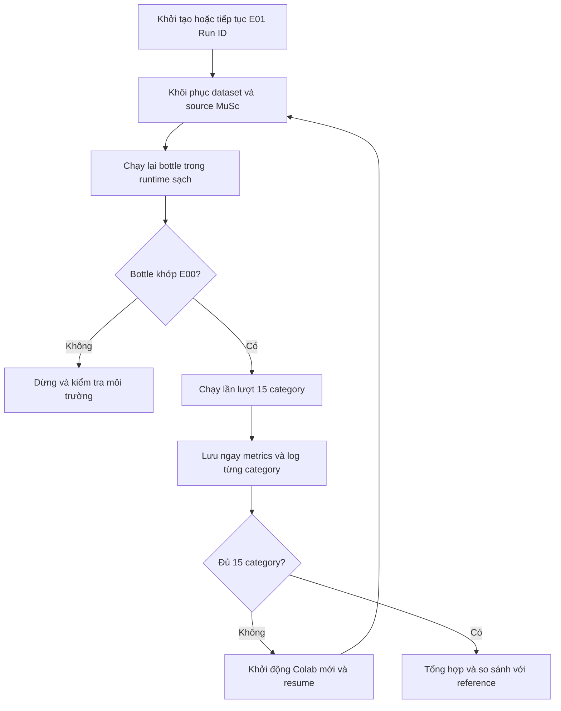

# Hướng dẫn chạy MuSc E01 trên toàn bộ MVTec AD

## 1. Mục tiêu

E01 chạy baseline MuSc đã được xác nhận ở E00 trên toàn bộ 15 category của MVTec AD. Kết quả cần có metrics của từng category, trung bình không trọng số của 15 category và bảng so sánh với repository chính thức.

E01 chưa thay đổi pipeline và chưa áp dụng top-k mean pooling.

## 2. Trạng thái trước E01

E00 trên `bottle` đã được chấp nhận:

| Metric | Kết quả E00 |
|---|---:|
| Image AUROC | 99.9206 |
| Image F1-max | 99.2126 |
| Image AP | 99.9752 |
| Pixel AUROC | 98.4777 |
| Pixel F1-max | 79.1740 |
| Pixel AP | 83.0450 |
| PRO | 96.1045 |

Toàn bộ giá trị giống repository chính thức khi làm tròn hai chữ số.

## 3. Thiết kế lần chạy E01

E01 chạy từng category bằng một subprocess riêng:



Cách chạy này chậm hơn một tiến trình `ALL` một ít vì backbone được nạp lại cho mỗi category. Đổi lại, kết quả đã hoàn thành không bị mất nếu Colab ngắt kết nối.

## 4. Cấu hình cố định

| Thành phần | Giá trị |
|---|---|
| MuSc commit | `b76b93da8bd3096a99964a96ae29d46f197a0651` |
| Backbone | OpenAI CLIP `ViT-L-14-336` |
| Input resolution | `518 x 518` |
| Feature layers | `5 11 17 23` |
| LNAMD degrees | `1 3 5` |
| MSM interval | 30% khoảng cách nhỏ nhất |
| `divide_num` | `1` |
| Batch size | `4` |
| Seed | `42` trong source code chính thức |
| Save Excel | `True` |
| Save visualization | `False` trong lần chạy định lượng E01 |

`vis=False` chỉ ngừng ghi anomaly-map PNG để giảm thời gian ghi Google Drive. Nó không thay đổi raw anomaly map hoặc metrics. Sau E01 sẽ chọn một số category để xuất hình phục vụ phân tích định tính.

## 5. Bắt đầu bằng runtime sạch

1. Lưu các notebook hoặc output cần thiết của phiên Colab hiện tại.
2. Chọn **Runtime > Disconnect and delete runtime**.
3. Kết nối lại và chọn GPU NVIDIA, ưu tiên Tesla T4 hoặc tốt hơn.
4. Tạo notebook E01 mới.
5. Chạy các cell bên dưới theo thứ tự.

Việc bắt đầu từ runtime sạch cũng hoàn thành kiểm tra cuối của Phase 2: quy trình có thể được khôi phục mà không phụ thuộc trạng thái còn sót lại từ E00.

## 6. Các cell Colab

### Cell 1 - Mount Drive và tạo hoặc resume E01 Run ID

```python
from google.colab import drive
drive.mount("/content/drive")

from datetime import datetime, timezone
from pathlib import Path
import json
import os

UPSTREAM_COMMIT = "b76b93da8bd3096a99964a96ae29d46f197a0651"
PROJECT_ROOT = Path("/content/drive/MyDrive/CS2203_MuSc")
RUNS_ROOT = PROJECT_ROOT / "runs"
ACTIVE_RUN_FILE = PROJECT_ROOT / "active-e01-run.txt"

CATEGORIES = [
    "bottle", "cable", "capsule", "carpet", "grid",
    "hazelnut", "leather", "metal_nut", "pill", "screw",
    "tile", "toothbrush", "transistor", "wood", "zipper",
]

PROJECT_ROOT.mkdir(parents=True, exist_ok=True)
RUNS_ROOT.mkdir(parents=True, exist_ok=True)

if ACTIVE_RUN_FILE.is_file():
    candidate_run_id = ACTIVE_RUN_FILE.read_text(encoding="utf-8").strip()
    candidate_root = RUNS_ROOT / candidate_run_id
    if candidate_root.is_dir() and not (candidate_root / "E01_AGGREGATED.json").exists():
        RUN_ID = candidate_run_id
        print("Tiếp tục E01 Run ID đang dở:", RUN_ID)
    else:
        ACTIVE_RUN_FILE.unlink()
        RUN_ID = datetime.now().strftime("%Y%m%d_%H%M%S_E01_mvtec_all_clip_l14_336_baseline")
        ACTIVE_RUN_FILE.write_text(RUN_ID + "\n", encoding="utf-8")
        print("Tạo E01 Run ID mới:", RUN_ID)
else:
    RUN_ID = datetime.now().strftime("%Y%m%d_%H%M%S_E01_mvtec_all_clip_l14_336_baseline")
    ACTIVE_RUN_FILE.write_text(RUN_ID + "\n", encoding="utf-8")
    print("Tạo E01 Run ID mới:", RUN_ID)

RUN_ROOT = RUNS_ROOT / RUN_ID
CATEGORY_ROOT = RUN_ROOT / "categories"
SESSION_ID = datetime.now().strftime("%Y%m%d_%H%M%S")
SESSION_ROOT = RUN_ROOT / "sessions" / SESSION_ID

CATEGORY_ROOT.mkdir(parents=True, exist_ok=True)
SESSION_ROOT.mkdir(parents=True, exist_ok=False)

os.environ["MUSC_COMMIT"] = UPSTREAM_COMMIT
os.environ["MUSC_E01_RUN_ROOT"] = str(RUN_ROOT)

(RUN_ROOT / "run-id.txt").write_text(RUN_ID + "\n", encoding="utf-8")

print("Run root:", RUN_ROOT)
print("Session root:", SESSION_ROOT)
```

Khi Colab bị ngắt, `active-e01-run.txt` giúp notebook tìm lại E01 Run ID đang chạy. Các category đã thành công sẽ được bỏ qua tự động.

### Cell 2 - Kiểm tra GPU và cài dependency

```python
import platform
import subprocess
import sys

subprocess.run(
    [
        sys.executable,
        "-m",
        "pip",
        "install",
        "-q",
        "--upgrade",
        "huggingface_hub",
        "ftfy==6.1.3",
        "openpyxl==3.1.2",
        "timm==0.9.12",
    ],
    check=True,
)

import cv2
import ftfy
import openpyxl
import sklearn
import skimage
import timm
import torch
import torchvision

assert torch.cuda.is_available(), "GPU chưa được bật trong Colab."

versions = {
    "python": sys.version,
    "platform": platform.platform(),
    "torch": torch.__version__,
    "torchvision": torchvision.__version__,
    "cuda_runtime": torch.version.cuda,
    "gpu": torch.cuda.get_device_name(0),
    "opencv": cv2.__version__,
    "ftfy": ftfy.__version__,
    "openpyxl": openpyxl.__version__,
    "scikit_learn": sklearn.__version__,
    "scikit_image": skimage.__version__,
    "timm": timm.__version__,
    "upstream_commit": UPSTREAM_COMMIT,
}

environment_text = "\n".join(f"{key}={value}" for key, value in versions.items())
(SESSION_ROOT / "environment.txt").write_text(environment_text + "\n", encoding="utf-8")
print(environment_text)
subprocess.run(["nvidia-smi"], check=True)
```

### Cell 3 - Khôi phục MVTec AD từ Hugging Face cache

```python
import shutil
import subprocess
from huggingface_hub import HfApi, hf_hub_download

HF_DATASET_REPO = "micguida1/mvtech_anomaly_detection"
HF_DATASET_REVISION = HfApi().dataset_info(HF_DATASET_REPO).sha
HF_CACHE = Path("/content/huggingface-mvtec-cache")

archive_path = hf_hub_download(
    repo_id=HF_DATASET_REPO,
    repo_type="dataset",
    filename="mvtec_anomaly_detection.tar.xz",
    revision=HF_DATASET_REVISION,
    cache_dir=HF_CACHE,
)

# Hugging Face dùng symlink trong cache. Cache phải nằm trên filesystem cục bộ,
# không đặt trong Google Drive vì DriveFS có thể biến symlink thành file pointer.
source_archive = Path(archive_path).resolve(strict=True)
local_archive = source_archive
archive_size = source_archive.stat().st_size
content_usage = shutil.disk_usage("/content")
required_free = 8 * 2**30
assert content_usage.free >= required_free, (
    "Không đủ dung lượng cục bộ để giải nén dataset. "
    f"Cần tối thiểu khoảng {required_free / 2**30:.2f} GiB trống."
)
print(f"Archive cục bộ: {archive_size / 2**30:.2f} GiB")

extract_root = Path("/content/data")
if extract_root.exists():
    shutil.rmtree(extract_root)
extract_root.mkdir(parents=True, exist_ok=False)

extract_result = subprocess.run(
    ["tar", "-xJf", str(local_archive), "-C", str(extract_root)],
    text=True,
    stdout=subprocess.PIPE,
    stderr=subprocess.STDOUT,
)
print("tar_return_code:", extract_result.returncode)
print("tar_output:", extract_result.stdout.strip() or "<empty>")
assert extract_result.returncode == 0, (
    "Giải nén thất bại. Chạy Cell 3D rồi Cell 3R ngay bên dưới."
)

expected_root = extract_root / "mvtec_anomaly_detection"
if expected_root.is_dir():
    DATA_ROOT = expected_root
else:
    candidates = [path.parent.parent for path in extract_root.rglob("bottle/test")]
    candidates = sorted(set(candidates))
    assert len(candidates) == 1, f"Không xác định được duy nhất dataset root: {candidates}"
    DATA_ROOT = candidates[0]

for category in CATEGORIES:
    for child in ["train", "test", "ground_truth"]:
        required = DATA_ROOT / category / child
        assert required.is_dir(), f"Thiếu thư mục: {required}"

DATA_SOURCE = f"huggingface:{HF_DATASET_REPO}@{HF_DATASET_REVISION}"
dataset_source_path = RUN_ROOT / "dataset-source.txt"
dataset_source_text = (
    f"source={DATA_SOURCE}\n"
    "archive=mvtec_anomaly_detection.tar.xz\n"
    f"resolved_root={DATA_ROOT}\n"
)

if dataset_source_path.exists():
    previous_lines = dataset_source_path.read_text(encoding="utf-8").splitlines()
    assert previous_lines[0] == f"source={DATA_SOURCE}", "Dataset revision đã thay đổi khi resume."
else:
    dataset_source_path.write_text(dataset_source_text, encoding="utf-8")

print("Dataset source:", DATA_SOURCE)
print("Dataset root:", DATA_ROOT)
print("Đã xác nhận đủ 15 category.")
```

#### Cell 3D - Chẩn đoán tùy chọn khi `tar` trả về exit status 2

Nếu muốn lưu bằng chứng chi tiết về lỗi trước khi phục hồi, chạy cell chỉ đọc dưới đây và lưu toàn bộ output. Có thể bỏ qua Cell 3D và chạy thẳng Cell 3R vì Cell 3R cũng tự kiểm tra archive trước khi sửa:

```python
from pathlib import Path
import os
import shutil
import subprocess

archive = Path(archive_path)

print("archive_path:", archive)
print("exists:", archive.exists())
print("is_file:", archive.is_file())
print("is_symlink:", archive.is_symlink())

if archive.is_symlink():
    print("symlink_target:", os.readlink(archive))

try:
    resolved_archive = archive.resolve(strict=True)
    print("resolved_archive:", resolved_archive)
    print("size_bytes:", resolved_archive.stat().st_size)
    with resolved_archive.open("rb") as stream:
        print("first_6_bytes_hex:", stream.read(6).hex())
except Exception as error:
    print("resolve_or_read_error:", repr(error))

for location in [Path("/content"), Path("/content/drive")]:
    usage = shutil.disk_usage(location)
    print(
        f"disk {location}: "
        f"total={usage.total / 2**30:.2f} GiB, "
        f"used={usage.used / 2**30:.2f} GiB, "
        f"free={usage.free / 2**30:.2f} GiB"
    )

if Path("/content/data").exists():
    partial = subprocess.run(
        ["du", "-sh", "/content/data"],
        text=True,
        stdout=subprocess.PIPE,
        stderr=subprocess.STDOUT,
    )
    print("partial_extraction:", partial.stdout.strip())

xz_test = subprocess.run(
    ["xz", "--test", str(archive)],
    text=True,
    stdout=subprocess.PIPE,
    stderr=subprocess.STDOUT,
)
print("xz_test_return_code:", xz_test.returncode)
print("xz_test_output:", xz_test.stdout.strip() or "<empty>")
```

Diễn giải kết quả:

- `first_6_bytes_hex` của archive XZ hợp lệ phải là `fd377a585a00`.
- `resolve_or_read_error` cho thấy snapshot symlink của Hugging Face không còn trỏ đến blob hợp lệ.
- `xz_test_return_code = 0` cho thấy archive qua được kiểm tra tính toàn vẹn.
- `xz_test_return_code != 0` kèm `Unexpected end of input` hoặc `Compressed data is corrupt` cho thấy cache bị thiếu hoặc hỏng.
- Dung lượng trống của `/content` phải lớn hơn kích thước dữ liệu sau giải nén.

Nếu Cell 3R vẫn thất bại, gửi toàn bộ output của Cell 3D và Cell 3R để xác định nguyên nhân. Không tiếp tục Cell 4 khi dataset chưa giải nén hoàn chỉnh.

#### Cell 3R - Phục hồi cache và giải nén từ ổ cục bộ

Cell này tự kiểm tra trước khi sửa:

1. Bỏ qua cache Hugging Face bị lỗi trên Google Drive.
2. Tải đúng dataset revision vào cache cục bộ của Colab, nơi symlink hoạt động đúng.
3. Kiểm tra archive thật bằng XZ trước khi giải nén.
4. Chỉ xóa thư mục `/content/data` đang giải nén dở. Không xóa cache hoặc kết quả trong Google Drive.

Chạy Cell 3R thay cho phần còn lại của Cell 3 sau khi gặp `CalledProcessError`:

```python
from pathlib import Path
import os
import shutil
import subprocess

def test_xz(path):
    candidate = Path(path)
    if not candidate.exists() or not candidate.is_file():
        return False, f"File không tồn tại hoặc không phải regular file: {candidate}"
    try:
        with candidate.open("rb") as stream:
            magic = stream.read(6)
    except Exception as error:
        return False, f"Không đọc được archive: {error!r}"
    if magic != bytes.fromhex("fd377a585a00"):
        return False, f"XZ magic không hợp lệ: {magic.hex()}"
    result = subprocess.run(
        ["xz", "--test", str(candidate)],
        text=True,
        stdout=subprocess.PIPE,
        stderr=subprocess.STDOUT,
    )
    return result.returncode == 0, result.stdout.strip()

LOCAL_HF_CACHE = Path("/content/huggingface-mvtec-recovery")
print("Đang tải hoặc dựng lại archive trong filesystem cục bộ của Colab...")
local_download_path = hf_hub_download(
    repo_id=HF_DATASET_REPO,
    repo_type="dataset",
    filename="mvtec_anomaly_detection.tar.xz",
    revision=HF_DATASET_REVISION,
    cache_dir=LOCAL_HF_CACHE,
    force_download=True,
)

download_link = Path(local_download_path)
source_archive = download_link.resolve(strict=True)
print("Local download path:", download_link)
print("Resolved archive:", source_archive)

source_valid, source_message = test_xz(source_archive)
print("Local Hugging Face archive valid:", source_valid)
print("Local Hugging Face archive check:", source_message or "OK")
assert source_valid, "Archive cục bộ không vượt qua kiểm tra XZ."

archive_size = source_archive.stat().st_size
content_usage = shutil.disk_usage("/content")
required_free = 8 * 2**30
print(f"Archive size: {archive_size / 2**30:.2f} GiB")
print(f"Free space in /content: {content_usage.free / 2**30:.2f} GiB")
assert content_usage.free >= required_free, (
    "Không đủ dung lượng cục bộ để giải nén dataset. "
    f"Cần tối thiểu khoảng {required_free / 2**30:.2f} GiB trống."
)

extract_root = Path("/content/data")
if extract_root.exists():
    shutil.rmtree(extract_root)
extract_root.mkdir(parents=True, exist_ok=False)

print("Đang giải nén archive cục bộ...")
extract_result = subprocess.run(
    ["tar", "-xJf", str(source_archive), "-C", str(extract_root)],
    text=True,
    stdout=subprocess.PIPE,
    stderr=subprocess.STDOUT,
)
print("tar_return_code:", extract_result.returncode)
print("tar_output:", extract_result.stdout.strip() or "<empty>")
assert extract_result.returncode == 0, "Giải nén archive cục bộ thất bại."

expected_root = extract_root / "mvtec_anomaly_detection"
if expected_root.is_dir():
    DATA_ROOT = expected_root
else:
    candidates = [path.parent.parent for path in extract_root.rglob("bottle/test")]
    candidates = sorted(set(candidates))
    assert len(candidates) == 1, f"Không xác định được duy nhất dataset root: {candidates}"
    DATA_ROOT = candidates[0]

for category in CATEGORIES:
    for child in ["train", "test", "ground_truth"]:
        required = DATA_ROOT / category / child
        assert required.is_dir(), f"Thiếu thư mục: {required}"

DATA_SOURCE = f"huggingface:{HF_DATASET_REPO}@{HF_DATASET_REVISION}"
dataset_source_path = RUN_ROOT / "dataset-source.txt"
dataset_source_text = (
    f"source={DATA_SOURCE}\n"
    "archive=mvtec_anomaly_detection.tar.xz\n"
    f"resolved_root={DATA_ROOT}\n"
    "extraction_source=colab_local_huggingface_cache\n"
)

if dataset_source_path.exists():
    previous_lines = dataset_source_path.read_text(encoding="utf-8").splitlines()
    assert previous_lines[0] == f"source={DATA_SOURCE}", "Dataset revision đã thay đổi."
else:
    dataset_source_path.write_text(dataset_source_text, encoding="utf-8")

print("Phục hồi thành công.")
print("Dataset root:", DATA_ROOT)
print("Đã xác nhận đủ 15 category.")
```

Chỉ tiếp tục Cell 4 khi ba dòng cuối xác nhận phục hồi thành công, hiển thị `DATA_ROOT` và đủ 15 category.


### Cell 4 - Clone MuSc và áp dụng compatibility fix

```python
import shutil
import subprocess

REPO_ROOT = Path("/content/MuSc")
if REPO_ROOT.exists():
    shutil.rmtree(REPO_ROOT)

subprocess.run(
    ["git", "clone", "https://github.com/xrli-U/MuSc.git", str(REPO_ROOT)],
    check=True,
)
subprocess.run(
    ["git", "checkout", "--detach", UPSTREAM_COMMIT],
    cwd=REPO_ROOT,
    check=True,
)

actual_commit = subprocess.run(
    ["git", "rev-parse", "HEAD"],
    cwd=REPO_ROOT,
    text=True,
    stdout=subprocess.PIPE,
    check=True,
).stdout.strip()
assert actual_commit == UPSTREAM_COMMIT

entrypoint = REPO_ROOT / "examples" / "musc_main.py"
local_package = REPO_ROOT / "datasets" / "__init__.py"
source = entrypoint.read_bytes()
old_line = b"sys.path.append(os.getcwd())"
new_line = b"sys.path.insert(0, os.getcwd())"

if old_line in source:
    entrypoint.write_bytes(source.replace(old_line, new_line, 1))
elif new_line not in source:
    raise RuntimeError("Không tìm thấy dòng sys.path mong đợi trong musc_main.py")

local_package.touch(exist_ok=True)

diagnostic = subprocess.run(
    [
        sys.executable,
        "-c",
        "import datasets; print(datasets.__file__); "
        "import datasets.mvtec; print('Đã import datasets.mvtec thành công')",
    ],
    cwd=REPO_ROOT,
    text=True,
    stdout=subprocess.PIPE,
    stderr=subprocess.STDOUT,
    check=True,
)
print(diagnostic.stdout)

resolved_package = Path(diagnostic.stdout.splitlines()[0]).resolve()
assert REPO_ROOT.resolve() in resolved_package.parents

git_status = subprocess.run(
    ["git", "status", "--short"],
    cwd=REPO_ROOT,
    text=True,
    stdout=subprocess.PIPE,
    check=True,
).stdout
git_diff = subprocess.run(
    ["git", "diff", "--", "examples/musc_main.py"],
    cwd=REPO_ROOT,
    text=True,
    stdout=subprocess.PIPE,
    check=True,
).stdout

(SESSION_ROOT / "compatibility-fix.txt").write_text(
    "Reason: avoid collision with the Hugging Face datasets package.\n"
    "Effect on method: none; import resolution only.\n\n"
    + git_status
    + "\n"
    + git_diff,
    encoding="utf-8",
)
(RUN_ROOT / "upstream-commit.txt").write_text(actual_commit + "\n", encoding="utf-8")
```

#### Cell 4M - Bản vá giảm CPU RAM, không đổi cấu hình baseline

Chạy cell này trên Colab RAM tiêu chuẩn. Bản vá chỉ giải phóng các tensor đã hết vòng đời và bỏ hai bản sao NumPy không cần thiết. Nó không chia test set, không đổi backbone, image size, feature layers, `r_list` hoặc công thức metric. Trong E01 mới, Cell 8 phải chạy `bottle` bằng source đã vá và xác nhận kết quả khớp E00. Khi resume một E01 đã có `bottle/SUCCESS.json`, Cell 8 chỉ đọc lại metrics cũ và không phải là phép kiểm tra A/B cho bản vá.

```python
import subprocess

musc_path = REPO_ROOT / "models" / "musc.py"
source = musc_path.read_bytes()
line_ending = b"\r\n" if b"\r\n" in source else b"\n"

def encode_block(text):
    return text.encode("utf-8").replace(b"\n", line_ending)

def replace_once(data, old_text, new_text, label):
    old = encode_block(old_text)
    new = encode_block(new_text)
    if new in data:
        print(f"SKIP {label}: đã áp dụng")
        return data
    count = data.count(old)
    assert count == 1, f"Không tìm thấy duy nhất marker {label}: count={count}"
    print(f"APPLY {label}")
    return data.replace(old, new, 1)

source = replace_once(
    source,
    "import cv2\n",
    "import cv2\nimport gc\n",
    "import gc",
)

source = replace_once(
    source,
    "        anomaly_maps = anomaly_maps.cpu().numpy()\n"
    "        torch.cuda.empty_cache()\n",
    "        anomaly_maps = anomaly_maps.cpu().numpy()\n"
    "        # Release feature tensors before allocating flattened metric arrays.\n"
    "        del patch_tokens_list, Z_layers, Z, features, patch_tokens\n"
    "        del anomaly_maps_l, anomaly_maps_msm, anomaly_maps_iter\n"
    "        del image_info, image, input_image, test_dataloader, test_dataset, LNAMD_r\n"
    "        gc.collect()\n"
    "        torch.cuda.empty_cache()\n",
    "release expired feature tensors",
)

source = replace_once(
    source,
    "        ac_score = np.array(anomaly_maps).reshape(B, -1).max(-1)\n",
    "        ac_score = anomaly_maps.reshape(B, -1).max(-1)\n",
    "remove anomaly-map copy for image score",
)

source = replace_once(
    source,
    "        pr_px = np.array(anomaly_maps)\n",
    "        pr_px = anomaly_maps\n",
    "remove anomaly-map copy for pixel metrics",
)

musc_path.write_bytes(source)

memory_diff = subprocess.run(
    ["git", "diff", "--", "models/musc.py"],
    cwd=REPO_ROOT,
    text=True,
    stdout=subprocess.PIPE,
    check=True,
).stdout
assert "gc.collect()" in memory_diff
assert "ac_score = anomaly_maps.reshape" in memory_diff
assert "pr_px = anomaly_maps" in memory_diff

(SESSION_ROOT / "cpu-memory-patch.diff").write_text(memory_diff, encoding="utf-8")
print(memory_diff)
```

### Cell 5 - Khôi phục CLIP weights cache

```python
import shutil

LOCAL_CLIP_CACHE = Path.home() / ".cache" / "clip"
DRIVE_CLIP_CACHE = PROJECT_ROOT / "cache" / "clip"
LOCAL_CLIP_CACHE.mkdir(parents=True, exist_ok=True)
DRIVE_CLIP_CACHE.mkdir(parents=True, exist_ok=True)

restored_files = []
for source_file in DRIVE_CLIP_CACHE.glob("*"):
    if source_file.is_file():
        target_file = LOCAL_CLIP_CACHE / source_file.name
        if not target_file.exists() or target_file.stat().st_size != source_file.stat().st_size:
            shutil.copy2(source_file, target_file)
        restored_files.append(target_file.name)

if restored_files:
    print("Đã khôi phục CLIP cache:", restored_files)
else:
    print("Chưa có CLIP cache trong Drive. Category đầu tiên sẽ tải weights khoảng 934 MB.")
```

### Cell 6 - Lưu cấu hình baseline E01

```python
BASELINE_CONFIG = {
    "dataset_name": "mvtec_ad",
    "backbone_name": "ViT-L-14-336",
    "pretrained": "openai",
    "feature_layers": [5, 11, 17, 23],
    "img_resize": 518,
    "divide_num": 1,
    "r_list": [1, 3, 5],
    "batch_size": 4,
    "vis": False,
    "vis_type": "whole_norm",
    "save_excel": True,
    "seed_in_upstream_entrypoint": 42,
}

config_path = RUN_ROOT / "baseline-config.json"
config_text = json.dumps(BASELINE_CONFIG, indent=2, sort_keys=True) + "\n"
if config_path.exists():
    assert config_path.read_text(encoding="utf-8") == config_text, "Baseline config đã thay đổi."
else:
    config_path.write_text(config_text, encoding="utf-8")

print(config_text)
```

### Cell 7 - Định nghĩa hàm chạy một category

```python
from datetime import datetime, timezone
import json
import pandas as pd
import shlex
import shutil
import subprocess
import time

METRIC_COLUMNS = [
    "auroc_px", "f1_px", "ap_px", "aupro",
    "auroc_sp", "f1_sp", "ap_sp",
]

def sync_clip_cache_to_drive():
    DRIVE_CLIP_CACHE.mkdir(parents=True, exist_ok=True)
    for source_file in LOCAL_CLIP_CACHE.glob("*"):
        if source_file.is_file():
            target_file = DRIVE_CLIP_CACHE / source_file.name
            if not target_file.exists() or target_file.stat().st_size != source_file.stat().st_size:
                shutil.copy2(source_file, target_file)

def successful_attempt(category):
    category_dir = CATEGORY_ROOT / category
    success_files = sorted(category_dir.glob("attempt_*/SUCCESS.json"))
    return success_files[-1].parent if success_files else None

def run_category(category):
    assert category in CATEGORIES, f"Category không hợp lệ: {category}"

    previous_success = successful_attempt(category)
    if previous_success is not None:
        metrics = json.loads((previous_success / "metrics.json").read_text(encoding="utf-8"))
        print(f"SKIP {category}: đã thành công tại {previous_success}")
        return metrics

    category_dir = CATEGORY_ROOT / category
    category_dir.mkdir(parents=True, exist_ok=True)
    attempt_number = len(list(category_dir.glob("attempt_*"))) + 1
    attempt_root = category_dir / f"attempt_{attempt_number:02d}"
    output_root = attempt_root / "output"
    attempt_root.mkdir(parents=True, exist_ok=False)

    command = [
        sys.executable,
        "examples/musc_main.py",
        "--device", "0",
        "--data_path", str(DATA_ROOT),
        "--dataset_name", "mvtec_ad",
        "--class_name", category,
        "--backbone_name", "ViT-L-14-336",
        "--pretrained", "openai",
        "--feature_layers", "5", "11", "17", "23",
        "--img_resize", "518",
        "--divide_num", "1",
        "--r_list", "1", "3", "5",
        "--batch_size", "4",
        "--output_dir", str(output_root),
        "--vis", "False",
        "--vis_type", "whole_norm",
        "--save_excel", "True",
    ]

    command_text = shlex.join(command)
    (attempt_root / "command.sh").write_text(
        "#!/usr/bin/env bash\nset -euo pipefail\n" + command_text + "\n",
        encoding="utf-8",
    )

    started_at = datetime.now(timezone.utc)
    started = time.time()
    log_path = attempt_root / "console.log"

    print(f"START {category}, attempt {attempt_number:02d}")
    with log_path.open("w", encoding="utf-8") as log_file:
        process = subprocess.Popen(
            command,
            cwd=REPO_ROOT,
            text=True,
            stdout=subprocess.PIPE,
            stderr=subprocess.STDOUT,
            bufsize=1,
        )
        for line in process.stdout:
            print(line, end="")
            log_file.write(line)
        return_code = process.wait()

    elapsed_seconds = time.time() - started
    sync_clip_cache_to_drive()

    status = {
        "category": category,
        "attempt": attempt_number,
        "started_at_utc": started_at.isoformat(),
        "finished_at_utc": datetime.now(timezone.utc).isoformat(),
        "elapsed_seconds": elapsed_seconds,
        "return_code": return_code,
        "gpu": torch.cuda.get_device_name(0),
    }

    if return_code != 0:
        (attempt_root / "FAILED.json").write_text(
            json.dumps(status, indent=2) + "\n",
            encoding="utf-8",
        )
        raise RuntimeError(f"{category} thất bại. Xem log: {log_path}")

    result_file = (
        output_root / "mvtec_ad" / "ViT-L-14-336" /
        "imagesize518" / "results.xlsx"
    )
    assert result_file.is_file(), f"Thiếu file kết quả: {result_file}"

    frame = pd.read_excel(result_file)
    frame = frame.rename(columns={frame.columns[0]: "category"})
    row = frame.iloc[0]
    assert row["category"] == category

    metrics = {"category": category}
    metrics.update({column: float(row[column]) for column in METRIC_COLUMNS})
    metrics["elapsed_seconds"] = elapsed_seconds
    metrics["attempt_root"] = str(attempt_root)

    (attempt_root / "metrics.json").write_text(
        json.dumps(metrics, indent=2) + "\n",
        encoding="utf-8",
    )
    (attempt_root / "SUCCESS.json").write_text(
        json.dumps(status, indent=2) + "\n",
        encoding="utf-8",
    )

    print(f"DONE {category}: {elapsed_seconds / 60:.2f} phút")
    print({column: round(metrics[column], 4) for column in METRIC_COLUMNS})
    return metrics
```

### Cell 8 - Kiểm tra runtime sạch bằng `bottle`

```python
E00_BOTTLE = {
    "auroc_px": 98.47773380618383,
    "f1_px": 79.1739992895171,
    "ap_px": 83.04497992850604,
    "aupro": 96.10450992045675,
    "auroc_sp": 99.92063492063492,
    "f1_sp": 99.21259842519686,
    "ap_sp": 99.97519841269839,
}

bottle_metrics = run_category("bottle")
bottle_deltas = {
    metric: bottle_metrics[metric] - E00_BOTTLE[metric]
    for metric in METRIC_COLUMNS
}
max_bottle_delta = max(abs(value) for value in bottle_deltas.values())

print("Chênh lệch với E00:")
for metric, delta in bottle_deltas.items():
    print(f"  {metric}: {delta:+.6f}")

assert max_bottle_delta <= 0.05, (
    f"Bottle lệch quá ngưỡng kiểm tra 0.05 điểm phần trăm: {max_bottle_delta:.6f}"
)

(RUN_ROOT / "clean-session-check.json").write_text(
    json.dumps(
        {
            "category": "bottle",
            "max_absolute_delta_from_E00": max_bottle_delta,
            "deltas": bottle_deltas,
            "status": "passed",
        },
        indent=2,
    ) + "\n",
    encoding="utf-8",
)

print("Kiểm tra runtime sạch đã đạt.")
```

Không chạy tiếp Cell 9 nếu assertion thất bại. Gửi `console.log`, `environment.txt` và metrics của `bottle` để kiểm tra.

#### Cell 8R - Kiểm tra tiến độ sau khi Colab hết RAM hoặc ngắt kết nối

Cell này chỉ đọc các attempt đã lưu trên Drive. Category có `SUCCESS.json` sẽ được Cell 9 bỏ qua. Attempt cuối không có `SUCCESS.json` hoặc `FAILED.json` được ghi là `INTERRUPTED`, thường là category đang chạy lúc runtime bị crash.

```python
from collections import deque

progress_rows = []
for category in CATEGORIES:
    category_dir = CATEGORY_ROOT / category
    attempts = sorted(category_dir.glob("attempt_*"))
    success = successful_attempt(category)

    if success is not None:
        status = "SUCCESS"
        latest = success
    elif attempts:
        latest = attempts[-1]
        status = "FAILED" if (latest / "FAILED.json").is_file() else "INTERRUPTED"
    else:
        latest = None
        status = "NOT_STARTED"

    progress_rows.append(
        {
            "category": category,
            "status": status,
            "attempts": len(attempts),
            "latest_attempt": str(latest) if latest else "",
        }
    )

progress = pd.DataFrame(progress_rows)
display(progress)

interrupted = progress.loc[progress["status"] == "INTERRUPTED", "category"].tolist()
remaining = progress.loc[progress["status"] != "SUCCESS", "category"].tolist()
print("Category bị gián đoạn:", interrupted)
print("Category còn lại:", remaining)

for category in interrupted:
    latest_attempt = Path(
        progress.loc[progress["category"] == category, "latest_attempt"].iloc[0]
    )
    log_path = latest_attempt / "console.log"
    if log_path.is_file():
        with log_path.open("r", encoding="utf-8", errors="replace") as stream:
            tail = list(deque(stream, maxlen=12))
        print(f"\n===== Cuối log của {category} =====")
        print("".join(tail))
```

### Cell 9 - Chạy hoặc resume toàn bộ 15 category

```python
all_metrics = {}

for index, category in enumerate(CATEGORIES, start=1):
    print(f"\n===== [{index:02d}/{len(CATEGORIES)}] {category} =====")
    all_metrics[category] = run_category(category)

print("Đã hoàn thành đủ 15 category.")
```

Cell này có thể chạy lâu. Nếu Colab ngắt kết nối:

1. Mở runtime GPU mới. Chọn High RAM nếu tài khoản có tùy chọn này.
2. Chạy lại Cell 1 đến Cell 7, gồm Cell 4M trên runtime RAM tiêu chuẩn.
3. Chạy Cell 8 để xác nhận bản vá không làm lệch kết quả `bottle`.
4. Chạy Cell 8R để xem category đã thành công và category bị gián đoạn.
5. Chạy Cell 9. Notebook sẽ dùng lại E01 Run ID và tự bỏ qua category đã có `SUCCESS.json`.

Giữ `--divide_num 1` cho baseline chính. Tăng `divide_num` làm mutual scoring trên các subset nhỏ hơn và có thể thay đổi metrics, vì vậy chỉ dùng như thí nghiệm fallback có ghi chú riêng nếu Cell 4M và High RAM đều không khả dụng.

Không xóa `active-e01-run.txt` khi E01 chưa tổng hợp xong.

### Cell 10 - Tổng hợp 15 kết quả

```python
records = []
missing_categories = []

for category in CATEGORIES:
    attempt_root = successful_attempt(category)
    if attempt_root is None:
        missing_categories.append(category)
        continue
    metrics = json.loads((attempt_root / "metrics.json").read_text(encoding="utf-8"))
    records.append(metrics)

assert not missing_categories, f"Chưa hoàn thành: {missing_categories}"
assert len(records) == 15

reproduced = pd.DataFrame(records)
reproduced["category"] = pd.Categorical(
    reproduced["category"],
    categories=CATEGORIES,
    ordered=True,
)
reproduced = reproduced.sort_values("category").reset_index(drop=True)

mean_row = {"category": "mean"}
for column in METRIC_COLUMNS:
    mean_row[column] = reproduced[column].mean()
mean_row["elapsed_seconds"] = reproduced["elapsed_seconds"].sum()
mean_row["attempt_root"] = ""

reproduced_with_mean = pd.concat(
    [reproduced, pd.DataFrame([mean_row])],
    ignore_index=True,
)

reproduced_csv = RUN_ROOT / "mvtec_ad_reproduced.csv"
reproduced_xlsx = RUN_ROOT / "mvtec_ad_reproduced.xlsx"
reproduced_with_mean.to_csv(reproduced_csv, index=False)
reproduced_with_mean.to_excel(reproduced_xlsx, index=False)

display(reproduced_with_mean)
print("Tổng thời gian category subprocess:", reproduced["elapsed_seconds"].sum() / 60, "phút")
```

### Cell 11 - So sánh với repository chính thức

```python
reference_records = [
    {"category": "bottle", "auroc_sp": 99.92, "f1_sp": 99.21, "ap_sp": 99.98, "auroc_px": 98.48, "f1_px": 79.17, "ap_px": 83.04, "aupro": 96.10},
    {"category": "cable", "auroc_sp": 98.99, "f1_sp": 97.30, "ap_sp": 99.42, "auroc_px": 95.76, "f1_px": 60.97, "ap_px": 57.70, "aupro": 89.62},
    {"category": "capsule", "auroc_sp": 96.45, "f1_sp": 94.88, "ap_sp": 99.30, "auroc_px": 98.96, "f1_px": 49.80, "ap_px": 48.45, "aupro": 95.49},
    {"category": "carpet", "auroc_sp": 99.88, "f1_sp": 99.44, "ap_sp": 99.96, "auroc_px": 99.45, "f1_px": 73.33, "ap_px": 76.05, "aupro": 97.58},
    {"category": "grid", "auroc_sp": 98.66, "f1_sp": 96.49, "ap_sp": 99.54, "auroc_px": 98.16, "f1_px": 43.94, "ap_px": 38.24, "aupro": 93.92},
    {"category": "hazelnut", "auroc_sp": 99.61, "f1_sp": 98.55, "ap_sp": 99.79, "auroc_px": 99.38, "f1_px": 73.41, "ap_px": 73.28, "aupro": 92.24},
    {"category": "leather", "auroc_sp": 100.00, "f1_sp": 100.00, "ap_sp": 100.00, "auroc_px": 99.72, "f1_px": 62.84, "ap_px": 64.47, "aupro": 98.74},
    {"category": "metal_nut", "auroc_sp": 96.92, "f1_sp": 97.38, "ap_sp": 99.25, "auroc_px": 86.12, "f1_px": 46.22, "ap_px": 47.54, "aupro": 89.34},
    {"category": "pill", "auroc_sp": 96.24, "f1_sp": 95.89, "ap_sp": 99.31, "auroc_px": 97.47, "f1_px": 65.54, "ap_px": 67.25, "aupro": 98.01},
    {"category": "screw", "auroc_sp": 82.17, "f1_sp": 88.89, "ap_sp": 90.88, "auroc_px": 98.77, "f1_px": 41.87, "ap_px": 36.12, "aupro": 94.40},
    {"category": "tile", "auroc_sp": 100.00, "f1_sp": 100.00, "ap_sp": 100.00, "auroc_px": 97.90, "f1_px": 74.71, "ap_px": 78.90, "aupro": 94.64},
    {"category": "toothbrush", "auroc_sp": 100.00, "f1_sp": 100.00, "ap_sp": 100.00, "auroc_px": 99.53, "f1_px": 70.19, "ap_px": 67.79, "aupro": 95.48},
    {"category": "transistor", "auroc_sp": 99.42, "f1_sp": 95.00, "ap_sp": 99.19, "auroc_px": 91.38, "f1_px": 59.24, "ap_px": 58.40, "aupro": 77.21},
    {"category": "wood", "auroc_sp": 98.51, "f1_sp": 98.33, "ap_sp": 99.52, "auroc_px": 97.24, "f1_px": 68.64, "ap_px": 74.75, "aupro": 94.50},
    {"category": "zipper", "auroc_sp": 99.84, "f1_sp": 99.17, "ap_sp": 99.96, "auroc_px": 98.40, "f1_px": 62.48, "ap_px": 61.89, "aupro": 94.46},
]

repository_mean = {
    "category": "mean",
    "auroc_sp": 97.77,
    "f1_sp": 97.37,
    "ap_sp": 99.07,
    "auroc_px": 97.11,
    "f1_px": 62.16,
    "ap_px": 62.26,
    "aupro": 93.45,
}

reference = pd.DataFrame(reference_records + [repository_mean])
comparison = reproduced_with_mean[["category", *METRIC_COLUMNS]].merge(
    reference[["category", *METRIC_COLUMNS]],
    on="category",
    suffixes=("_reproduced", "_reference"),
    validate="one_to_one",
)

for metric in METRIC_COLUMNS:
    comparison[f"{metric}_delta"] = (
        comparison[f"{metric}_reproduced"] - comparison[f"{metric}_reference"]
    )

delta_columns = [f"{metric}_delta" for metric in METRIC_COLUMNS]
category_rows = comparison[comparison["category"] != "mean"]
max_absolute_delta = category_rows[delta_columns].abs().to_numpy().max()

alerts = []
for _, row in category_rows.iterrows():
    for metric in METRIC_COLUMNS:
        delta = float(row[f"{metric}_delta"])
        if abs(delta) > 0.10:
            alerts.append({
                "category": row["category"],
                "metric": metric,
                "reproduced": row[f"{metric}_reproduced"],
                "reference": row[f"{metric}_reference"],
                "delta": delta,
            })

comparison.to_csv(RUN_ROOT / "mvtec_ad_reference_comparison.csv", index=False)
comparison.to_excel(RUN_ROOT / "mvtec_ad_reference_comparison.xlsx", index=False)
pd.DataFrame(alerts).to_csv(RUN_ROOT / "comparison-alerts.csv", index=False)

mean_comparison = comparison[comparison["category"] == "mean"]
display(mean_comparison)
print(f"Sai khác tuyệt đối lớn nhất ở category rows: {max_absolute_delta:.6f}")
print(f"Số cảnh báo vượt 0.10 điểm phần trăm: {len(alerts)}")

summary_lines = [
    "# E01 MVTec AD Baseline Summary",
    "",
    f"- Run ID: `{RUN_ID}`",
    f"- Completed categories: {len(records)}/15",
    f"- Maximum absolute category-metric delta: {max_absolute_delta:.6f} percentage points",
    f"- Deltas above 0.10 percentage points: {len(alerts)}",
    "",
    "## Reproduced Mean",
    "",
]

mean_record = reproduced_with_mean[reproduced_with_mean["category"] == "mean"].iloc[0]
for metric in METRIC_COLUMNS:
    summary_lines.append(f"- {metric}: {mean_record[metric]:.6f}")

(RUN_ROOT / "E01_SUMMARY.md").write_text(
    "\n".join(summary_lines) + "\n",
    encoding="utf-8",
)

completion = {
    "run_id": RUN_ID,
    "aggregated_at_utc": datetime.now(timezone.utc).isoformat(),
    "completed_categories": len(records),
    "max_absolute_category_metric_delta": float(max_absolute_delta),
    "alerts_over_0_10_percentage_points": len(alerts),
}
(RUN_ROOT / "E01_AGGREGATED.json").write_text(
    json.dumps(completion, indent=2) + "\n",
    encoding="utf-8",
)

if ACTIVE_RUN_FILE.is_file() and ACTIVE_RUN_FILE.read_text(encoding="utf-8").strip() == RUN_ID:
    ACTIVE_RUN_FILE.unlink()
```

Ngưỡng 0.10 điểm phần trăm trong cell này chỉ dùng để tạo cảnh báo kiểm tra. Nó không tự động chứng minh E01 đạt hay không đạt. Kết luận cuối cùng phải xem từng category, mean, log và môi trường.

### Cell 12 - Đóng gói kết quả gửi kiểm tra

```python
import shutil

EXPORT_ROOT = PROJECT_ROOT / "exports"
EXPORT_ROOT.mkdir(parents=True, exist_ok=True)
archive_base = EXPORT_ROOT / RUN_ID
archive_path = shutil.make_archive(
    str(archive_base),
    "zip",
    root_dir=RUN_ROOT,
)

print("Đã tạo ZIP:", archive_path)
```

## 7. Các file cần gửi sau E01

Gửi file ZIP trong:

```text
MyDrive/CS2203_MuSc/exports/<E01_RUN_ID>.zip
```

Nếu ZIP quá lớn, gửi tối thiểu:

```text
E01_SUMMARY.md
E01_AGGREGATED.json
mvtec_ad_reproduced.csv
mvtec_ad_reference_comparison.csv
comparison-alerts.csv
baseline-config.json
dataset-source.txt
sessions/<latest-session>/environment.txt
```

Kèm theo thư mục `categories/<category>/attempt_<n>/` của bất kỳ category nào có cảnh báo hoặc lỗi.

## 8. Tiêu chí hoàn thành E01

- [ ] E01 được bắt đầu từ runtime sạch.
- [ ] `bottle` vượt qua kiểm tra so với E00.
- [ ] Có `SUCCESS.json` cho đủ 15 category.
- [ ] Mỗi category có `console.log`, `command.sh`, `metrics.json` và `results.xlsx`.
- [ ] Cấu hình giữ `divide_num=1`, batch size 4 và đúng backbone.
- [ ] Có bảng per-category và mean.
- [ ] Có bảng so sánh với repository chính thức.
- [ ] Mọi cảnh báo trên 0.10 điểm phần trăm được kiểm tra.
- [ ] Không có category bị ghi đè khi chạy lại.
- [ ] ZIP kết quả được lưu trong Google Drive.

## 9. Nếu gặp lỗi

### Colab bị ngắt kết nối

Khởi động GPU runtime mới, sau đó chạy lại Cell 1 đến Cell 7 và Cell 9. Không tạo Run ID thủ công và không xóa `active-e01-run.txt`.

### Một category bị CUDA out-of-memory

Không đổi `divide_num` ngay. Gửi:

- Tên category.
- `FAILED.json`.
- `console.log`.
- `environment.txt` của session.

Nếu buộc phải dùng `divide_num > 1`, đó sẽ là một cấu hình khác vì nó thay đổi tập ảnh dùng trong mutual scoring.

### `bottle` không khớp E00

Dừng trước Cell 9. Kiểm tra commit, dataset revision, GPU, package versions, CLIP weights và compatibility fix.

### Một category thất bại nhưng Colab vẫn hoạt động

Không xóa attempt thất bại. Chạy lại Cell 9. Hàm sẽ tạo `attempt_02` cho category đó và giữ nguyên `attempt_01`.

## 10. Sau khi E01 được chấp nhận

1. Chọn category mạnh và yếu dựa trên metrics.
2. Xuất anomaly maps cho một nhóm nhỏ phục vụ phân tích định tính.
3. Kiểm tra failure cases, đặc biệt ở `screw`, `metal_nut` và `transistor` nếu kết quả tái lập vẫn cho thấy các điểm yếu giống reference.
4. Sau đó mới triển khai E04 với top-1-percent mean pooling.

## 11. Nguồn tham khảo

1. Xurui Li, Ziming Huang, Feng Xue, and Yu Zhou. [MuSc: Zero-Shot Industrial Anomaly Classification and Segmentation with Mutual Scoring of the Unlabeled Images](https://openreview.net/forum?id=AHgc5SMdtd). ICLR 2024.
2. [Official MuSc repository](https://github.com/xrli-U/MuSc), commit [`b76b93d`](https://github.com/xrli-U/MuSc/commit/b76b93da8bd3096a99964a96ae29d46f197a0651).
3. [Official MVTec AD dataset page](https://www.mvtec.com/research-teaching/datasets/mvtec-ad).
4. [Hugging Face community mirror](https://huggingface.co/datasets/micguida1/mvtech_anomaly_detection).
