# Tái hiện phương pháp MuSc cho phát hiện và phân vùng bất thường zero-shot trên ảnh công nghiệp

## Thông tin thành viên và mức độ hoàn thành

| STT | Họ và tên | MSSV | Công việc chính | Mức độ hoàn thành |
|---:|---|---|---|---:|
| 1 | Phạm Duy Khánh | 26848096 | Thực hiện toàn bộ đồ án: nghiên cứu phương pháp, thiết lập môi trường, chạy và kiểm tra thực nghiệm, phân tích kết quả, viết báo cáo | 100% |

## Tóm tắt

Phát hiện bất thường công nghiệp thường gặp tình trạng khan hiếm ảnh lỗi, lỗi mới xuất hiện không báo trước và chi phí gán nhãn theo pixel cao. Báo cáo này tái lập MuSc, một phương pháp phát hiện và phân vùng bất thường zero-shot không huấn luyện trên dữ liệu đích và không cần text prompt. MuSc sử dụng đặc trưng từ Contrastive Language-Image Pre-training (CLIP) với Vision Transformer (ViT), tổng hợp lân cận cục bộ ở nhiều mức bằng Local Neighborhood Aggregation with Multiple Degrees (LNAMD), so sánh patch giữa các ảnh bằng Mutual Scoring Mechanism (MSM), sau đó hiệu chỉnh điểm bất thường cấp ảnh bằng Re-scoring with Constrained Image-level Neighborhood (RsCIN). Thực nghiệm sử dụng cấu hình cố định trên toàn bộ 15 lớp của MVTec Anomaly Detection (MVTec AD) và 12 lớp của VisA. Kết quả tái lập bám rất sát bảng tham chiếu của repository ở cấp pixel: sai lệch tuyệt đối lớn nhất của giá trị trung bình là 0,0044 điểm phần trăm trên MVTec AD và 0,0036 điểm phần trăm trên VisA. Trên MVTec AD, nhóm texture đạt trung bình cao hơn nhóm object ở cả bảy độ đo, với chênh lệch lớn nhất là 6,3305 điểm phần trăm ở Pixel Average Precision (AP); đây là so sánh mô tả, không phải bằng chứng rằng texture vốn dễ hơn. Sai lệch lớn hơn so với repository xuất hiện ở các độ đo cấp ảnh, đặc biệt trên `pcb2`, cho thấy bước RsCIN nhạy hơn với môi trường thực thi. Phân tích định tính cho thấy MuSc định vị tốt các lỗi nhỏ, nổi bật và cô lập, nhưng có thể tạo đáp ứng lan rộng theo toàn vật thể, bỏ sót lỗi mảnh, hoặc phản ứng với vùng phản xạ và nhiễu nền. So sánh quan sát trước và sau RsCIN trên bốn lớp VisA cho thấy RsCIN cải thiện ba lớp nhưng làm giảm cả Area Under the Receiver Operating Characteristic Curve (AUROC), F1-max và AP trên `pcb3`. Một thí nghiệm mở rộng có kiểm soát trên MVTec AD cho thấy trung bình top 1% không cải thiện maximum pooling: sau RsCIN, Image AUROC giảm 0,9529 điểm phần trăm. Phân tích chín ca cố định giải thích rằng phép tổng hợp mới có thể sửa một số false positive do đỉnh cục bộ, nhưng cũng tạo false positive khi anomaly map đáp ứng rộng trên vật thể. Các kết quả xác nhận khả năng tái lập của pipeline, đồng thời chỉ ra rằng AUROC cao không đồng nghĩa với biên phân vùng chặt quanh khuyết tật.

**Từ khóa:** industrial anomaly detection, zero-shot anomaly detection, anomaly segmentation, MuSc, MVTec AD, VisA, reproducibility.

## 1. Giới thiệu

Kiểm tra ngoại quan trong sản xuất cần phát hiện được cả sản phẩm lỗi và vị trí lỗi. Cách tiếp cận supervised thường cần nhiều ảnh bất thường đã gán nhãn, trong khi mỗi loại lỗi có thể hiếm, đa dạng và thay đổi theo dây chuyền. Ngay cả khi có ảnh lỗi, việc tạo mask theo pixel cũng tốn nhiều công sức. Vì vậy, bài toán zero-shot anomaly detection có ý nghĩa thực tiễn: hệ thống cần hoạt động trên một lớp sản phẩm mới mà không dùng mẫu huấn luyện có nhãn của lớp đó.

MuSc được giới thiệu tại International Conference on Learning Representations (ICLR) 2024 như một phương pháp training-free cho phát hiện và phân vùng bất thường công nghiệp [1]. Phương pháp không học thêm tham số trên tập đích và không dựa vào text prompt. Thay vào đó, MuSc khai thác một giả định thống kê đơn giản: mẫu hình bình thường thường lặp lại giữa nhiều ảnh cùng lớp sản phẩm, còn mẫu hình bất thường thường hiếm và khó tìm được đối sánh tương tự.

Mục tiêu của đồ án là:

1. Giải thích đầy đủ bài toán, input, output và ba thành phần LNAMD, MSM, RsCIN.
2. Tái lập baseline chính thức trên MVTec AD và VisA bằng Google Colab.
3. Đối chiếu kết quả với bài báo và bảng tham chiếu của repository chính thức.
4. Phân tích hình ảnh thành công, ca khó, giới hạn của phương pháp và các nguy cơ đối với reproducibility.

Đồ án tập trung vào tái lập và phân tích phương pháp đã công bố, không tuyên bố đóng góp thuật toán mới.

## 2. Nền tảng và công trình liên quan

Các phương pháp industrial anomaly detection khác nhau chủ yếu ở nguồn bằng chứng dùng để mô hình hóa trạng thái bình thường hoặc bất thường. PatchCore xây dựng một memory bank đại diện từ patch feature của các ảnh bình thường thuộc lớp đích, sau đó dùng khoảng cách nearest-neighbor để phát hiện và định vị bất thường [2]. Cách tiếp cận này đạt hiệu quả cao nhưng vẫn cần tập ảnh bình thường của lớp sản phẩm cần kiểm tra.

Các phương pháp dựa trên vision-language model giảm yêu cầu về dữ liệu đích. WinCLIP sử dụng CLIP với compositional prompt ensemble cho các trạng thái bình thường và bất thường, đồng thời tổng hợp đặc trưng ở mức window, patch và image để thực hiện zero-shot classification và segmentation mà không fine-tune theo từng lớp đích [3]. AnomalyCLIP thay prompt viết tay bằng object-agnostic prompt được học trên dữ liệu anomaly detection phụ trợ, nhờ đó hướng CLIP tập trung vào normality và abnormality thay vì object semantics [4]. Vì vẫn cần giai đoạn học prompt trên dữ liệu phụ trợ, AnomalyCLIP là zero-shot đối với dataset đích nhưng không phải training-free theo nghĩa tuyệt đối.

MuSc khác các hướng trên ở chỗ không dùng tập ảnh normal riêng, không học thêm prompt và không cần text prompt khi inference [1]. Phương pháp lấy chính tập test chưa gán nhãn của một lớp sản phẩm làm nguồn tham chiếu: patch bình thường được kỳ vọng xuất hiện lặp lại giữa nhiều ảnh, còn patch bất thường thường hiếm. Đổi lại, dự đoán của một ảnh phụ thuộc vào thành phần của toàn bộ test set, nên MuSc mang tính transductive.

| Phương pháp | Dữ liệu của lớp đích | Huấn luyện anomaly-specific | Text prompt | Nguồn điểm bất thường chính |
|---|---|---|---|---|
| PatchCore [2] | Ảnh normal | Có bước xây dựng memory bank trên lớp đích | Không | Khoảng cách tới patch normal trong memory bank |
| WinCLIP [3] | Không cần ảnh huấn luyện ở chế độ zero-shot | Không | Prompt ensemble viết sẵn | Image-text similarity và multi-scale window features |
| AnomalyCLIP [4] | Không cần ảnh huấn luyện của dataset đích | Có, trên dữ liệu phụ trợ | Object-agnostic prompt được học | Global và local visual-text similarity |
| MuSc [1] | Toàn bộ test set chưa gán nhãn | Không | Không | Mutual scoring giữa patch của các ảnh test |

So sánh này nhằm xác định đúng protocol của đồ án, không phải bảng xếp hạng hiệu năng. Các phương pháp sử dụng nguồn dữ liệu và giả định khác nhau, vì vậy chỉ nên so sánh metric trực tiếp khi dataset split, backbone, image size và chế độ zero-shot hoặc few-shot được khớp đầy đủ.

## 3. Phát biểu bài toán

### 3.1. Input

Với một lớp sản phẩm công nghiệp, input là tập ảnh kiểm thử chưa gán nhãn:

$$
D_u = \{I_i\}_{i=1}^{N}.
$$

Tập này có thể chứa cả ảnh bình thường và ảnh bất thường. Trong quá trình suy luận, MuSc không sử dụng nhãn cấp ảnh hoặc mask pixel. Ground truth chỉ được dùng sau khi suy luận để tính các độ đo đánh giá.

### 3.2. Output

Với mỗi ảnh $I_i$, hệ thống sinh ra:

1. Một anomaly map dày đặc ở cấp pixel để phân vùng vùng bất thường.
2. Một anomaly score ở cấp ảnh để phân loại ảnh bình thường hoặc bất thường.

Điểm càng cao biểu thị bằng chứng bất thường càng mạnh. Do dự đoán của một ảnh phụ thuộc vào các ảnh chưa gán nhãn khác trong cùng lớp sản phẩm, MuSc nên được mô tả chính xác là phương pháp **transductive zero-shot anomaly detection**.

## 4. Phương pháp MuSc

### 4.1. Pipeline tổng thể

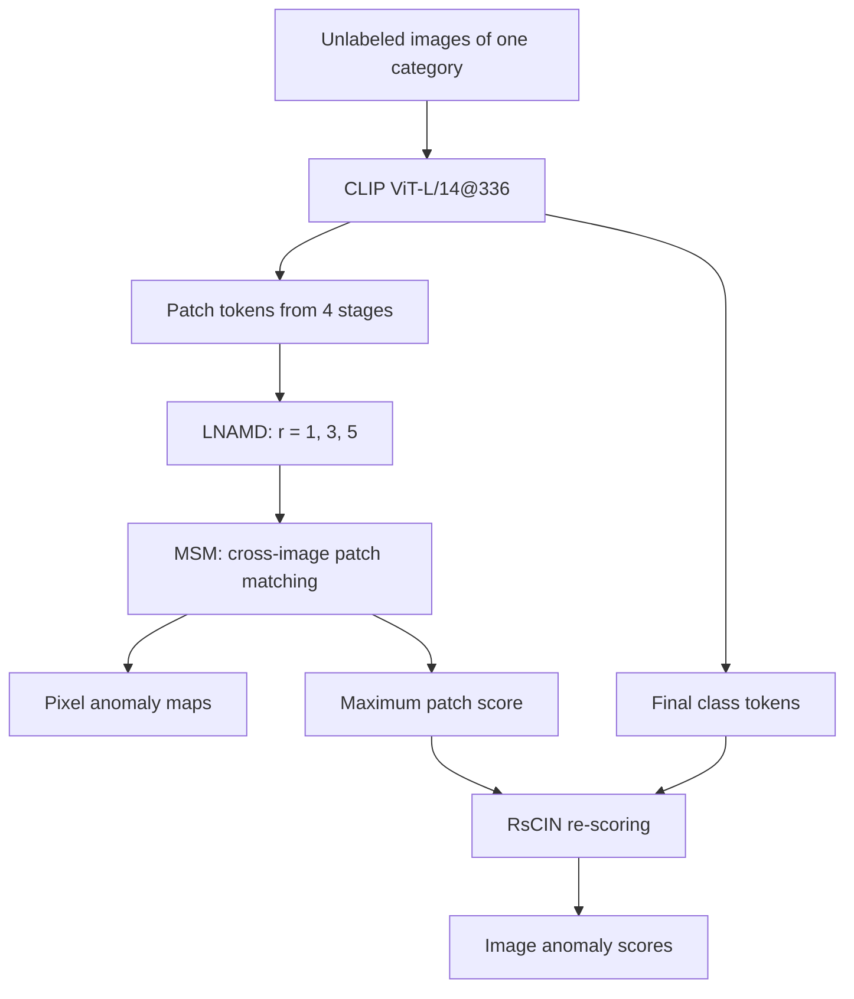

MuSc xử lý độc lập từng lớp sản phẩm. Ví dụ, đặc trưng của `bottle` không được so sánh với đặc trưng của `cable`.

### 4.2. Trích xuất đặc trưng bằng Vision Transformer

Thực nghiệm sử dụng OpenAI CLIP `ViT-L-14-336` [5]. Dù tên backbone chứa số 336, ảnh đầu vào được resize thành $518 \times 518$. MuSc lấy patch token ở cuối bốn stage, tương ứng các layer 6, 12, 18 và 24. Trong file cấu hình, các vị trí này được lưu theo chỉ số bắt đầu từ 0 là `[5, 11, 17, 23]`. Patch token phục vụ LNAMD và MSM, còn class token ở layer cuối phục vụ RsCIN. Backbone được giữ cố định, không fine-tune trên MVTec AD hoặc VisA.

### 4.3. LNAMD: tổng hợp lân cận cục bộ ở nhiều mức

Một kích thước lân cận duy nhất khó phù hợp với mọi loại khuyết tật. LNAMD tạo ba biểu diễn cho mỗi patch bằng average pooling trên lân cận $r \times r$, với:

$$
r \in \{1,3,5\}.
$$

$r=1$ giữ chi tiết cục bộ, còn $r=3$ và $r=5$ bổ sung ngữ cảnh rộng hơn. MuSc bảo toàn cả ba mức và kết hợp điểm của chúng ở giai đoạn sau, nhờ đó có thể phản ứng với khuyết tật ở nhiều kích thước.

### 4.4. MSM: chấm điểm tương hỗ giữa các ảnh

Với patch thứ $m$ của ảnh $I_i$, một ảnh khác $I_j$ gán điểm bằng khoảng cách Euclidean nhỏ nhất đến mọi patch của nó:

$$
a_{i,l}^{m,r}(I_j)=
\min_n \left\|\hat{p}_{i,l}^{m,r}-\hat{p}_{j,l}^{n,r}\right\|_2,
\qquad j \ne i.
$$

Nếu một patch biểu diễn cấu trúc bình thường, nó có khả năng tìm được nhiều patch tương tự trong các ảnh khác và nhận khoảng cách nhỏ. Nếu patch chứa lỗi hiếm, số đối sánh gần sẽ ít hơn. MuSc sắp xếp vector khoảng cách liên ảnh và chỉ lấy trung bình 30% giá trị nhỏ nhất. Cách này cho phép một patch bình thường chỉ cần tìm được một nhóm ảnh bình thường đủ tương tự, thay vì phải giống toàn bộ tập ảnh.

Điểm patch cuối cùng là trung bình trên bốn stage và ba mức lân cận. Vector điểm được reshape và nội suy song tuyến tính để tạo anomaly map. Điểm cấp ảnh ban đầu là giá trị lớn nhất trên anomaly map:

$$
c_i = \max_m a_i^m.
$$

Cách lấy cực đại nhạy với lỗi nhỏ nhưng cũng nhạy với một điểm nhiễu cô lập.

### 4.5. RsCIN: hiệu chỉnh điểm cấp ảnh

RsCIN sử dụng cosine similarity giữa các class token để xây dựng lân cận ảnh. Điểm ban đầu của một ảnh được kết hợp với điểm của các ảnh có hình dạng tổng thể tương tự. Baseline dùng hai kích thước lân cận `{2, 3}` cho MVTec AD và `{8, 9}` cho VisA, cộng với self-score. Mục tiêu là giảm ảnh hưởng của một cực đại cục bộ không đại diện cho toàn ảnh.

RsCIN chỉ tác động đến điểm cấp ảnh. Anomaly map và các độ đo cấp pixel đã được hình thành trước bước này.

## 5. Thiết kế thực nghiệm

### 5.1. Datasets

**MVTec AD.** Bộ dữ liệu gồm 5.354 ảnh độ phân giải cao của 15 lớp, bao gồm 10 lớp vật thể và 5 lớp texture, kèm mask pixel cho ảnh bất thường [6]. E01 chạy toàn bộ 15 lớp. E01Q chọn `leather`, `transistor` và `screw` để phân tích định tính.

**VisA.** Bộ dữ liệu gồm 10.821 ảnh độ phân giải cao của 12 lớp trong ba miền vật thể, trong đó có 9.621 ảnh bình thường và 1.200 ảnh bất thường, kèm nhãn cấp ảnh và pixel [7]. E02 chạy toàn bộ 12 lớp với 2.162 ảnh thuộc test split. E02Q phân tích 752 ảnh của `pcb2`, `pcb3`, `pcb4` và `fryum`.

### 5.2. Độ đo

| Mức đánh giá | Độ đo | Ý nghĩa chính |
|---|---|---|
| Cấp ảnh | AUROC | Khả năng xếp ảnh bất thường cao hơn ảnh bình thường trên mọi ngưỡng |
| Cấp ảnh | AP | Độ chính xác trung bình theo đường precision-recall, nhạy với mất cân bằng lớp |
| Cấp ảnh | F1-max | F1 tốt nhất khi quét các ngưỡng quyết định |
| Cấp pixel | AUROC | Khả năng phân biệt pixel lỗi và pixel bình thường |
| Cấp pixel | AP | Chất lượng precision-recall của phân vùng lỗi |
| Cấp pixel | F1-max | F1 phân vùng tốt nhất theo ngưỡng |
| Cấp pixel | Per-Region Overlap (PRO) | Mức chồng lấp theo vùng lỗi, tích phân với false-positive rate dưới 0,3 |

AUROC, AP và F1-max cấp ảnh được tính sau RsCIN. Các độ đo cấp pixel được tính trực tiếp từ anomaly map. F1-max sử dụng ngưỡng tối ưu hậu nghiệm nên thể hiện tiềm năng phân tách trên benchmark, không phải một ngưỡng cố định sẵn cho triển khai thực tế.

### 5.3. Cấu hình MuSc tham chiếu

| Thành phần | Giá trị |
|---|---|
| MuSc repository | Commit `b76b93d` [8] |
| Backbone | OpenAI CLIP `ViT-L-14-336` |
| Kích thước ảnh | `518 x 518` |
| Feature layers | `[5, 11, 17, 23]` |
| LNAMD degrees | `[1, 3, 5]` |
| MSM interval | 30% khoảng cách nhỏ nhất |
| `divide_num` | `1` |
| Batch size | `4` |
| Seed | `42` |
| Visualization | Tắt ở E01/E02; `whole_norm` ở E01Q/E02Q |

Mỗi lớp được chạy trong một subprocess riêng và lưu trạng thái độc lập. Thiết kế này cho phép tiếp tục từ lớp chưa hoàn thành sau khi Colab mất kết nối hoặc hết CPU RAM mà không ghi đè kết quả đã có.

### 5.4. Môi trường thực thi và thay đổi tương thích

| Thành phần | Phiên bản quan sát được |
|---|---|
| Nền tảng | Google Colab, Tesla T4 |
| Python | 3.13.15 |
| PyTorch | 2.11.0+cu130 |
| Torchvision | 0.26.0+cu130 |
| CUDA runtime | 13.0 |
| OpenCV | 4.14.0 |
| scikit-learn | 1.6.1 |
| scikit-image | 0.25.2 |
| timm | 0.9.12 |

Môi trường này mới hơn đáng kể so với môi trường được mô tả trong repository là Python 3.8, PyTorch 2.0.1 và CUDA 11.7. Hai thay đổi kỹ thuật được lưu lại đầy đủ:

1. Thêm `datasets/__init__.py` và đặt đường dẫn MuSc ở đầu `sys.path` để tránh xung đột với package `datasets` của Hugging Face.
2. Giải phóng tensor đặc trưng sau khi tạo anomaly map và bỏ hai bản sao NumPy dư thừa để giảm CPU RAM.

Thay đổi thứ hai không sửa công thức tính điểm theo kiểm tra mã nguồn. Tuy nhiên, chưa có A/B test cùng một lớp giữa bản có và không có memory patch trong cùng môi trường, nên đây vẫn là một giới hạn cần công bố.

## 6. Kết quả định lượng

Các giá trị dưới đây là phần trăm. Cột "Bài báo" lấy từ Table 1 của bài MuSc [1]. Để audit tái lập, báo cáo ưu tiên so sánh với bảng của repository tại commit đã khóa vì bảng này có độ chính xác hai chữ số và chi tiết theo lớp. Bài báo và repository có một số chênh lệch nhỏ, vì vậy hai nguồn được trình bày tách biệt.

### 6.1. MVTec AD

| Mức | Độ đo | Bài báo | Repository | E01 tái lập | Sai lệch so với repository |
|---|---|---:|---:|---:|---:|
| Pixel | AUROC | 97,3 | 97,11 | 97,114390 | +0,004390 |
| Pixel | F1-max | 62,6 | 62,16 | 62,157971 | -0,002029 |
| Pixel | AP | 62,7 | 62,26 | 62,261741 | +0,001741 |
| Pixel | PRO | 93,8 | 93,45 | 93,452960 | +0,002960 |
| Ảnh | AUROC | 97,8 | 97,77 | 97,734031 | -0,035969 |
| Ảnh | F1-max | 97,5 | 97,37 | 97,405687 | +0,035687 |
| Ảnh | AP | 99,1 | 99,07 | 99,052802 | -0,017198 |

Toàn bộ 15 lớp hoàn thành. Sai lệch tuyệt đối lớn nhất của giá trị trung bình chỉ là 0,035969 điểm phần trăm. Cả 60 phép so sánh cấp pixel theo lớp đều lệch dưới 0,10 điểm phần trăm. Có 10 trong 45 phép so sánh cấp ảnh lệch trên 0,10, lớn nhất là F1-max của `capsule` với +0,813780 điểm phần trăm. Vì sai lệch tập trung ở cấp ảnh, RsCIN và sự khác biệt môi trường là một giả thuyết hợp lý, nhưng chưa được chứng minh bằng rerun trên môi trường chính thức.

E01 tiêu thụ tổng cộng 7.169,446 giây subprocess thành công, tương đương 119,49 phút. Con số này không bao gồm thời gian cài đặt, tải dữ liệu, attempt `pill` bị gián đoạn và tổng hợp kết quả.

### 6.2. So sánh nhóm object và texture trên MVTec AD

MVTec AD gồm 10 lớp object và 5 lớp texture [6]. Bảng dưới tính macro-average trong từng nhóm, nghĩa là mỗi category có trọng số bằng nhau bất kể số ảnh. Dữ liệu nguồn là bảng E01 theo category được lưu tại [`artifacts/e01/mvtec_ad_reproduced.csv`](artifacts/e01/mvtec_ad_reproduced.csv); dòng mean trong file đã được đối chiếu bằng cách tính lại từ 15 category.

\begingroup
\footnotesize

| Nhóm | Số lớp | Px AUROC | Px F1 | Px AP | PRO | Img AUROC | Img F1 | Img AP |
|---|---:|---:|---:|---:|---:|---:|---:|---:|
| Object | 10 | 96,4251 | 60,8901 | 60,1516 | 92,2416 | 96,8959 | 96,6819 | 98,6768 |
| Texture | 5 | 98,4930 | 64,6937 | 66,4821 | 95,8757 | 99,4103 | 98,8532 | 99,8048 |
| Chênh lệch | - | +2,0679 | +3,8035 | +6,3305 | +3,6341 | +2,5145 | +2,1712 | +1,1280 |

\endgroup

Nhóm texture cao hơn nhóm object trên cả bảy độ đo. Khoảng cách lớn nhất xuất hiện ở Pixel AP (+6,3305 điểm phần trăm), tiếp theo là Pixel F1-max (+3,8035) và PRO (+3,6341). Kết quả này cho thấy cấu hình MuSc tái lập xử lý tốt hơn nhóm texture khi lấy trung bình theo category trong benchmark này. Tuy nhiên, đây chỉ là phân tích mô tả trên hai nhóm có kích thước không cân bằng. Số ảnh, loại khuyết tật, độ tương phản và độ khó khác nhau giữa các category, nên không thể kết luận texture vốn dễ hơn object hoặc loại dữ liệu là nguyên nhân của chênh lệch. Chẳng hạn, `grid` vẫn chỉ đạt Pixel AP 38,2368%, trong khi các lớp object khó như `metal_nut` và `screw` kéo giảm một số trung bình của nhóm object.

### 6.3. VisA

| Mức | Độ đo | Bài báo | Repository | E02 tái lập | Sai lệch so với repository |
|---|---|---:|---:|---:|---:|
| Pixel | AUROC | 98,8 | 98,71 | 98,713645 | +0,003645 |
| Pixel | F1-max | 48,8 | 48,90 | 48,900484 | +0,000484 |
| Pixel | AP | 45,1 | 45,38 | 45,383142 | +0,003142 |
| Pixel | PRO | 92,7 | 92,43 | 92,428779 | -0,001221 |
| Ảnh | AUROC | 92,8 | 92,57 | 92,400077 | -0,169923 |
| Ảnh | F1-max | 89,5 | 89,06 | 88,797846 | -0,262154 |
| Ảnh | AP | 93,5 | 93,31 | 93,177198 | -0,132802 |

Toàn bộ 12 lớp và 2.162 ảnh test hoàn thành. Bốn giá trị trung bình cấp pixel khớp repository trong 0,004 điểm phần trăm. Ba giá trị cấp ảnh thấp hơn từ 0,133 đến 0,262 điểm phần trăm. Sai lệch theo lớp lớn nhất là F1-max cấp ảnh của `pcb2`, bằng -2,506154 điểm phần trăm.

Repository ghi `fryum` Pixel AUROC là 99,43, nhưng trung bình của 12 giá trị được in khi đó là 98,8383, không phải 98,71 như bảng công bố. Nếu giữ nguyên 11 lớp còn lại, trung bình 98,71 suy ra giá trị `fryum` xấp xỉ 97,89. Kết quả tái lập là 97,9309. Đây là bằng chứng mạnh về lỗi đánh máy trong ô tham chiếu, nhưng báo cáo không tự ý thay thế giá trị gốc.

E02 tiêu thụ 11.696,378 giây subprocess thành công, tương đương 194,94 phút, không bao gồm setup, preprocessing và attempt `macaroni2` bị gián đoạn.

## 7. Kết quả định tính trên MVTec AD

E01Q chạy lại ba lớp với `whole_norm`, tạo 384 heatmap và chọn 18 ca theo quy tắc cố định: hai anomaly có pixel AUROC cao nhất, hai anomaly thấp nhất và hai normal có đáp ứng top 1% cao nhất cho mỗi lớp. Các độ đo khớp E01 trong sai số dấu phẩy động khoảng $1,42 \times 10^{-14}$ điểm phần trăm, nên việc bật visualization không làm thay đổi baseline.

### 7.1. Các ca định vị tốt

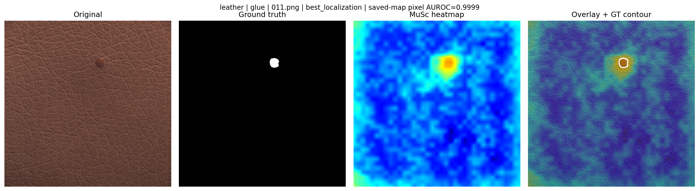

**Hình 1.** `leather/glue/011`: đỉnh heatmap gọn và trùng với mask của khuyết tật. Pixel AUROC tái dựng từ heatmap lưu là 0,9999. Đây là kiểu lỗi nhỏ, tương phản và cô lập mà MuSc xử lý tốt.

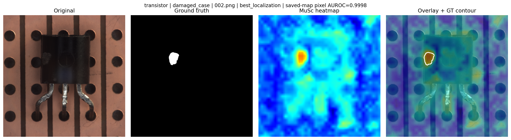

**Hình 2.** `transistor/damaged_case/002`: vùng đáp ứng mạnh nằm đúng trên phần hư hỏng của vỏ transistor, với pixel AUROC tái dựng 0,9998.

### 7.2. Các ca khó

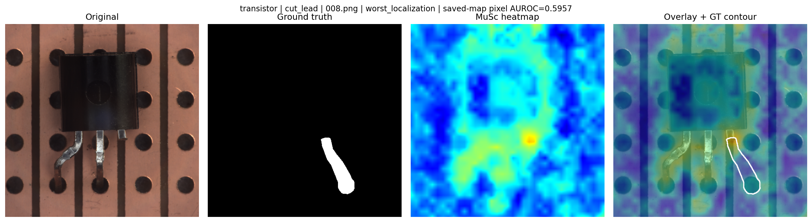

**Hình 3.** `transistor/cut_lead/008`: đỉnh heatmap nằm tại chân bị cắt, nhưng phần lớn mask là đoạn chân bị thiếu, trông giống nền và không nổi bật, trong khi đáp ứng còn lan trên vỏ và cấu trúc xung quanh. Pixel AUROC tái dựng chỉ đạt 0,5957. Hành vi này phù hợp với PRO thấp của cả lớp `transistor`, bằng 77,2087%.

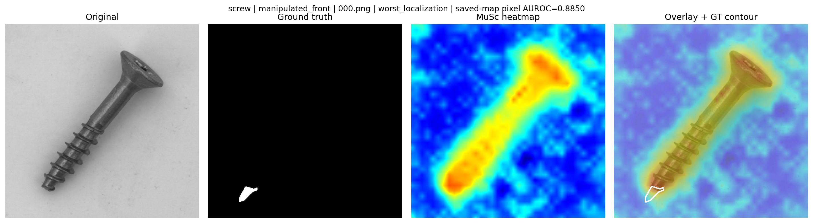

**Hình 4.** `screw/manipulated_front/000`: ground truth chỉ bao phủ một vùng nhỏ ở đầu vít, nhưng heatmap kích hoạt gần như toàn thân vít. Đây là một ví dụ rõ về việc pixel AUROC có thể tương đối cao dù biên định vị không chặt. Ở cấp lớp, `screw` chỉ đạt Image AUROC 82,3119% và Pixel AP 36,1135%.

## 8. Kết quả định tính và ảnh hưởng của RsCIN trên VisA

E02Q tạo record cho toàn bộ 752 ảnh thuộc bốn lớp, chọn 24 ca và xuất đầy đủ ảnh gốc, mask, heatmap, overlay. Mọi độ đo khớp E02 trong sai số dấu phẩy động. Cụm từ "ứng viên" được giữ nguyên vì các ảnh cực trị theo score chưa phải lỗi phân loại được xác nhận nếu chưa áp dụng một decision threshold cụ thể.

### 8.1. So sánh trước và sau RsCIN

| Độ đo | Lớp | Ban đầu | Sau RsCIN | Chênh lệch |
|---|---|---:|---:|---:|
| AUROC | `pcb2` | 87,0600 | 92,0100 | +4,9500 |
| AUROC | `pcb3` | 94,9109 | 92,9703 | -1,9406 |
| AUROC | `pcb4` | 92,4059 | 98,6040 | +6,1980 |
| AUROC | `fryum` | 97,4600 | 98,5800 | +1,1200 |
| F1-max | `pcb2` | 84,8168 | 86,1538 | +1,3371 |
| F1-max | `pcb3` | 87,3239 | 85,9813 | -1,3426 |
| F1-max | `pcb4` | 83,7438 | 93,8776 | +10,1337 |
| F1-max | `fryum` | 94,0594 | 97,4359 | +3,3765 |
| AP | `pcb2` | 88,6538 | 93,5731 | +4,9193 |
| AP | `pcb3` | 95,2467 | 93,2793 | -1,9673 |
| AP | `pcb4` | 92,7985 | 98,6431 | +5,8446 |
| AP | `fryum` | 98,8284 | 99,4038 | +0,5754 |

RsCIN cải thiện cả ba độ đo trên `pcb2`, `pcb4` và `fryum`, mạnh nhất ở `pcb4`. Ngược lại, `pcb3` giảm trên cả ba độ đo. Trong lớp này, 85/100 ảnh bất thường bị giảm score, còn 72/101 ảnh bình thường tăng score sau RsCIN. Kết quả cho thấy giả định "ảnh tương tự nên có điểm bất thường tương tự" không đúng như nhau cho mọi lớp.

### 8.2. Các ca đại diện

Từ Hình 6 đến Hình 8, mỗi hình gồm bốn ô theo thứ tự: ảnh gốc, ground truth, heatmap MuSc và overlay có viền ground truth. Ground truth được hiển thị nhị phân vì mask VisA lưu class ID của lỗi (từ 1 đến 7), không phải giá trị 255 như MVTec AD.

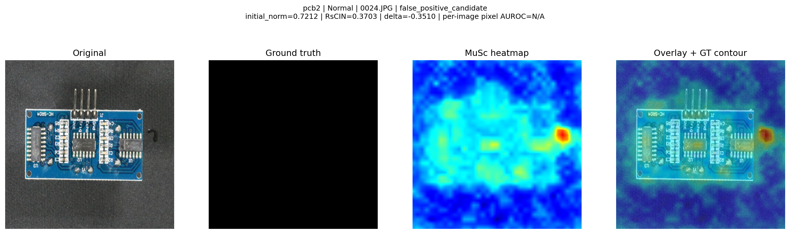

**Hình 5.** `pcb2/Normal/0024`: một vùng tối nằm bên phải bo mạch nhận đáp ứng mạnh nhất. Đây là ứng viên nhiễu bối cảnh, không phải false positive đã được xác nhận bằng threshold.

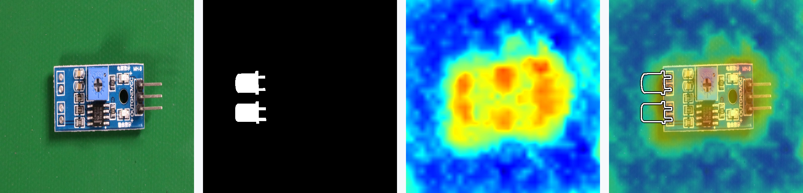

**Hình 6.** `pcb3/Anomaly/043`: ground truth mở rộng đến các cấu trúc bị thiếu hoặc dịch chuyển cạnh bo mạch, trong khi heatmap tập trung vào thân bo mạch. Pixel AUROC của ảnh là 0,8049. Ca này cùng xu hướng score bất lợi sau RsCIN giải thích điểm yếu của `pcb3`.

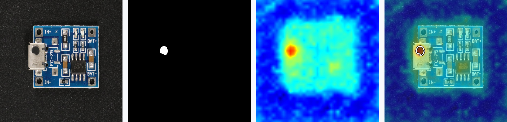

**Hình 7.** `pcb4/Anomaly/032`: một đỉnh cục bộ rõ trùng với lỗi tròn trên connector. Pixel AUROC của ảnh là 0,9997. Đây là ví dụ tốt cho khả năng phát hiện lỗi nhỏ khi biểu diễn patch đủ khác biệt với mẫu hình lặp lại.

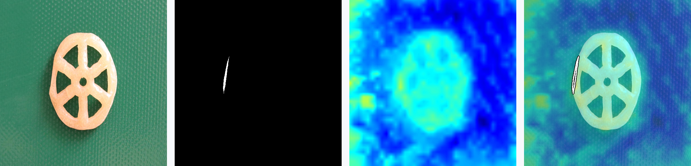

**Hình 8.** `fryum/Anomaly/010`: đáp ứng mạnh nhất nằm ở nền bên trái, cách lỗi hơn 100 pixel trên ảnh 518 x 518, trong khi lỗi mảnh ở biên yếu hơn. Pixel AUROC của ảnh vẫn đạt 0,9250, thấp nhất trong 100 ảnh lỗi của `fryum`, minh họa rằng AUROC cao không đồng nghĩa với định vị sát biên lỗi.

## 9. Thử nghiệm mở rộng có kiểm soát: top 1% pooling

### 9.1. Thiết kế và kết quả định lượng

E04 kiểm tra giả thuyết rằng trung bình top 1% pixel có thể giảm độ nhạy với một điểm nóng nhiễu so với maximum pooling. Hai phép tổng hợp được tính từ cùng anomaly map trên toàn bộ 15 lớp MVTec AD, cả trước và sau RsCIN. Với ảnh $518 \times 518$, top 1% tương ứng trung bình của 2.684 pixel có score cao nhất. Backbone, feature layer, LNAMD, MSM, dữ liệu và toàn bộ anomaly map được giữ nguyên, nên so sánh chỉ hỗ trợ kết luận về cách tạo score cấp ảnh.

| Biến thể | Image AUROC | Image F1-max | Image AP |
|---|---:|---:|---:|
| Maximum, chưa RsCIN | 97,3864 | 96,7355 | 98,7258 |
| Maximum, sau RsCIN | **97,7340** | **97,4057** | **99,0528** |
| Top 1%, chưa RsCIN | 97,0227 | 96,8796 | 98,8246 |
| Top 1%, sau RsCIN | 96,7811 | 96,9747 | 98,7766 |

Kết quả chính là chênh lệch giữa top 1% và maximum sau RsCIN: Image AUROC giảm 0,9529, F1-max giảm 0,4310 và AP giảm 0,2762 điểm phần trăm. Trước RsCIN, AUROC giảm 0,3638 điểm, trong khi F1-max và AP tăng nhẹ lần lượt 0,1441 và 0,0988 điểm. Ở operating point F1-max riêng của từng biến thể, top 1% sửa 17 false positive nhưng tạo 25 false positive mới trước RsCIN; sau RsCIN, các số tương ứng là 4 và 36. Vì mỗi biến thể có threshold tối ưu riêng, các số đếm này chỉ mô tả benchmark và không phải error rate khi triển khai.

Giả thuyết mở rộng không được ủng hộ trên toàn benchmark. Kết quả âm được giữ nguyên thay vì điều chỉnh tỷ lệ pooling sau khi xem số liệu.

### 9.2. Giải thích định tính bằng E04Q

E04Q chạy lại `carpet`, `transistor` và `screw` với visualization, ghi nhận 377 heatmap và tạo panel cho chín ca đã cố định trước khi xem hình. Cả bốn score của từng ảnh khớp E04 trong sai số dấu phẩy động. Maximum và top 1% dùng cùng anomaly map; RsCIN cũng chỉ thay score cấp ảnh, không tạo heatmap mới.

| Ca có lợi | Phản ví dụ |
|:---:|:---:|
| 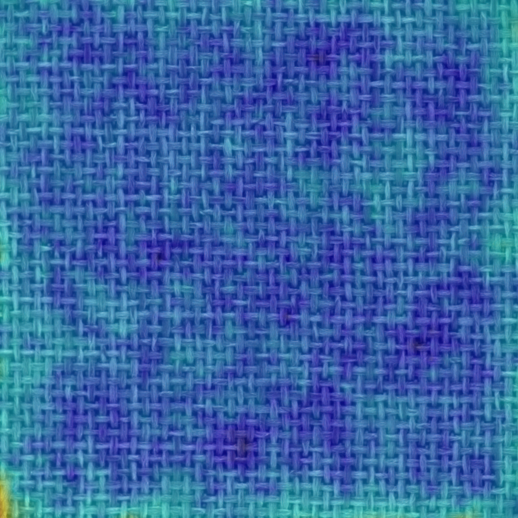{width=75%} | 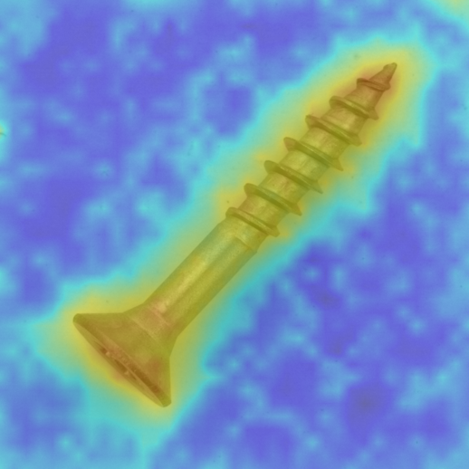{width=75%} |
| `carpet/good/019`: FP sang TN | `screw/good/003`: TN sang FP |

**Hình 9.** Hai ca normal đối lập trong E04Q. Ở `carpet/good/019`, top 1% sửa false positive trong cả nhánh raw và RsCIN. Ở `screw/good/003`, top 1% tạo false positive mới trong cả hai nhánh.

Ảnh `carpet/good/019` có đáp ứng khuếch tán và một vùng mạnh hơn ở biên, nên giảm ảnh hưởng của đỉnh cục bộ có lợi. Ngược lại, anomaly map của `screw/good/003` kích hoạt gần như toàn bộ vít normal thay vì một điểm nhiễu riêng lẻ. Averaging trên vùng score cao vẫn giữ đáp ứng cấu trúc rộng và có thể làm thứ tự score bất lợi.

Hai ca đối lập giải thích trade-off nhưng không ước lượng tần suất của từng cơ chế. Chín ảnh được chọn theo thay đổi score và quyết định, không phải là mẫu đại diện ngẫu nhiên. Màu của `whole_norm` chỉ nên được đọc theo vị trí trong từng ảnh, không dùng để so sánh cường độ tuyệt đối giữa hai ảnh.

## 10. Đánh giá phương pháp

### 10.1. Ưu điểm

1. **Không cần huấn luyện trên tập đích.** MuSc không dùng ảnh train có nhãn, mask hoặc text prompt cho lớp sản phẩm mới.
2. **Giải quyết đồng thời classification và segmentation.** Cùng một pipeline sinh anomaly map và điểm cấp ảnh.
3. **Khai thác nhiều mức ngữ cảnh.** LNAMD kết hợp đặc trưng cục bộ và lân cận rộng, phù hợp với lỗi có kích thước khác nhau.
4. **Kết quả cấp pixel tái lập tốt.** Trên cả hai benchmark, các giá trị trung bình cấp pixel gần như trùng bảng repository.
5. **Có khả năng diễn giải trực quan.** Heatmap cho phép kiểm tra nơi mô hình tập trung và liên hệ định tính với các độ đo.

### 10.2. Hạn chế

1. **Phụ thuộc thành phần tập test.** Điểm của một ảnh thay đổi theo các ảnh khác cùng lớp vì MSM là transductive.
2. **Chi phí tính toán cao.** MSM so sánh patch giữa nhiều cặp ảnh, khiến thời gian và bộ nhớ tăng nhanh theo số ảnh và số patch.
3. **Giả định lỗi hiếm có thể bị vi phạm.** Nếu cùng một lỗi lặp lại nhiều lần, các patch lỗi có thể tìm được nhiều đối sánh và bị xem là bình thường.
4. **Nhạy với orientation, scale và nhiễu bối cảnh.** Đáp ứng sai xuất hiện ở vùng phản xạ, cấu trúc lặp lại hoặc dấu vết ngoài vật thể.
5. **Không có phép tổng hợp score tối ưu ổn định.** Maximum pooling có thể bị chi phối bởi một điểm nóng, nhưng E04 cho thấy trung bình top 1% chỉ sửa một số false positive và làm giảm Image AUROC sau RsCIN trên toàn benchmark.
6. **RsCIN không luôn cải thiện.** Kết quả `pcb3` cho thấy làm mượt theo ảnh tương tự có thể kéo score theo hướng bất lợi.
7. **Heatmap có thể quá thô.** Với `cut_lead`, đỉnh heatmap nằm đúng chỗ nhưng phần lớn mask không nổi bật; với vết mảnh ở biên `fryum`, đáp ứng trên lỗi yếu hơn đáp ứng ở nền.

### 10.3. Nguy cơ đối với reproducibility

- Colab dùng software stack mới hơn môi trường chính thức, đặc biệt ở PyTorch và CUDA.
- `torch.topk` trong RsCIN có thể nhạy với thứ tự khi nhiều similarity gần bằng nhau. Đây mới là giả thuyết, chưa phải nguyên nhân đã chứng minh.
- Hai attempt bị gián đoạn đã được lưu lại thay vì xóa, nhưng tổng runtime không bao gồm thời gian thất bại và setup.
- Memory patch được đánh giá là bảo toàn phép tính qua semantic diff, song chưa có A/B test matched-environment.
- Các panel định tính là các ca cực trị được chọn có chủ đích. Chúng minh họa cơ chế, không ước lượng tần suất của mỗi kiểu thất bại.
- Heatmap `whole_norm` cung cấp thang màu chung trong một lần chạy theo lớp, nhưng màu sắc không tự động tương ứng với quyết định phân loại.

## 11. Kết luận

Đồ án đã tái lập thành công MuSc trên toàn bộ MVTec AD và VisA với một cấu hình cố định, đồng thời bảo toàn log, cấu hình, phiên bản môi trường và các attempt bị gián đoạn. Sự khớp gần như tuyệt đối ở cấp pixel cho thấy các bước trích xuất đặc trưng, LNAMD, MSM, tạo anomaly map và tính metric đã được tái lập đúng. Sai lệch cấp ảnh lớn hơn cho thấy RsCIN và môi trường thực thi là phần cần thận trọng nhất khi đánh giá reproducibility.

Phân tích định tính bổ sung ý nghĩa mà bảng số liệu đơn thuần không thể hiện: MuSc mạnh với lỗi nhỏ, nổi bật và cô lập, nhưng có thể phản ứng lan theo toàn vật thể, yếu với lỗi mảnh, và bị ảnh hưởng bởi phản xạ hoặc nhiễu nền. Thử nghiệm quan sát trên VisA còn cho thấy RsCIN có lợi theo từng lớp chứ không phải luôn luôn có lợi. Vì vậy, kết luận chính không chỉ là baseline được tái lập, mà còn là các độ đo tổng hợp cần được đọc cùng heatmap, failure cases và điều kiện môi trường.

Thí nghiệm mở rộng E04 cho thấy trung bình top 1% không phải là thay thế tốt hơn cho maximum pooling dưới cấu hình đã khóa. Sau RsCIN, cả ba độ đo cấp ảnh đều giảm, dù một số false positive riêng lẻ được sửa. E04Q giải thích kết quả này bằng hai cơ chế đối lập: giảm ảnh hưởng của đỉnh cục bộ có thể có lợi, nhưng đáp ứng rộng theo vật thể vẫn khiến top 1% duy trì hoặc làm xấu thứ tự score. Kết quả âm này giới hạn đúng phạm vi đóng góp của đồ án và cung cấp một bài học thực nghiệm: thay đổi có trực giác hợp lý vẫn cần được kiểm tra trên toàn benchmark và giữ nguyên khi giả thuyết không được ủng hộ.

## 12. Khả năng truy cập dữ liệu và mã nguồn

- MVTec AD và VisA là các benchmark công khai, được sử dụng theo protocol của công trình gốc [6], [7].
- Repository MuSc chính thức và commit dùng trong đồ án được nêu tại [8].
- **Source code/notebook tái lập của nhóm:** <https://github.com/DiiKhanh/cs2203-musc-reproduction>. Repository đang ở chế độ private tại thời điểm viết báo cáo; cần cấp quyền cho giảng viên hoặc chuyển sang public và kiểm tra truy cập trước khi nộp.
- Các file kết quả gốc, checksum, log, cấu hình và bảng theo lớp được bảo toàn trong các gói E01, E01Q, E02, E02Q, E04 và E04Q. Do kích thước lớn, cần quyết định nơi lưu và cấp quyền truy cập trong gói nộp cuối.

## 13. Tuyên bố

**Đạo đức nghiên cứu.** Thực nghiệm chỉ sử dụng benchmark ảnh công nghiệp công khai, không có người tham gia, động vật hoặc dữ liệu cá nhân.

**Đóng góp của thành viên.** Nhóm có một thành viên. Phạm Duy Khánh thực hiện toàn bộ quá trình nghiên cứu phương pháp, thiết lập môi trường, chạy và kiểm tra thực nghiệm, phân tích kết quả, chuẩn bị hình minh họa và viết báo cáo.

## Tài liệu tham khảo

[1] X. Li, Z. Huang, F. Xue, and Y. Zhou, “MuSc: Zero-Shot Industrial Anomaly Classification and Segmentation with Mutual Scoring of the Unlabeled Images,” *The Twelfth International Conference on Learning Representations (ICLR)*, 2024. [Online]. Available: <https://proceedings.iclr.cc/paper_files/paper/2024/hash/096b1019463f34eb241e87cfce8dfe16-Abstract-Conference.html>

[2] K. Roth, L. Pemula, J. Zepeda, B. Schölkopf, T. Brox, and P. Gehler, “Towards Total Recall in Industrial Anomaly Detection,” in *Proceedings of the IEEE/CVF Conference on Computer Vision and Pattern Recognition (CVPR)*, pp. 14318-14328, 2022. doi: <https://doi.org/10.1109/CVPR52688.2022.01392>

[3] J. Jeong, Y. Zou, T. Kim, D. Zhang, A. Ravichandran, and O. Dabeer, “WinCLIP: Zero-/Few-Shot Anomaly Classification and Segmentation,” in *Proceedings of the IEEE/CVF Conference on Computer Vision and Pattern Recognition (CVPR)*, pp. 19606-19616, 2023. doi: <https://doi.org/10.1109/CVPR52729.2023.01878>

[4] Q. Zhou, G. Pang, Y. Tian, S. He, and J. Chen, “AnomalyCLIP: Object-Agnostic Prompt Learning for Zero-Shot Anomaly Detection,” *The Twelfth International Conference on Learning Representations (ICLR)*, 2024. [Online]. Available: <https://openreview.net/forum?id=buC4E91xZE>

[5] A. Radford et al., “Learning Transferable Visual Models From Natural Language Supervision,” in *Proceedings of the 38th International Conference on Machine Learning*, PMLR 139, pp. 8748-8763, 2021. [Online]. Available: <https://proceedings.mlr.press/v139/radford21a.html>

[6] P. Bergmann, M. Fauser, D. Sattlegger, and C. Steger, “MVTec AD - A Comprehensive Real-World Dataset for Unsupervised Anomaly Detection,” in *Proceedings of the IEEE/CVF Conference on Computer Vision and Pattern Recognition (CVPR)*, pp. 9592-9600, 2019. doi: <https://doi.org/10.1109/CVPR.2019.00982>

[7] Y. Zou, J. Jeong, L. Pemula, D. Zhang, and O. Dabeer, “SPot-the-Difference Self-Supervised Pre-training for Anomaly Detection and Segmentation,” in *European Conference on Computer Vision (ECCV)*, pp. 392-408, 2022. doi: <https://doi.org/10.1007/978-3-031-20056-4_23>

[8] X. Li, “MuSc official implementation,” GitHub, commit `b76b93d`, 2026. [Online]. Available: <https://github.com/xrli-U/MuSc/tree/b76b93da8bd3096a99964a96ae29d46f197a0651>
