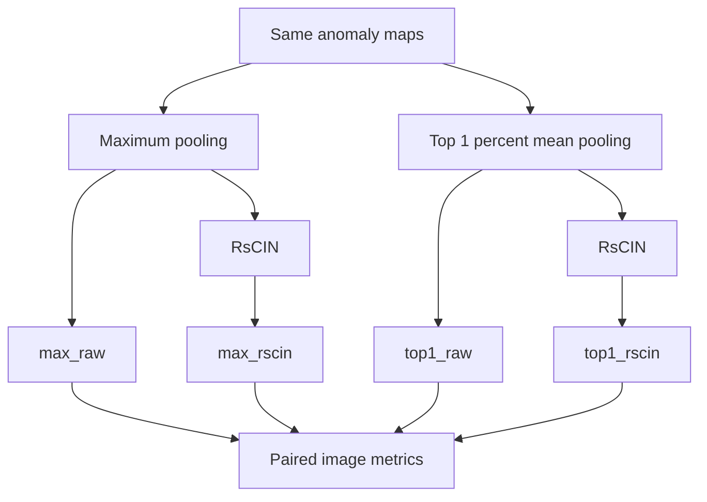

# Hướng dẫn chạy MuSc E04: top-1-percent mean pooling

## Material Passport

- Origin Skill: experiment-agent
- Origin Mode: plan
- Origin Date: 2026-10-16
- Verification Status: UNVERIFIED
- Version Label: code_plan_v1

## 1. Mục tiêu

E04 kiểm tra một thay đổi duy nhất trong MuSc: thay initial image-level anomaly score từ maximum của toàn bộ anomaly map bằng trung bình của 1% pixel có anomaly score cao nhất.

Giả thuyết cần kiểm tra:

> Top-1-percent mean pooling giảm độ nhạy với một điểm nóng cô lập trên ảnh bình thường, nhưng vẫn giữ được tín hiệu của vùng bất thường thật.

E04 không thay backbone, LNAMD, MSM, anomaly map, pixel-level metrics hoặc cách RsCIN hoạt động. Vì vậy, mọi kết luận của E04 chỉ áp dụng cho image-level classification.

## 2. Thiết kế 2 x 2

Từ cùng một anomaly map và cùng class token, mỗi ảnh có bốn score:

| Variant | Initial pooling | RsCIN |
|---|---|---|
| `max_raw` | Maximum | Không |
| `max_rscin` | Maximum | Có |
| `top1_raw` | Mean của top 1% pixel | Không |
| `top1_rscin` | Mean của top 1% pixel | Có |



Cả bốn variant được tính trong cùng một category subprocess. Cách này bảo đảm chúng dùng đúng cùng anomaly map, class token, dataset split và môi trường thực thi.

## 3. Biến, độ đo và tiêu chí diễn giải

- Independent variable: phép gộp initial image score, gồm `maximum` và `top-1-percent mean`.
- Secondary factor: có hoặc không có RsCIN.
- Primary outcome: macro-average Image AUROC trên 15 category của MVTec AD.
- Secondary outcomes: macro-average Image AP, Image F1-max và paired delta theo category.
- Mechanism evidence: normal image đổi từ false positive dưới maximum thành true negative dưới top 1%, tại operating point F1-max riêng của từng variant, và heatmap cho thấy đáp ứng cô lập.
- Control variables: commit, dataset revision, backbone, input size, feature layers, LNAMD degrees, MSM interval, `divide_num`, batch size và seed.

Không tự động kết luận E04 thành công chỉ vì một metric tăng. Cần đọc đồng thời:

1. Macro delta của ba image-level metrics.
2. Số category tăng, hòa và giảm.
3. False-positive candidates được giải quyết và false positives mới.
4. Heatmap của các ca đại diện.

Threshold tại F1-max được chọn hậu nghiệm từ ground truth benchmark. Nó chỉ phục vụ phân tích, không phải threshold triển khai thực tế.

## 4. Cấu hình cố định

| Thành phần | Giá trị |
|---|---|
| MuSc commit | `b76b93da8bd3096a99964a96ae29d46f197a0651` |
| Dataset | MVTec AD, toàn bộ 15 category |
| Backbone | OpenAI CLIP `ViT-L-14-336` |
| Input resolution | `518 x 518` |
| Feature layers | `5 11 17 23` |
| LNAMD degrees | `1 3 5` |
| MSM interval | 30% khoảng cách nhỏ nhất |
| `divide_num` | `1` |
| Batch size | `4` |
| Seed | `42` trong entry point chính thức |
| Pooling fraction | `0.01` |
| Top count | `ceil(number_of_pixels * 0.01)` |
| Quantitative visualization | `False` |

Với anomaly map `518 x 518`, mỗi ảnh có 268.324 pixel và top 1% gồm `ceil(268324 x 0.01) = 2684` pixel.

## 5. Điều kiện trước khi chạy

- E01 đã hoàn thành trên đủ 15 category.
- File E01 baseline gốc vẫn được giữ nguyên.
- Google Drive còn đủ dung lượng cho một run mới.
- Dùng runtime GPU mới. Không chạy E04 trong thư mục E01.

E04 sử dụng lại phần setup đã được kiểm chứng của E01. Mở đồng thời [hướng dẫn E01](2026-10-11-huong-dan-colab-musc-e01.md) để chạy các cell setup được chỉ rõ bên dưới.

## 6. Các cell Colab

### Cell E04-1 - Mount Drive và tạo hoặc resume E04 Run ID

```python
from google.colab import drive
drive.mount("/content/drive")

from datetime import datetime, timezone
from pathlib import Path
import json
import os

UPSTREAM_COMMIT = "b76b93da8bd3096a99964a96ae29d46f197a0651"
PROJECT_ROOT = Path("/content/drive/MyDrive/CS2203_MuSc")
RUNS_ROOT = PROJECT_ROOT / "runs"
ACTIVE_RUN_FILE = PROJECT_ROOT / "active-e04-run.txt"

CATEGORIES = [
    "bottle", "cable", "capsule", "carpet", "grid",
    "hazelnut", "leather", "metal_nut", "pill", "screw",
    "tile", "toothbrush", "transistor", "wood", "zipper",
]

PROJECT_ROOT.mkdir(parents=True, exist_ok=True)
RUNS_ROOT.mkdir(parents=True, exist_ok=True)

if ACTIVE_RUN_FILE.is_file():
    candidate_run_id = ACTIVE_RUN_FILE.read_text(encoding="utf-8").strip()
    candidate_root = RUNS_ROOT / candidate_run_id
    if candidate_root.is_dir() and not (candidate_root / "E04_AGGREGATED.json").exists():
        RUN_ID = candidate_run_id
        print("Tiếp tục E04 Run ID đang dở:", RUN_ID)
    else:
        ACTIVE_RUN_FILE.unlink()
        RUN_ID = datetime.now().strftime("%Y%m%d_%H%M%S_E04_mvtec_top1_pooling")
        ACTIVE_RUN_FILE.write_text(RUN_ID + "\n", encoding="utf-8")
        print("Tạo E04 Run ID mới:", RUN_ID)
else:
    RUN_ID = datetime.now().strftime("%Y%m%d_%H%M%S_E04_mvtec_top1_pooling")
    ACTIVE_RUN_FILE.write_text(RUN_ID + "\n", encoding="utf-8")
    print("Tạo E04 Run ID mới:", RUN_ID)

RUN_ROOT = RUNS_ROOT / RUN_ID
CATEGORY_ROOT = RUN_ROOT / "categories"
SESSION_ID = datetime.now().strftime("%Y%m%d_%H%M%S")
SESSION_ROOT = RUN_ROOT / "sessions" / SESSION_ID

CATEGORY_ROOT.mkdir(parents=True, exist_ok=True)
SESSION_ROOT.mkdir(parents=True, exist_ok=False)

os.environ["MUSC_COMMIT"] = UPSTREAM_COMMIT
os.environ["MUSC_E04_RUN_ROOT"] = str(RUN_ROOT)
(RUN_ROOT / "run-id.txt").write_text(RUN_ID + "\n", encoding="utf-8")

print("Run root:", RUN_ROOT)
print("Session root:", SESSION_ROOT)
```

### Cell E04-2 đến E04-5 - Dùng lại setup E01

Chạy nguyên văn các cell sau từ [hướng dẫn E01](2026-10-11-huong-dan-colab-musc-e01.md):

1. **Cell 2** - Kiểm tra GPU và cài dependency.
2. **Cell 3** - Khôi phục MVTec AD. Nếu lỗi archive thì chạy Cell 3D và 3R.
3. **Cell 4** - Clone MuSc và áp dụng compatibility fix.
4. **Cell 4M** - Áp dụng bản vá giảm CPU RAM.
5. **Cell 5** - Khôi phục CLIP weights cache.

Các cell này dùng các biến `UPSTREAM_COMMIT`, `RUN_ROOT`, `SESSION_ROOT` và `CATEGORIES` đã được Cell E04-1 định nghĩa. Không chạy Cell 6 trở đi của E01.

Sau Cell 4M, kiểm tra:

```python
assert (REPO_ROOT / "models" / "musc.py").is_file()
assert DATA_ROOT.is_dir()
assert actual_commit == UPSTREAM_COMMIT
print("Setup dùng chung đã sẵn sàng cho E04.")
```

### Cell E04-6 - Lưu cấu hình đã đăng ký trước

```python
E04_CONFIG = {
    "experiment_id": "E04",
    "dataset_name": "mvtec_ad",
    "categories": CATEGORIES,
    "upstream_commit": UPSTREAM_COMMIT,
    "backbone_name": "ViT-L-14-336",
    "pretrained": "openai",
    "feature_layers": [5, 11, 17, 23],
    "img_resize": 518,
    "divide_num": 1,
    "r_list": [1, 3, 5],
    "batch_size": 4,
    "seed_in_upstream_entrypoint": 42,
    "pool_fraction": 0.01,
    "top_count_rule": "ceil(number_of_pixels * pool_fraction)",
    "variants": ["max_raw", "max_rscin", "top1_raw", "top1_rscin"],
    "primary_outcome": "macro_mean_image_auroc_top1_rscin_minus_max_rscin",
    "secondary_outcomes": ["image_ap", "image_f1_max", "paired_category_deltas"],
    "vis": False,
}

config_path = RUN_ROOT / "e04-config.json"
config_text = json.dumps(E04_CONFIG, indent=2, sort_keys=True) + "\n"
if config_path.exists():
    assert config_path.read_text(encoding="utf-8") == config_text, "E04 config đã thay đổi khi resume."
else:
    config_path.write_text(config_text, encoding="utf-8")

print(config_text)
```

### Cell E04-7 - Áp dụng patch top-1-percent mean và ghi bốn score variant

Cell này phải chạy sau Cell 4M. Nó giữ `max_rscin` làm output baseline của MuSc, đồng thời xuất thêm ba variant để phân tích.

```python
import subprocess

musc_path = REPO_ROOT / "models" / "musc.py"
source = musc_path.read_bytes()
line_ending = b"\r\n" if b"\r\n" in source else b"\n"

def encode_block(text):
    return text.encode("utf-8").replace(b"\n", line_ending)

def replace_once(data, old_text, new_text, label):
    old = encode_block(old_text)
    new = encode_block(new_text)
    if new in data:
        print(f"SKIP {label}: đã áp dụng")
        return data
    count = data.count(old)
    assert count == 1, f"Không tìm thấy duy nhất marker {label}: count={count}"
    print(f"APPLY {label}")
    return data.replace(old, new, 1)

source = replace_once(
    source,
    "import cv2\n",
    "import cv2\nimport csv\nimport json\n",
    "E04 imports",
)

source = replace_once(
    source,
    "warnings.filterwarnings(\"ignore\")\n\n\nclass MuSc():\n",
    "warnings.filterwarnings(\"ignore\")\n\n\n"
    "def top_fraction_mean(anomaly_maps, fraction=0.01):\n"
    "    assert 0 < fraction <= 1\n"
    "    flat_scores = np.asarray(anomaly_maps).reshape(anomaly_maps.shape[0], -1)\n"
    "    top_count = max(1, int(np.ceil(flat_scores.shape[1] * fraction)))\n"
    "    pooled_scores = np.empty(flat_scores.shape[0], dtype=np.float64)\n"
    "    for index, row in enumerate(flat_scores):\n"
    "        split_index = row.size - top_count\n"
    "        pooled_scores[index] = np.partition(row, split_index)[split_index:].mean()\n"
    "    return pooled_scores, top_count\n\n\n"
    "class MuSc():\n",
    "top_fraction_mean helper",
)

source = replace_once(
    source,
    "        ac_score = anomaly_maps.reshape(B, -1).max(-1)\n",
    "        e04_scoring_started = time.time()\n"
    "        flat_scores = anomaly_maps.reshape(B, -1)\n"
    "        max_score = flat_scores.max(-1)\n"
    "        top1_score, top1_count = top_fraction_mean(anomaly_maps, fraction=0.01)\n"
    "        ac_score = max_score\n",
    "E04 pooling variants",
)

source = replace_once(
    source,
    "        scores_cls = RsCIN(ac_score, class_tokens, k_list=k_score)\n",
    "        scores_cls = RsCIN(max_score, class_tokens, k_list=k_score)\n"
    "        score_variants = {\n"
    "            'max_raw': np.asarray(max_score),\n"
    "            'max_rscin': np.asarray(scores_cls),\n"
    "            'top1_raw': np.asarray(top1_score),\n"
    "            'top1_rscin': np.asarray(RsCIN(top1_score, class_tokens, k_list=k_score)),\n"
    "        }\n",
    "E04 score matrix",
)

source = replace_once(
    source,
    "        image_metric, pixel_metric = compute_metrics(gt_sp, pr_sp, gt_px, pr_px)\n",
    "        image_metric, pixel_metric = compute_metrics(gt_sp, pr_sp, gt_px, pr_px)\n"
    "        variant_metrics = {}\n"
    "        for variant_name, variant_scores in score_variants.items():\n"
    "            if variant_name == 'max_rscin':\n"
    "                variant_image_metric = image_metric\n"
    "            else:\n"
    "                variant_image_metric, _ = compute_metrics(\n"
    "                    gt_sp, np.asarray(variant_scores), None, None\n"
    "                )\n"
    "            variant_metrics[variant_name] = {\n"
    "                'auroc_sp': float(variant_image_metric[0] * 100),\n"
    "                'f1_sp': float(variant_image_metric[1] * 100),\n"
    "                'ap_sp': float(variant_image_metric[2] * 100),\n"
    "            }\n"
    "\n"
    "        e04_scoring_seconds = time.time() - e04_scoring_started\n"
    "        e04_payload = {\n"
    "            'category': category,\n"
    "            'image_count': int(B),\n"
    "            'pixel_count_per_image': int(flat_scores.shape[1]),\n"
    "            'pool_fraction': 0.01,\n"
    "            'top_count': int(top1_count),\n"
    "            'e04_scoring_seconds': float(e04_scoring_seconds),\n"
    "            'variants': variant_metrics,\n"
    "        }\n"
    "        with open(os.path.join(self.output_dir, 'e04-metrics.json'), 'w') as stream:\n"
    "            json.dump(e04_payload, stream, indent=2)\n"
    "            stream.write('\\n')\n"
    "\n"
    "        score_path = os.path.join(self.output_dir, 'e04-per-image-scores.csv')\n"
    "        with open(score_path, 'w', newline='') as stream:\n"
    "            fieldnames = ['image_path', 'label', *score_variants.keys()]\n"
    "            writer = csv.DictWriter(stream, fieldnames=fieldnames)\n"
    "            writer.writeheader()\n"
    "            for index, image_path in enumerate(image_path_list):\n"
    "                row = {\n"
    "                    'image_path': image_path,\n"
    "                    'label': int(gt_sp[index]),\n"
    "                }\n"
    "                for variant_name, variant_scores in score_variants.items():\n"
    "                    row[variant_name] = float(variant_scores[index])\n"
    "                writer.writerow(row)\n",
    "E04 metric and score export",
)

musc_path.write_bytes(source)

syntax_check = subprocess.run(
    [sys.executable, "-m", "py_compile", str(musc_path)],
    cwd=REPO_ROOT,
    text=True,
    stdout=subprocess.PIPE,
    stderr=subprocess.STDOUT,
)
print(syntax_check.stdout)
assert syntax_check.returncode == 0, "models/musc.py không qua được syntax check."

e04_diff = subprocess.run(
    ["git", "diff", "--", "models/musc.py"],
    cwd=REPO_ROOT,
    text=True,
    stdout=subprocess.PIPE,
    check=True,
).stdout

assert "def top_fraction_mean" in e04_diff
assert "e04-per-image-scores.csv" in e04_diff
assert "score_variants" in e04_diff

(SESSION_ROOT / "e04-source.patch").write_text(e04_diff, encoding="utf-8")
(RUN_ROOT / "e04-source.patch").write_text(e04_diff, encoding="utf-8")
print(e04_diff)
```

### Cell E04-8 - Unit test cho pooling helper

Các expected value dưới đây được tính thủ công. Test 250 phần tử bắt lỗi dùng `floor` thay vì `ceil`.

Cell này chỉ nạp đúng hàm `top_fraction_mean` từ source bằng AST. Không import toàn bộ
`models.musc`, vì import đó sẽ kéo theo `torch` và backbone `open_clip`, trong khi các
dependency này không liên quan đến unit test pooling.

```python
import ast
import numpy as np

musc_path = REPO_ROOT / "models" / "musc.py"
musc_tree = ast.parse(musc_path.read_text(encoding="utf-8"))
helper_node = next(
    node
    for node in musc_tree.body
    if isinstance(node, ast.FunctionDef) and node.name == "top_fraction_mean"
)

helper_module = ast.Module(body=[helper_node], type_ignores=[])
ast.fix_missing_locations(helper_module)
helper_namespace = {"np": np}
exec(compile(helper_module, str(musc_path), "exec"), helper_namespace)
top_fraction_mean = helper_namespace["top_fraction_mean"]

scores_200 = np.arange(1, 201, dtype=np.float64).reshape(1, 1, 10, 20)
pooled_200, count_200 = top_fraction_mean(scores_200, 0.01)
assert count_200 == 2
assert pooled_200[0] == 199.5

scores_250 = np.arange(1, 251, dtype=np.float64).reshape(1, 1, 10, 25)
pooled_250, count_250 = top_fraction_mean(scores_250, 0.01)
assert count_250 == 3
assert pooled_250[0] == 249.0

single = np.array([[[[3.0]]]])
pooled_single, count_single = top_fraction_mean(single, 0.01)
assert count_single == 1
assert pooled_single[0] == 3.0

try:
    top_fraction_mean(single, 0.0)
except AssertionError:
    pass
else:
    raise AssertionError("fraction=0 phải bị từ chối")

print("Đạt 4 kiểm tra pooling.")
```

Không cài package PyPI tên `open_clip` để xử lý cell này. MuSc đã chứa implementation
`open_clip` riêng trong `models/backbone/open_clip`. Không chạy experiment nếu Cell E04-8
thất bại.

### Cell E04-9 - Định nghĩa hàm chạy một category

```python
from datetime import datetime, timezone
import json
import pandas as pd
import shlex
import shutil
import subprocess
import time

BASELINE_METRIC_COLUMNS = [
    "auroc_px", "f1_px", "ap_px", "aupro",
    "auroc_sp", "f1_sp", "ap_sp",
]
VARIANT_METRIC_COLUMNS = ["auroc_sp", "f1_sp", "ap_sp"]

def sync_clip_cache_to_drive():
    DRIVE_CLIP_CACHE.mkdir(parents=True, exist_ok=True)
    for source_file in LOCAL_CLIP_CACHE.glob("*"):
        if source_file.is_file():
            target_file = DRIVE_CLIP_CACHE / source_file.name
            if not target_file.exists() or target_file.stat().st_size != source_file.stat().st_size:
                shutil.copy2(source_file, target_file)

def successful_attempt(category):
    category_dir = CATEGORY_ROOT / category
    success_files = sorted(category_dir.glob("attempt_*/SUCCESS.json"))
    return success_files[-1].parent if success_files else None

def run_category(category):
    assert category in CATEGORIES, f"Category không hợp lệ: {category}"

    previous_success = successful_attempt(category)
    if previous_success is not None:
        metrics = json.loads((previous_success / "metrics.json").read_text(encoding="utf-8"))
        print(f"SKIP {category}: đã thành công tại {previous_success}")
        return metrics

    category_dir = CATEGORY_ROOT / category
    category_dir.mkdir(parents=True, exist_ok=True)
    attempt_number = len(list(category_dir.glob("attempt_*"))) + 1
    attempt_root = category_dir / f"attempt_{attempt_number:02d}"
    output_root = attempt_root / "output"
    attempt_root.mkdir(parents=True, exist_ok=False)

    command = [
        sys.executable,
        "examples/musc_main.py",
        "--device", "0",
        "--data_path", str(DATA_ROOT),
        "--dataset_name", "mvtec_ad",
        "--class_name", category,
        "--backbone_name", "ViT-L-14-336",
        "--pretrained", "openai",
        "--feature_layers", "5", "11", "17", "23",
        "--img_resize", "518",
        "--divide_num", "1",
        "--r_list", "1", "3", "5",
        "--batch_size", "4",
        "--output_dir", str(output_root),
        "--vis", "False",
        "--vis_type", "whole_norm",
        "--save_excel", "True",
    ]

    command_text = shlex.join(command)
    (attempt_root / "command.sh").write_text(
        "#!/usr/bin/env bash\nset -euo pipefail\n" + command_text + "\n",
        encoding="utf-8",
    )

    started_at = datetime.now(timezone.utc)
    started = time.time()
    log_path = attempt_root / "console.log"

    print(f"START {category}, attempt {attempt_number:02d}")
    with log_path.open("w", encoding="utf-8") as log_file:
        process = subprocess.Popen(
            command,
            cwd=REPO_ROOT,
            text=True,
            stdout=subprocess.PIPE,
            stderr=subprocess.STDOUT,
            bufsize=1,
        )
        for line in process.stdout:
            print(line, end="")
            log_file.write(line)
        return_code = process.wait()

    elapsed_seconds = time.time() - started
    sync_clip_cache_to_drive()

    status = {
        "category": category,
        "attempt": attempt_number,
        "started_at_utc": started_at.isoformat(),
        "finished_at_utc": datetime.now(timezone.utc).isoformat(),
        "elapsed_seconds": elapsed_seconds,
        "return_code": return_code,
        "gpu": torch.cuda.get_device_name(0),
    }

    if return_code != 0:
        (attempt_root / "FAILED.json").write_text(
            json.dumps(status, indent=2) + "\n",
            encoding="utf-8",
        )
        raise RuntimeError(f"{category} thất bại. Xem log: {log_path}")

    result_dir = output_root / "mvtec_ad" / "ViT-L-14-336" / "imagesize518"
    result_file = result_dir / "results.xlsx"
    e04_metric_file = result_dir / "e04-metrics.json"
    e04_score_file = result_dir / "e04-per-image-scores.csv"

    for required in [result_file, e04_metric_file, e04_score_file]:
        assert required.is_file(), f"Thiếu output: {required}"

    frame = pd.read_excel(result_file)
    frame = frame.rename(columns={frame.columns[0]: "category"})
    row = frame.iloc[0]
    assert row["category"] == category

    baseline_metrics = {
        column: float(row[column])
        for column in BASELINE_METRIC_COLUMNS
    }
    e04_payload = json.loads(e04_metric_file.read_text(encoding="utf-8"))
    per_image = pd.read_csv(e04_score_file)

    assert e04_payload["category"] == category
    assert e04_payload["pool_fraction"] == 0.01
    assert e04_payload["top_count"] == 2684
    assert len(per_image) == e04_payload["image_count"]
    assert per_image["image_path"].is_unique
    assert set(per_image["label"].unique()).issubset({0, 1})
    assert set(e04_payload["variants"]) == set(E04_CONFIG["variants"])

    for metric_name in VARIANT_METRIC_COLUMNS:
        baseline_value = baseline_metrics[metric_name]
        exported_value = e04_payload["variants"]["max_rscin"][metric_name]
        assert abs(baseline_value - exported_value) <= 1e-9

    shutil.copy2(result_file, attempt_root / "results.xlsx")
    shutil.copy2(e04_metric_file, attempt_root / "e04-metrics.json")
    shutil.copy2(e04_score_file, attempt_root / "e04-per-image-scores.csv")

    metrics = {
        "category": category,
        "elapsed_seconds": elapsed_seconds,
        "attempt_root": str(attempt_root),
        "baseline": baseline_metrics,
        "e04": e04_payload,
    }
    (attempt_root / "metrics.json").write_text(
        json.dumps(metrics, indent=2) + "\n",
        encoding="utf-8",
    )
    (attempt_root / "SUCCESS.json").write_text(
        json.dumps(status, indent=2) + "\n",
        encoding="utf-8",
    )

    print(f"DONE {category}: {elapsed_seconds / 60:.2f} phút")
    display(pd.DataFrame(e04_payload["variants"]).T)
    return metrics
```

### Cell E04-10 - Smoke test `bottle` và cổng baseline

```python
E01_BOTTLE = {
    "auroc_px": 98.47773380618383,
    "f1_px": 79.1739992895171,
    "ap_px": 83.04497992850604,
    "aupro": 96.10450992045675,
    "auroc_sp": 99.92063492063492,
    "f1_sp": 99.21259842519686,
    "ap_sp": 99.97519841269839,
}

bottle_metrics = run_category("bottle")
bottle_deltas = {
    metric: bottle_metrics["baseline"][metric] - E01_BOTTLE[metric]
    for metric in BASELINE_METRIC_COLUMNS
}
max_bottle_delta = max(abs(value) for value in bottle_deltas.values())

print("Chênh lệch nhánh max_rscin so với E01 bottle:")
for metric, delta in bottle_deltas.items():
    print(f"  {metric}: {delta:+.6f}")

assert max_bottle_delta <= 0.05, (
    "Nhánh baseline của E04 lệch E01 quá 0,05 điểm phần trăm: "
    f"{max_bottle_delta:.6f}"
)

(RUN_ROOT / "bottle-baseline-gate.json").write_text(
    json.dumps(
        {
            "category": "bottle",
            "max_absolute_delta_from_E01": max_bottle_delta,
            "deltas": bottle_deltas,
            "status": "passed",
        },
        indent=2,
    ) + "\n",
    encoding="utf-8",
)

print("Cổng baseline đạt. Có thể chạy toàn bộ E04.")
```

Không chạy Cell E04-11 nếu assertion này thất bại.

### Cell E04-10R - Kiểm tra tiến độ sau khi Colab bị ngắt

```python
from collections import deque

progress_rows = []
for category in CATEGORIES:
    category_dir = CATEGORY_ROOT / category
    attempts = sorted(category_dir.glob("attempt_*"))
    success = successful_attempt(category)

    if success is not None:
        status = "SUCCESS"
        latest = success
    elif attempts:
        latest = attempts[-1]
        status = "FAILED" if (latest / "FAILED.json").is_file() else "INTERRUPTED"
    else:
        latest = None
        status = "NOT_STARTED"

    progress_rows.append({
        "category": category,
        "status": status,
        "attempts": len(attempts),
        "latest_attempt": str(latest) if latest else "",
    })

progress = pd.DataFrame(progress_rows)
display(progress)
print("Category còn lại:", progress.loc[progress["status"] != "SUCCESS", "category"].tolist())

for _, row in progress.loc[progress["status"] == "INTERRUPTED"].iterrows():
    log_path = Path(row["latest_attempt"]) / "console.log"
    if log_path.is_file():
        with log_path.open("r", encoding="utf-8", errors="replace") as stream:
            print(f"\n===== Cuối log của {row['category']} =====")
            print("".join(deque(stream, maxlen=12)))
```

### Cell E04-11 - Chạy hoặc resume đủ 15 category

```python
all_metrics = {}

for index, category in enumerate(CATEGORIES, start=1):
    print(f"\n===== [{index:02d}/{len(CATEGORIES)}] {category} =====")
    all_metrics[category] = run_category(category)

print("Đã hoàn thành đủ 15 category.")
```

Nếu runtime bị ngắt, mở runtime GPU mới và chạy lại Cell E04-1, các cell setup dùng chung, rồi Cell E04-6 đến E04-11. Category đã có `SUCCESS.json` sẽ được bỏ qua.

### Cell E04-12 - Tổng hợp metrics và kiểm tra continuity với E01

```python
records = []
variant_rows = []
baseline_rows = []
score_frames = []
missing_categories = []

for category in CATEGORIES:
    attempt_root = successful_attempt(category)
    if attempt_root is None:
        missing_categories.append(category)
        continue

    record = json.loads((attempt_root / "metrics.json").read_text(encoding="utf-8"))
    records.append(record)

    baseline_rows.append({"category": category, **record["baseline"]})
    for variant_name, values in record["e04"]["variants"].items():
        variant_rows.append({
            "category": category,
            "variant": variant_name,
            **values,
        })

    score_frame = pd.read_csv(attempt_root / "e04-per-image-scores.csv")
    score_frame.insert(0, "category", category)
    score_frames.append(score_frame)

assert not missing_categories, f"Chưa hoàn thành: {missing_categories}"
assert len(records) == 15

variant_metrics = pd.DataFrame(variant_rows)
baseline_metrics = pd.DataFrame(baseline_rows)
scores_all = pd.concat(score_frames, ignore_index=True)

assert len(variant_metrics) == 15 * 4
assert scores_all.groupby("category").size().index.tolist() == CATEGORIES

macro_summary = (
    variant_metrics
    .groupby("variant", sort=False)[VARIANT_METRIC_COLUMNS]
    .mean()
    .reindex(E04_CONFIG["variants"])
    .reset_index()
)

delta_rows = []
for category in CATEGORIES:
    current = variant_metrics[variant_metrics["category"] == category].set_index("variant")
    row = {"category": category}
    for metric in VARIANT_METRIC_COLUMNS:
        row[f"{metric}_top1_minus_max_raw"] = (
            current.loc["top1_raw", metric] - current.loc["max_raw", metric]
        )
        row[f"{metric}_top1_minus_max_rscin"] = (
            current.loc["top1_rscin", metric] - current.loc["max_rscin", metric]
        )
    delta_rows.append(row)

pooling_deltas = pd.DataFrame(delta_rows)
mean_delta = {"category": "mean"}
for column in pooling_deltas.columns[1:]:
    mean_delta[column] = pooling_deltas[column].mean()
pooling_deltas = pd.concat(
    [pooling_deltas, pd.DataFrame([mean_delta])],
    ignore_index=True,
)

E01_MEAN = {
    "auroc_px": 97.11439045595469,
    "f1_px": 62.15797111567,
    "ap_px": 62.261740752632576,
    "aupro": 93.452960337022,
    "auroc_sp": 97.73403123044086,
    "f1_sp": 97.40568733484771,
    "ap_sp": 99.05280231359009,
}

baseline_mean = baseline_metrics[BASELINE_METRIC_COLUMNS].mean()
baseline_mean_deltas = {
    metric: float(baseline_mean[metric] - E01_MEAN[metric])
    for metric in BASELINE_METRIC_COLUMNS
}
max_baseline_mean_delta = max(abs(value) for value in baseline_mean_deltas.values())
assert max_baseline_mean_delta <= 0.05, (
    "Baseline continuity lệch E01 quá 0,05 điểm phần trăm: "
    f"{max_baseline_mean_delta:.6f}"
)

variant_metrics.to_csv(RUN_ROOT / "e04-category-metrics-long.csv", index=False)
macro_summary.to_csv(RUN_ROOT / "e04-macro-summary.csv", index=False)
pooling_deltas.to_csv(RUN_ROOT / "e04-pooling-deltas.csv", index=False)
baseline_metrics.to_csv(RUN_ROOT / "e04-baseline-continuity.csv", index=False)
scores_all.to_csv(RUN_ROOT / "e04-per-image-scores-all.csv", index=False)

display(macro_summary)
display(pooling_deltas.tail(5))
print("Baseline continuity max mean delta:", max_baseline_mean_delta)
print("Tổng subprocess runtime:", sum(r["elapsed_seconds"] for r in records) / 60, "phút")
```

### Cell E04-13 - Paired wins/losses và false-positive candidates

```python
import numpy as np
from sklearn.metrics import precision_recall_curve

def best_f1_operating_point(labels, scores):
    labels = np.asarray(labels, dtype=np.int32)
    scores = np.asarray(scores, dtype=np.float64)
    precisions, recalls, thresholds = precision_recall_curve(labels, scores)
    denominators = precisions + recalls
    f1_values = np.divide(
        2 * precisions * recalls,
        denominators,
        out=np.zeros_like(denominators),
        where=denominators != 0,
    )
    best_index = int(np.nanargmax(f1_values))
    assert best_index < len(thresholds), "Không có threshold hữu hạn cho F1-max."
    threshold = float(thresholds[best_index])
    predictions = (scores >= threshold).astype(np.int32)
    return {
        "threshold": threshold,
        "f1": float(f1_values[best_index]),
        "tp": int(((predictions == 1) & (labels == 1)).sum()),
        "fp": int(((predictions == 1) & (labels == 0)).sum()),
        "tn": int(((predictions == 0) & (labels == 0)).sum()),
        "fn": int(((predictions == 0) & (labels == 1)).sum()),
    }

operating_rows = []
for category in CATEGORIES:
    category_scores = scores_all[scores_all["category"] == category]
    for variant in E04_CONFIG["variants"]:
        operating_rows.append({
            "category": category,
            "variant": variant,
            **best_f1_operating_point(
                category_scores["label"],
                category_scores[variant],
            ),
        })

operating_points = pd.DataFrame(operating_rows)
operating_points.to_csv(RUN_ROOT / "e04-operating-points.csv", index=False)

for variant in E04_CONFIG["variants"]:
    scores_all[f"{variant}_rank_pct"] = (
        scores_all.groupby("category")[variant]
        .rank(method="average", pct=True)
    )
    threshold_map = (
        operating_points[operating_points["variant"] == variant]
        .set_index("category")["threshold"]
    )
    scores_all[f"pred_{variant}"] = (
        scores_all[variant] >= scores_all["category"].map(threshold_map)
    )

normal_candidates = scores_all[scores_all["label"] == 0].copy()
normal_candidates["rank_drop_raw"] = (
    normal_candidates["max_raw_rank_pct"]
    - normal_candidates["top1_raw_rank_pct"]
)
normal_candidates["rank_drop_rscin"] = (
    normal_candidates["max_rscin_rank_pct"]
    - normal_candidates["top1_rscin_rank_pct"]
)
normal_candidates["resolved_fp_raw"] = (
    normal_candidates["pred_max_raw"]
    & ~normal_candidates["pred_top1_raw"]
)
normal_candidates["resolved_fp_rscin"] = (
    normal_candidates["pred_max_rscin"]
    & ~normal_candidates["pred_top1_rscin"]
)
normal_candidates["new_fp_raw"] = (
    ~normal_candidates["pred_max_raw"]
    & normal_candidates["pred_top1_raw"]
)
normal_candidates["new_fp_rscin"] = (
    ~normal_candidates["pred_max_rscin"]
    & normal_candidates["pred_top1_rscin"]
)

candidate_order = normal_candidates.sort_values(
    ["resolved_fp_rscin", "resolved_fp_raw", "rank_drop_rscin", "rank_drop_raw"],
    ascending=False,
)
candidate_order.to_csv(RUN_ROOT / "e04-normal-candidates.csv", index=False)

win_loss_rows = []
for context, top_variant, max_variant in [
    ("without_rscin", "top1_raw", "max_raw"),
    ("with_rscin", "top1_rscin", "max_rscin"),
]:
    for metric in VARIANT_METRIC_COLUMNS:
        paired = variant_metrics.pivot(index="category", columns="variant", values=metric)
        delta = paired[top_variant] - paired[max_variant]
        tolerance = 1e-9
        win_loss_rows.append({
            "context": context,
            "metric": metric,
            "wins": int((delta > tolerance).sum()),
            "ties": int((delta.abs() <= tolerance).sum()),
            "losses": int((delta < -tolerance).sum()),
            "mean_delta": float(delta.mean()),
            "median_delta": float(delta.median()),
        })

win_loss = pd.DataFrame(win_loss_rows)
win_loss.to_csv(RUN_ROOT / "e04-win-tie-loss.csv", index=False)
scores_all.to_csv(RUN_ROOT / "e04-per-image-scores-all.csv", index=False)

display(win_loss)
display(candidate_order.head(12)[[
    "category", "image_path",
    "resolved_fp_raw", "resolved_fp_rscin",
    "rank_drop_raw", "rank_drop_rscin",
    "max_raw", "top1_raw", "max_rscin", "top1_rscin",
]])
```

`resolved_fp_*` và `new_fp_*` dùng threshold F1-max riêng cho từng variant. Đây là operating point hậu nghiệm của benchmark, nên báo cáo phải ghi rõ giới hạn này.

### Cell E04-14 - Ghi summary và đóng run định lượng

```python
mean_delta_row = pooling_deltas[pooling_deltas["category"] == "mean"].iloc[0]
mean_deltas = {
    key: (value if key == "category" else float(value))
    for key, value in mean_delta_row.to_dict().items()
}

summary_lines = [
    "# E04 MVTec AD Top-1-Percent Pooling Summary",
    "",
    f"- Run ID: `{RUN_ID}`",
    "- Completed categories: 15/15",
    f"- Baseline continuity maximum mean delta: {max_baseline_mean_delta:.6f} percentage points",
    f"- Total subprocess runtime: {sum(r['elapsed_seconds'] for r in records) / 60:.2f} minutes",
    "",
    "## Macro Metrics",
    "",
    macro_summary.to_string(index=False),
    "",
    "## Mean Pooling Deltas",
    "",
]

for key, value in mean_deltas.items():
    if key != "category":
        summary_lines.append(f"- {key}: {value:+.6f}")

summary_lines.extend([
    "",
    "## Interpretation Guardrails",
    "",
    "- Pixel-level metrics are controls, not E04 outcomes.",
    "- F1-max thresholds are selected post hoc from benchmark labels.",
    "- A metric increase alone does not prove reduced isolated-noise sensitivity.",
    "- Qualitative heatmaps are required for the proposed mechanism claim.",
])

(RUN_ROOT / "E04_SUMMARY.md").write_text(
    "\n".join(summary_lines) + "\n",
    encoding="utf-8",
)

completion = {
    "run_id": RUN_ID,
    "aggregated_at_utc": datetime.now(timezone.utc).isoformat(),
    "completed_categories": 15,
    "max_baseline_mean_delta_from_E01": max_baseline_mean_delta,
    "mean_pooling_deltas": mean_deltas,
    "quantitative_status": "complete",
    "qualitative_status": "pending_candidate_review",
}
(RUN_ROOT / "E04_AGGREGATED.json").write_text(
    json.dumps(completion, indent=2) + "\n",
    encoding="utf-8",
)

if ACTIVE_RUN_FILE.is_file() and ACTIVE_RUN_FILE.read_text(encoding="utf-8").strip() == RUN_ID:
    ACTIVE_RUN_FILE.unlink()

print((RUN_ROOT / "E04_SUMMARY.md").read_text(encoding="utf-8"))
```

### Cell E04-15 - Đóng gói kết quả định lượng

```python
EXPORT_ROOT = PROJECT_ROOT / "exports"
EXPORT_ROOT.mkdir(parents=True, exist_ok=True)
archive_path = shutil.make_archive(
    str(EXPORT_ROOT / RUN_ID),
    "zip",
    root_dir=RUN_ROOT,
)
print("Đã tạo ZIP:", archive_path)
```

## 7. Phân tích định tính sau khi có kết quả

Sau khi chạy xong, gửi ZIP để kiểm tra trước. Dựa trên `e04-normal-candidates.csv`, chọn tối đa ba category chứa:

1. Normal image là false positive dưới maximum nhưng không còn là false positive dưới top 1%.
2. Normal image có rank giảm mạnh nhất.
3. Nếu có, anomaly image bị giảm rank mạnh để kiểm tra trade-off.

Chỉ rerun các category được chọn với `--vis True`. Không chọn ảnh dựa trên việc heatmap có đẹp hay không. Heatmap cần trả lời câu hỏi: maximum có bị chi phối bởi một vùng nóng nhỏ và cô lập hay không.

Nếu không có normal image nào được giải quyết, vẫn giữ kết quả. Không đổi pooling fraction sau khi xem kết quả. Việc thử 0,5%, 2% hoặc 5% sẽ là experiment khác và cần đăng ký trước một protocol mới.

## 8. Cách đọc kết quả

Các kết luận hợp lệ:

- `top1_rscin` tăng macro Image AUROC bao nhiêu điểm phần trăm so với `max_rscin`.
- Bao nhiêu trong 15 category tăng, hòa hoặc giảm.
- Top 1% có giải quyết false-positive candidates hay tạo false positives mới tại F1-max operating point.
- Các heatmap đại diện có phù hợp với cơ chế điểm nóng cô lập hay không.

Không kết luận:

- Top 1% luôn tốt hơn maximum chỉ từ một category.
- Top 1% cải thiện segmentation, vì anomaly map không thay đổi.
- Một normal image có score cao chắc chắn là false positive nếu chưa áp dụng threshold.
- Cơ chế giảm nhiễu đã được chứng minh nếu chỉ có AUROC hoặc AP tăng mà chưa xem heatmap.

## 9. File cần gửi sau E04

Gửi file:

```text
MyDrive/CS2203_MuSc/exports/<E04_RUN_ID>.zip
```

Nếu ZIP quá lớn, gửi tối thiểu:

```text
E04_SUMMARY.md
E04_AGGREGATED.json
e04-config.json
e04-source.patch
bottle-baseline-gate.json
e04-category-metrics-long.csv
e04-macro-summary.csv
e04-pooling-deltas.csv
e04-win-tie-loss.csv
e04-operating-points.csv
e04-normal-candidates.csv
e04-per-image-scores-all.csv
e04-baseline-continuity.csv
sessions/<latest-session>/environment.txt
```

Giữ lại toàn bộ `console.log`, `metrics.json`, `SUCCESS.json` và per-image score của từng category trong Google Drive.

## 10. Tiêu chí hoàn thành

- [ ] Unit test pooling đạt đủ bốn assertion.
- [ ] `bottle` vượt cổng continuity với E01.
- [ ] Có `SUCCESS.json` cho đủ 15 category.
- [ ] Mỗi category có đúng bốn score variant cho mọi ảnh.
- [ ] `max_rscin` khớp output baseline trong cùng subprocess.
- [ ] Mean của bảy baseline metrics lệch E01 không quá 0,05 điểm phần trăm.
- [ ] Có macro metrics và paired category deltas.
- [ ] Có bảng win, tie và loss cho ba image metrics.
- [ ] Có operating-point confusion counts và normal candidate table.
- [ ] Không thay pooling fraction sau khi xem kết quả.
- [ ] Có ít nhất ba heatmap đại diện nếu muốn đưa ra mechanism claim.
- [ ] ZIP kết quả được lưu trên Google Drive.

## 11. Nguồn tham khảo

1. Xurui Li, Ziming Huang, Feng Xue, and Yu Zhou. [MuSc: Zero-Shot Industrial Anomaly Classification and Segmentation with Mutual Scoring of the Unlabeled Images](https://openreview.net/forum?id=AHgc5SMdtd). ICLR 2024.
2. [Official MuSc implementation](https://github.com/xrli-U/MuSc), pinned commit [`b76b93d`](https://github.com/xrli-U/MuSc/commit/b76b93da8bd3096a99964a96ae29d46f197a0651).
3. [MVTec AD official dataset page](https://www.mvtec.com/research-teaching/datasets/mvtec-ad).
