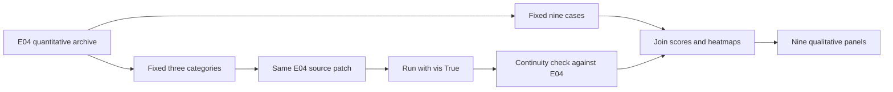

# MuSc E04Q Colab Guide: Qualitative Review of Top-1-Percent Pooling

## Material Passport

- Origin Skill: experiment-agent
- Origin Mode: plan
- Origin Date: 2026-10-17
- Verification Status: UNVERIFIED
- Version Label: code_plan_v1

## 1. Objective

E04Q is the qualitative follow-up to the completed E04 quantitative run. It reruns three preregistered MVTec AD categories with visualization enabled and creates panels for nine cases selected before any E04Q heatmap is viewed.

E04Q asks two questions:

1. Do the normal images helped by top-1-percent pooling contain a small isolated hotspot that can dominate maximum pooling?
2. Why does top-1-percent pooling substantially degrade `screw`, especially after RsCIN?

E04Q does not tune the pooling fraction, change the selected categories, or select cases by visual attractiveness.

## 2. Fixed Scope

### Selected categories

| Category | Role | Quantitative evidence from E04 |
|---|---|---|
| `carpet` | Positive mechanism case | `good/019.png` changes from false positive to true negative in both raw and RsCIN contexts; all three RsCIN metrics improve |
| `transistor` | Mixed case | Seven raw false positives are resolved, but top 1 percent also creates new candidates and slightly reduces RsCIN AUROC |
| `screw` | Strong counterexample | RsCIN AUROC falls by 9.7151 points and top 1 percent creates 19 new RsCIN false-positive candidates |

### Fixed case plan

| Category | Relative test path | Selection reason |
|---|---|---|
| `carpet` | `good/019.png` | `resolved_fp_both` |
| `carpet` | `metal_contamination/013.png` | `large_anomaly_rank_drop` |
| `carpet` | `color/013.png` | `large_anomaly_rank_drop` |
| `transistor` | `good/022.png` | `resolved_fp_raw_largest_drop` |
| `transistor` | `good/001.png` | `new_fp_both` |
| `transistor` | `cut_lead/001.png` | `large_anomaly_rank_drop` |
| `screw` | `good/008.png` | `new_fp_raw_largest_adverse_change` |
| `screw` | `good/003.png` | `new_fp_rscin_largest_adverse_change` |
| `screw` | `scratch_neck/000.png` | `largest_rscin_anomaly_rank_drop` |

The heatmap is the same anomaly map used by both maximum and top-1-percent pooling. RsCIN changes the image-level score using image neighbors; it does not create a different pixel heatmap.



## 3. Expected Outputs

- `whole_norm` heatmaps for every test image in `carpet`, `transistor`, and `screw`.
- E04 score continuity checks for all four score variants.
- Exactly nine selected panels, with three fixed cases per category.
- A table containing maximum and top-1-percent scores before and after RsCIN.
- Original image, ground-truth mask, heatmap, overlay, and panel for each selected case.
- A compact ZIP that excludes the full intermediate heatmap directory.

Expected heatmap counts are 117 for `carpet`, 100 for `transistor`, and 160 for `screw`, for a total of 377.

## 4. Runtime Estimate

The E04 subprocess times for these categories were approximately 8 minutes for `carpet`, 7 minutes for `transistor`, and 13 minutes for `screw`. Allow 35 to 50 minutes for inference and Drive heatmap writes, excluding environment setup and ZIP export.

## 5. Colab Cells

Use a new notebook or append a section named `E04Q - qualitative pooling analysis` to the E04 notebook. E04Q must use its own Run ID.

### Cell E04Q-0 - Mount Drive and create or resume the run

```python
from google.colab import drive
drive.mount("/content/drive", force_remount=False)

from datetime import datetime, timezone
from pathlib import Path
import json
import os

UPSTREAM_COMMIT = "b76b93da8bd3096a99964a96ae29d46f197a0651"
PROJECT_ROOT = Path("/content/drive/MyDrive/CS2203_MuSc")
RUNS_ROOT = PROJECT_ROOT / "runs"
EXPORT_ROOT = PROJECT_ROOT / "exports"
SOURCE_E04_RUN_ID = "20261016_102025_E04_mvtec_top1_pooling"
SOURCE_E04_ROOT = RUNS_ROOT / SOURCE_E04_RUN_ID
ACTIVE_Q_RUN_FILE = PROJECT_ROOT / "active-e04q-run.txt"

CATEGORIES = [
    "bottle", "cable", "capsule", "carpet", "grid",
    "hazelnut", "leather", "metal_nut", "pill", "screw",
    "tile", "toothbrush", "transistor", "wood", "zipper",
]
QUAL_CATEGORIES = ["carpet", "transistor", "screw"]

RUNS_ROOT.mkdir(parents=True, exist_ok=True)
EXPORT_ROOT.mkdir(parents=True, exist_ok=True)

if ACTIVE_Q_RUN_FILE.is_file():
    candidate_id = ACTIVE_Q_RUN_FILE.read_text(encoding="utf-8").strip()
    candidate_root = RUNS_ROOT / candidate_id
    if candidate_root.is_dir() and not (candidate_root / "E04Q_DONE.json").exists():
        RUN_ID = candidate_id
        print("Resume E04Q Run ID:", RUN_ID)
    else:
        ACTIVE_Q_RUN_FILE.unlink()
        RUN_ID = datetime.now().strftime("%Y%m%d_%H%M%S_E04Q_mvtec_pooling_qualitative")
        ACTIVE_Q_RUN_FILE.write_text(RUN_ID + "\n", encoding="utf-8")
        print("Create E04Q Run ID:", RUN_ID)
else:
    RUN_ID = datetime.now().strftime("%Y%m%d_%H%M%S_E04Q_mvtec_pooling_qualitative")
    ACTIVE_Q_RUN_FILE.write_text(RUN_ID + "\n", encoding="utf-8")
    print("Create E04Q Run ID:", RUN_ID)

RUN_ROOT = RUNS_ROOT / RUN_ID
CATEGORY_ROOT = RUN_ROOT / "categories"
SESSION_ID = datetime.now().strftime("%Y%m%d_%H%M%S")
SESSION_ROOT = RUN_ROOT / "sessions" / SESSION_ID

CATEGORY_ROOT.mkdir(parents=True, exist_ok=True)
SESSION_ROOT.mkdir(parents=True, exist_ok=False)

required_source_files = [
    "E04_AGGREGATED.json",
    "e04-source.patch",
    "e04-config.json",
    "e04-category-metrics-long.csv",
    "e04-per-image-scores-all.csv",
]
assert SOURCE_E04_ROOT.is_dir(), f"Missing source E04 run: {SOURCE_E04_ROOT}"
for name in required_source_files:
    assert (SOURCE_E04_ROOT / name).is_file(), f"Missing E04 source artifact: {name}"

(RUN_ROOT / "run-id.txt").write_text(RUN_ID + "\n", encoding="utf-8")
(RUN_ROOT / "source-e04-run-id.txt").write_text(
    SOURCE_E04_RUN_ID + "\n",
    encoding="utf-8",
)

print("E04Q root:", RUN_ROOT)
print("Source E04 root:", SOURCE_E04_ROOT)
```

### Cells E04Q-S1 to E04Q-S4 - Restore the shared runtime

Run these cells from the [E01 Colab guide](2026-10-11-huong-dan-colab-musc-e01.md) in order:

1. E01 Cell 2 to check the GPU and install dependencies.
2. E01 Cell 3 to restore MVTec AD.
3. E01 Cell 4 to clone MuSc at the pinned commit and apply the import compatibility fix.
4. E01 Cell 5 to restore the CLIP weights cache.

Do not run E01 Cell 4M. The archived `e04-source.patch` already contains the CPU-memory patch, and Cell E04Q-1 applies that exact source patch.

The `--ignore-space-change` flag in E04Q-1 is required because the pinned upstream `models/musc.py` uses CRLF line endings while the archived unified diff uses LF. The patch still has to match every non-whitespace source line and all required E04 markers are checked afterward.

### Cell E04Q-1 - Apply the exact E04 source patch

```python
import hashlib
import shutil
import subprocess
import torch

if "DATA_ROOT" not in globals():
    DATA_ROOT = Path("/content/data")
if "REPO_ROOT" not in globals():
    REPO_ROOT = Path("/content/MuSc")

patch_path = SOURCE_E04_ROOT / "e04-source.patch"
musc_path = REPO_ROOT / "models" / "musc.py"

assert torch.cuda.is_available(), "A GPU runtime is required."
assert (REPO_ROOT / "examples" / "musc_main.py").is_file()
assert musc_path.is_file()
assert all((DATA_ROOT / category / "test").is_dir() for category in QUAL_CATEGORIES)

actual_commit = subprocess.run(
    ["git", "rev-parse", "HEAD"],
    cwd=REPO_ROOT,
    text=True,
    stdout=subprocess.PIPE,
    check=True,
).stdout.strip()
assert actual_commit == UPSTREAM_COMMIT

source_text = musc_path.read_text(encoding="utf-8", errors="replace")
if "def top_fraction_mean" not in source_text:
    subprocess.run(
        ["git", "apply", "--check", "--ignore-space-change", str(patch_path)],
        cwd=REPO_ROOT,
        check=True,
    )
    subprocess.run(
        ["git", "apply", "--ignore-space-change", str(patch_path)],
        cwd=REPO_ROOT,
        check=True,
    )
else:
    print("SKIP source patch: E04 markers already exist.")

source_text = musc_path.read_text(encoding="utf-8", errors="replace")
required_markers = [
    "def top_fraction_mean",
    "score_variants = {",
    "e04-per-image-scores.csv",
    "gc.collect()",
]
for marker in required_markers:
    assert marker in source_text, marker

subprocess.run(
    ["python", "-m", "py_compile", str(musc_path)],
    cwd=REPO_ROOT,
    check=True,
)

patch_sha256 = hashlib.sha256(patch_path.read_bytes()).hexdigest()
shutil.copy2(patch_path, RUN_ROOT / "source-e04.patch")
shutil.copy2(patch_path, SESSION_ROOT / "source-e04.patch")
(SESSION_ROOT / "source-patch-sha256.txt").write_text(
    patch_sha256 + "\n",
    encoding="utf-8",
)

print("GPU:", torch.cuda.get_device_name(0))
print("Commit:", actual_commit)
print("E04 source patch SHA-256:", patch_sha256)
print("E04Q source is ready.")
```

### Cell E04Q-2 - Register the configuration and fixed case plan

```python
import pandas as pd

CASE_PLAN = [
    {
        "category": "carpet",
        "relative_test_path": "good/019.png",
        "expected_label": 0,
        "selection_reason": "resolved_fp_both",
    },
    {
        "category": "carpet",
        "relative_test_path": "metal_contamination/013.png",
        "expected_label": 1,
        "selection_reason": "large_anomaly_rank_drop",
    },
    {
        "category": "carpet",
        "relative_test_path": "color/013.png",
        "expected_label": 1,
        "selection_reason": "large_anomaly_rank_drop",
    },
    {
        "category": "transistor",
        "relative_test_path": "good/022.png",
        "expected_label": 0,
        "selection_reason": "resolved_fp_raw_largest_drop",
    },
    {
        "category": "transistor",
        "relative_test_path": "good/001.png",
        "expected_label": 0,
        "selection_reason": "new_fp_both",
    },
    {
        "category": "transistor",
        "relative_test_path": "cut_lead/001.png",
        "expected_label": 1,
        "selection_reason": "large_anomaly_rank_drop",
    },
    {
        "category": "screw",
        "relative_test_path": "good/008.png",
        "expected_label": 0,
        "selection_reason": "new_fp_raw_largest_adverse_change",
    },
    {
        "category": "screw",
        "relative_test_path": "good/003.png",
        "expected_label": 0,
        "selection_reason": "new_fp_rscin_largest_adverse_change",
    },
    {
        "category": "screw",
        "relative_test_path": "scratch_neck/000.png",
        "expected_label": 1,
        "selection_reason": "largest_rscin_anomaly_rank_drop",
    },
]

QUAL_CONFIG = {
    "experiment_id": "E04Q",
    "source_e04_run_id": SOURCE_E04_RUN_ID,
    "categories": QUAL_CATEGORIES,
    "upstream_commit": UPSTREAM_COMMIT,
    "dataset_name": "mvtec_ad",
    "backbone_name": "ViT-L-14-336",
    "pretrained": "openai",
    "feature_layers": [5, 11, 17, 23],
    "img_resize": 518,
    "divide_num": 1,
    "r_list": [1, 3, 5],
    "batch_size": 4,
    "pool_fraction": 0.01,
    "variants": ["max_raw", "max_rscin", "top1_raw", "top1_rscin"],
    "vis": True,
    "vis_type": "whole_norm",
    "selection_frozen_before_heatmap_review": True,
}

config_text = json.dumps(QUAL_CONFIG, indent=2, sort_keys=True) + "\n"
config_path = RUN_ROOT / "e04q-config.json"
if config_path.exists():
    assert config_path.read_text(encoding="utf-8") == config_text
else:
    config_path.write_text(config_text, encoding="utf-8")

case_plan = pd.DataFrame(CASE_PLAN)
assert len(case_plan) == 9
assert case_plan[["category", "relative_test_path"]].drop_duplicates().shape[0] == 9
assert set(case_plan["category"]) == set(QUAL_CATEGORIES)
assert (case_plan.groupby("category").size() == 3).all()
case_plan.to_csv(RUN_ROOT / "fixed-case-plan.csv", index=False)

source_scores = pd.read_csv(SOURCE_E04_ROOT / "e04-per-image-scores-all.csv")
source_metrics_long = pd.read_csv(
    SOURCE_E04_ROOT / "e04-category-metrics-long.csv"
)

def relative_test_path(path):
    parts = Path(path).parts
    test_index = parts.index("test")
    return "/".join(parts[test_index + 1:])

source_scores["relative_test_path"] = source_scores["image_path"].map(
    relative_test_path
)
source_keys = set(
    zip(source_scores["category"], source_scores["relative_test_path"])
)
plan_keys = set(zip(case_plan["category"], case_plan["relative_test_path"]))
assert plan_keys <= source_keys

display(case_plan)
```

### Cell E04Q-3 - Define the category runner with E04 continuity checks

```python
from datetime import datetime, timezone
import numpy as np
import shlex
import shutil
import subprocess
import sys
import time

VARIANTS = QUAL_CONFIG["variants"]
METRICS = ["auroc_sp", "f1_sp", "ap_sp"]

def successful_qual_attempt(category):
    success_files = sorted((CATEGORY_ROOT / category).glob("attempt_*/SUCCESS.json"))
    return success_files[-1].parent if success_files else None

def run_qual_category(category):
    previous = successful_qual_attempt(category)
    if previous is not None:
        metrics = json.loads((previous / "metrics.json").read_text(encoding="utf-8"))
        print(f"SKIP {category}: successful at {previous}")
        return metrics

    category_dir = CATEGORY_ROOT / category
    category_dir.mkdir(parents=True, exist_ok=True)
    attempt_number = len(list(category_dir.glob("attempt_*"))) + 1
    attempt_root = category_dir / f"attempt_{attempt_number:02d}"
    output_root = attempt_root / "output"
    attempt_root.mkdir(parents=True, exist_ok=False)

    command = [
        sys.executable,
        "examples/musc_main.py",
        "--device", "0",
        "--data_path", str(DATA_ROOT),
        "--dataset_name", "mvtec_ad",
        "--class_name", category,
        "--backbone_name", "ViT-L-14-336",
        "--pretrained", "openai",
        "--feature_layers", "5", "11", "17", "23",
        "--img_resize", "518",
        "--divide_num", "1",
        "--r_list", "1", "3", "5",
        "--batch_size", "4",
        "--output_dir", str(output_root),
        "--vis", "True",
        "--vis_type", "whole_norm",
        "--save_excel", "True",
    ]

    (attempt_root / "command.sh").write_text(
        "#!/usr/bin/env bash\nset -euo pipefail\n" + shlex.join(command) + "\n",
        encoding="utf-8",
    )

    started_at = datetime.now(timezone.utc)
    started = time.time()
    log_path = attempt_root / "console.log"
    print(f"START {category}, attempt {attempt_number:02d}")

    with log_path.open("w", encoding="utf-8") as log_file:
        process = subprocess.Popen(
            command,
            cwd=REPO_ROOT,
            text=True,
            stdout=subprocess.PIPE,
            stderr=subprocess.STDOUT,
            bufsize=1,
        )
        for line in process.stdout:
            print(line, end="")
            log_file.write(line)
        return_code = process.wait()

    elapsed_seconds = time.time() - started
    status = {
        "category": category,
        "attempt": attempt_number,
        "started_at_utc": started_at.isoformat(),
        "finished_at_utc": datetime.now(timezone.utc).isoformat(),
        "elapsed_seconds": elapsed_seconds,
        "return_code": return_code,
        "gpu": torch.cuda.get_device_name(0),
    }

    if return_code != 0:
        (attempt_root / "FAILED.json").write_text(
            json.dumps(status, indent=2) + "\n",
            encoding="utf-8",
        )
        raise RuntimeError(f"{category} failed. See {log_path}")

    try:
        result_root = (
            output_root / "mvtec_ad" / "ViT-L-14-336" / "imagesize518"
        )
        result_file = result_root / "results.xlsx"
        rerun_metric_file = result_root / "e04-metrics.json"
        rerun_score_file = result_root / "e04-per-image-scores.csv"
        heatmap_root = result_root / category

        for required in [
            result_file,
            rerun_metric_file,
            rerun_score_file,
        ]:
            assert required.is_file(), f"Missing output: {required}"
        assert heatmap_root.is_dir(), f"Missing heatmap root: {heatmap_root}"

        expected_images = sorted(
            path
            for path in (DATA_ROOT / category / "test").glob("*/*")
            if path.is_file()
        )
        heatmaps = sorted(
            path
            for path in heatmap_root.rglob("*")
            if path.is_file() and path.suffix.lower() in {".png", ".jpg", ".jpeg"}
        )
        assert len(heatmaps) == len(expected_images), (
            f"Heatmap count mismatch: {len(heatmaps)} != {len(expected_images)}"
        )

        rerun_payload = json.loads(rerun_metric_file.read_text(encoding="utf-8"))
        source_category_metrics = source_metrics_long[
            source_metrics_long["category"] == category
        ].set_index("variant")

        metric_deltas = {}
        for variant in VARIANTS:
            metric_deltas[variant] = {}
            for metric in METRICS:
                source_value = float(source_category_metrics.loc[variant, metric])
                rerun_value = float(rerun_payload["variants"][variant][metric])
                metric_deltas[variant][metric] = rerun_value - source_value

        max_metric_delta = max(
            abs(value)
            for variant_deltas in metric_deltas.values()
            for value in variant_deltas.values()
        )
        assert max_metric_delta <= 0.05, (
            f"{category} differs from E04 by {max_metric_delta} percentage points"
        )

        rerun_scores = pd.read_csv(rerun_score_file)
        rerun_scores["relative_test_path"] = rerun_scores["image_path"].map(
            relative_test_path
        )
        source_category_scores = source_scores[
            source_scores["category"] == category
        ].copy()

        rerun_scores = rerun_scores.sort_values("relative_test_path").reset_index(drop=True)
        source_category_scores = source_category_scores.sort_values(
            "relative_test_path"
        ).reset_index(drop=True)

        assert rerun_scores["relative_test_path"].tolist() == (
            source_category_scores["relative_test_path"].tolist()
        )
        assert rerun_scores["label"].astype(int).tolist() == (
            source_category_scores["label"].astype(int).tolist()
        )

        score_deltas = {}
        for variant in VARIANTS:
            delta = np.abs(
                rerun_scores[variant].to_numpy(dtype=float)
                - source_category_scores[variant].to_numpy(dtype=float)
            )
            score_deltas[variant] = float(delta.max())
            assert np.allclose(
                rerun_scores[variant].to_numpy(dtype=float),
                source_category_scores[variant].to_numpy(dtype=float),
                rtol=1e-6,
                atol=1e-7,
            ), f"Per-image continuity failed for {category} {variant}"

        shutil.copy2(result_file, attempt_root / "results.xlsx")
        shutil.copy2(rerun_metric_file, attempt_root / "e04-metrics.json")
        shutil.copy2(rerun_score_file, attempt_root / "e04-per-image-scores.csv")

        metrics = {
            "category": category,
            "elapsed_seconds": elapsed_seconds,
            "heatmap_count": len(heatmaps),
            "max_absolute_metric_delta_from_e04": float(max_metric_delta),
            "max_absolute_per_image_score_delta_from_e04": score_deltas,
            "attempt_root": str(attempt_root),
        }
        (attempt_root / "metrics.json").write_text(
            json.dumps(metrics, indent=2) + "\n",
            encoding="utf-8",
        )
        (attempt_root / "SUCCESS.json").write_text(
            json.dumps(status, indent=2) + "\n",
            encoding="utf-8",
        )
    except Exception as error:
        status["validation_error"] = repr(error)
        (attempt_root / "FAILED.json").write_text(
            json.dumps(status, indent=2) + "\n",
            encoding="utf-8",
        )
        raise

    print(
        f"DONE {category}: {elapsed_seconds / 60:.2f} minutes, "
        f"{len(heatmaps)} heatmaps"
    )
    print("Max metric delta from E04:", max_metric_delta)
    print("Max per-image score deltas:", score_deltas)
    return metrics
```

### Cell E04Q-4 - Inspect progress after an interruption

```python
from collections import deque

progress_rows = []
for category in QUAL_CATEGORIES:
    category_dir = CATEGORY_ROOT / category
    attempts = sorted(category_dir.glob("attempt_*"))
    success = successful_qual_attempt(category)

    if success is not None:
        status = "SUCCESS"
        latest = success
    elif attempts:
        latest = attempts[-1]
        status = "FAILED" if (latest / "FAILED.json").is_file() else "INTERRUPTED"
    else:
        latest = None
        status = "NOT_STARTED"

    progress_rows.append(
        {
            "category": category,
            "status": status,
            "attempts": len(attempts),
            "latest_attempt": str(latest) if latest else "",
        }
    )

progress = pd.DataFrame(progress_rows)
display(progress)

for _, row in progress[progress["status"].isin(["FAILED", "INTERRUPTED"])].iterrows():
    log_path = Path(row["latest_attempt"]) / "console.log"
    if log_path.is_file():
        print(f"\n===== Tail of {row['category']} log =====")
        with log_path.open("r", encoding="utf-8", errors="replace") as stream:
            print("".join(deque(stream, maxlen=12)))
```

### Cell E04Q-5 - Run or resume the three categories

```python
qual_metrics = {}
for index, category in enumerate(QUAL_CATEGORIES, start=1):
    print(f"\n===== [{index}/{len(QUAL_CATEGORIES)}] {category} =====")
    qual_metrics[category] = run_qual_category(category)

print("Completed E04Q inference for all three categories.")
```

If the runtime stops, rerun E04Q-0, restore the shared runtime, and rerun E04Q-1 through E04Q-5. A category with `SUCCESS.json` is skipped. An interrupted category starts a new attempt.

### Cell E04Q-6 - Join fixed cases with scores, masks, and heatmaps

```python
def csv_bool(value):
    if isinstance(value, str):
        assert value in {"True", "False"}, value
        return value == "True"
    return bool(value)

case_records = []

for category in QUAL_CATEGORIES:
    attempt_root = successful_qual_attempt(category)
    assert attempt_root is not None

    rerun_scores = pd.read_csv(attempt_root / "e04-per-image-scores.csv")
    rerun_scores["relative_test_path"] = rerun_scores["image_path"].map(
        relative_test_path
    )

    source_category = source_scores[source_scores["category"] == category].copy()
    source_columns = [
        "category",
        "relative_test_path",
        "label",
        "max_raw",
        "max_rscin",
        "top1_raw",
        "top1_rscin",
        "max_raw_rank_pct",
        "max_rscin_rank_pct",
        "top1_raw_rank_pct",
        "top1_rscin_rank_pct",
        "pred_max_raw",
        "pred_max_rscin",
        "pred_top1_raw",
        "pred_top1_rscin",
    ]
    source_category = source_category[source_columns]

    merged = rerun_scores.merge(
        source_category,
        on=["relative_test_path", "label"],
        suffixes=("_rerun", "_e04"),
        validate="one_to_one",
    )

    attempt_result_root = (
        attempt_root / "output" / "mvtec_ad" / "ViT-L-14-336" / "imagesize518"
    )

    for plan_row in CASE_PLAN:
        if plan_row["category"] != category:
            continue

        match = merged[
            merged["relative_test_path"] == plan_row["relative_test_path"]
        ]
        assert len(match) == 1, plan_row
        row = match.iloc[0]
        assert int(row["label"]) == plan_row["expected_label"]

        anomaly_type, image_name = plan_row["relative_test_path"].split("/", 1)
        image_path = DATA_ROOT / category / "test" / anomaly_type / image_name
        heatmap_path = attempt_result_root / category / anomaly_type / image_name
        assert image_path.is_file(), image_path
        assert heatmap_path.is_file(), heatmap_path

        mask_path = ""
        if int(row["label"]) == 1:
            mask_candidates = sorted(
                (DATA_ROOT / category / "ground_truth" / anomaly_type).glob(
                    f"{Path(image_name).stem}*"
                )
            )
            assert len(mask_candidates) == 1, mask_candidates
            mask_path = str(mask_candidates[0])

        case_records.append(
            {
                "category": category,
                "relative_test_path": plan_row["relative_test_path"],
                "selection_reason": plan_row["selection_reason"],
                "label": int(row["label"]),
                "image_path": str(image_path),
                "mask_path": mask_path,
                "heatmap_path": str(heatmap_path),
                "max_raw": float(row["max_raw_e04"]),
                "top1_raw": float(row["top1_raw_e04"]),
                "max_rscin": float(row["max_rscin_e04"]),
                "top1_rscin": float(row["top1_rscin_e04"]),
                "rank_drop_raw": float(row["max_raw_rank_pct"] - row["top1_raw_rank_pct"]),
                "rank_drop_rscin": float(
                    row["max_rscin_rank_pct"] - row["top1_rscin_rank_pct"]
                ),
                "pred_max_raw": csv_bool(row["pred_max_raw"]),
                "pred_top1_raw": csv_bool(row["pred_top1_raw"]),
                "pred_max_rscin": csv_bool(row["pred_max_rscin"]),
                "pred_top1_rscin": csv_bool(row["pred_top1_rscin"]),
            }
        )

selected = pd.DataFrame(case_records)
assert len(selected) == 9
assert selected[["category", "relative_test_path"]].drop_duplicates().shape[0] == 9
assert (selected.groupby("category").size() == 3).all()
selected.to_csv(RUN_ROOT / "selected-qualitative-cases.csv", index=False)

display(
    selected[
        [
            "category",
            "relative_test_path",
            "selection_reason",
            "label",
            "rank_drop_raw",
            "rank_drop_rscin",
            "pred_max_raw",
            "pred_top1_raw",
            "pred_max_rscin",
            "pred_top1_rscin",
        ]
    ]
)
```

### Cell E04Q-7 - Create report assets and panels

```python
import cv2
import matplotlib.pyplot as plt
import numpy as np
from PIL import Image
from torchvision.transforms import InterpolationMode
from torchvision.transforms import functional as TF

ASSET_ROOT = RUN_ROOT / "selected-assets"
ASSET_ROOT.mkdir(parents=True, exist_ok=True)

def prepare_original(path):
    image = Image.open(path).convert("RGB")
    image = TF.resize(
        image,
        518,
        interpolation=InterpolationMode.BICUBIC,
        antialias=True,
    )
    image = TF.center_crop(image, [518, 518])
    return np.asarray(image)

asset_records = []
for _, row in selected.iterrows():
    anomaly_type, image_name = row["relative_test_path"].split("/", 1)
    key = f"{row['category']}__{anomaly_type}__{Path(image_name).stem}"
    case_root = ASSET_ROOT / key
    case_root.mkdir(parents=True, exist_ok=True)

    original = prepare_original(row["image_path"])
    heatmap_bgr = cv2.imread(row["heatmap_path"], cv2.IMREAD_COLOR)
    assert heatmap_bgr is not None, row["heatmap_path"]
    heatmap_rgb = cv2.cvtColor(heatmap_bgr, cv2.COLOR_BGR2RGB)
    if heatmap_rgb.shape[:2] != original.shape[:2]:
        heatmap_rgb = cv2.resize(
            heatmap_rgb,
            (original.shape[1], original.shape[0]),
            interpolation=cv2.INTER_LINEAR,
        )

    if row["mask_path"]:
        mask = cv2.imread(row["mask_path"], cv2.IMREAD_GRAYSCALE)
        assert mask is not None, row["mask_path"]
        mask = cv2.resize(
            mask,
            (original.shape[1], original.shape[0]),
            interpolation=cv2.INTER_NEAREST,
        )
    else:
        mask = np.zeros(original.shape[:2], dtype=np.uint8)

    overlay = cv2.addWeighted(original, 0.55, heatmap_rgb, 0.45, 0)
    contours, _ = cv2.findContours(
        (mask > 0).astype(np.uint8),
        cv2.RETR_EXTERNAL,
        cv2.CHAIN_APPROX_SIMPLE,
    )
    cv2.drawContours(overlay, contours, -1, (255, 255, 255), 2)

    Image.fromarray(original).save(case_root / "original.png")
    Image.fromarray(mask).save(case_root / "ground_truth.png")
    Image.fromarray(heatmap_rgb).save(case_root / "heatmap.png")
    Image.fromarray(overlay).save(case_root / "overlay.png")

    fig, axes = plt.subplots(1, 4, figsize=(16, 4.8))
    axes[0].imshow(original)
    axes[0].set_title("Original")
    axes[1].imshow(mask, cmap="gray", vmin=0, vmax=255)
    axes[1].set_title("Ground truth")
    axes[2].imshow(heatmap_rgb)
    axes[2].set_title("MuSc anomaly map")
    axes[3].imshow(overlay)
    axes[3].set_title("Overlay + GT contour")
    for axis in axes:
        axis.axis("off")

    fig.suptitle(
        f"{row['category']} | {row['relative_test_path']} | {row['selection_reason']}\n"
        f"raw: max={row['max_raw']:.4f}, top1={row['top1_raw']:.4f}, "
        f"rank drop={row['rank_drop_raw']:+.4f} | "
        f"RsCIN: max={row['max_rscin']:.4f}, top1={row['top1_rscin']:.4f}, "
        f"rank drop={row['rank_drop_rscin']:+.4f}",
        fontsize=10,
    )
    fig.tight_layout(rect=[0, 0, 1, 0.86])
    panel_path = case_root / "panel.png"
    fig.savefig(panel_path, dpi=180, bbox_inches="tight")
    plt.close(fig)

    asset_records.append(
        {
            **row.to_dict(),
            "asset_root": str(case_root),
            "panel_path": str(panel_path),
        }
    )

asset_index = pd.DataFrame(asset_records)
assert len(asset_index) == 9
assert asset_index["panel_path"].map(lambda path: Path(path).is_file()).all()
asset_index.to_csv(RUN_ROOT / "selected-assets-index.csv", index=False)

print("Created", len(asset_index), "panels at", ASSET_ROOT)
```

### Cell E04Q-8 - Review all panels

```python
from IPython.display import display

for category in QUAL_CATEGORIES:
    print(f"\n===== {category} =====")
    rows = asset_index[asset_index["category"] == category]
    for _, row in rows.iterrows():
        print(
            row["selection_reason"],
            row["relative_test_path"],
            f"raw rank drop={row['rank_drop_raw']:+.4f}",
            f"RsCIN rank drop={row['rank_drop_rscin']:+.4f}",
        )
        display(Image.open(row["panel_path"]))
```

For each panel, record only visible evidence:

- Whether a normal image contains one small isolated hotspot or a broad response.
- Whether the hotspot is on the object, boundary, reflection, texture, or background.
- Whether an anomaly signal is spatially compact or distributed across many pixels.
- Whether top-1-percent pooling suppresses a nuisance peak while preserving the anomalous region.
- Whether `screw` contains diffuse moderate responses that top-1-percent pooling preserves or amplifies in rank relative to maximum pooling.

Do not call the mechanism confirmed merely because a candidate changes its predicted label. The spatial pattern must agree with the mechanism.

### Cell E04Q-9 - Final checks and compact ZIP

```python
import zipfile

successful_attempts = {
    category: successful_qual_attempt(category)
    for category in QUAL_CATEGORIES
}
assert all(path is not None for path in successful_attempts.values())
assert len(asset_index) == 9
assert (asset_index.groupby("category").size() == 3).all()

metrics_records = [
    json.loads((attempt / "metrics.json").read_text(encoding="utf-8"))
    for attempt in successful_attempts.values()
]
assert sum(record["heatmap_count"] for record in metrics_records) == 377

max_metric_delta = max(
    record["max_absolute_metric_delta_from_e04"]
    for record in metrics_records
)
max_score_delta = max(
    value
    for record in metrics_records
    for value in record["max_absolute_per_image_score_delta_from_e04"].values()
)
assert max_metric_delta <= 0.05

summary_lines = [
    "# E04Q MVTec AD Pooling Qualitative Summary",
    "",
    f"- Run ID: `{RUN_ID}`",
    f"- Source E04 Run ID: `{SOURCE_E04_RUN_ID}`",
    f"- Categories: {', '.join(QUAL_CATEGORIES)}",
    f"- Heatmaps: {sum(record['heatmap_count'] for record in metrics_records)}",
    f"- Selected cases: {len(asset_index)}",
    f"- Maximum metric delta from E04: {max_metric_delta:.12g} percentage points",
    f"- Maximum per-image score delta from E04: {max_score_delta:.12g}",
    "",
    "## Review Status",
    "",
    "The panels are generated. Human qualitative interpretation remains pending until every panel is reviewed.",
]
(RUN_ROOT / "E04Q_SUMMARY.md").write_text(
    "\n".join(summary_lines) + "\n",
    encoding="utf-8",
)

done = {
    "run_id": RUN_ID,
    "source_e04_run_id": SOURCE_E04_RUN_ID,
    "completed_at_utc": datetime.now(timezone.utc).isoformat(),
    "categories": QUAL_CATEGORIES,
    "heatmap_count": int(sum(record["heatmap_count"] for record in metrics_records)),
    "selected_case_count": int(len(asset_index)),
    "max_absolute_metric_delta_from_e04": float(max_metric_delta),
    "max_absolute_per_image_score_delta_from_e04": float(max_score_delta),
    "status": "panels_generated_review_pending",
}
(RUN_ROOT / "E04Q_DONE.json").write_text(
    json.dumps(done, indent=2) + "\n",
    encoding="utf-8",
)

if (
    ACTIVE_Q_RUN_FILE.is_file()
    and ACTIVE_Q_RUN_FILE.read_text(encoding="utf-8").strip() == RUN_ID
):
    ACTIVE_Q_RUN_FILE.unlink()

zip_path = EXPORT_ROOT / f"{RUN_ID}.zip"
with zipfile.ZipFile(zip_path, "w", compression=zipfile.ZIP_DEFLATED) as archive:
    for path in RUN_ROOT.rglob("*"):
        if not path.is_file():
            continue
        relative = path.relative_to(RUN_ROOT)
        if "output" in relative.parts:
            continue
        archive.write(path, arcname=str(relative))

with zipfile.ZipFile(zip_path) as archive:
    bad_member = archive.testzip()
    assert bad_member is None, f"Damaged ZIP member: {bad_member}"
    names = archive.namelist()
    assert "E04Q_DONE.json" in names
    assert "selected-qualitative-cases.csv" in names
    assert "selected-assets-index.csv" in names
    assert len([name for name in names if name.endswith("/panel.png")]) == 9
    assert not any("/output/" in f"/{name}" for name in names)

print("E04Q panel generation is complete.")
print("ZIP:", zip_path)
print("ZIP size, MiB:", zip_path.stat().st_size / 2**20)
```

Download the ZIP from `MyDrive/CS2203_MuSc/exports/` and send it for panel review. Keep the full E04Q run directory on Drive because it contains all 377 intermediate heatmaps.

## 6. Recovery After a Colab Disconnect

1. Run E04Q-0 and verify that it resumes the same Run ID.
2. Restore E01 Cells 2, 3, 4, and 5. Do not run E01 Cell 4M.
3. Run E04Q-1 to apply the archived E04 source patch.
4. Run E04Q-2 and E04Q-3 to restore variables and functions.
5. Run E04Q-4 to inspect the interrupted attempt and its log.
6. Run E04Q-5 only after the failure or interruption is understood.

Successful categories are skipped. An interrupted category creates a new attempt and reruns from the beginning.

## 7. Acceptance Criteria

- [ ] The exact archived E04 source patch is applied to the pinned MuSc commit.
- [ ] `carpet`, `transistor`, and `screw` each have one successful attempt.
- [ ] There are exactly 377 heatmaps.
- [ ] All four score variants preserve per-image continuity with E04 within the documented tolerance.
- [ ] Every rerun image metric differs from E04 by no more than 0.05 percentage points.
- [ ] The nine fixed cases are used without substitution after heatmap review.
- [ ] Every case has an original image, ground-truth mask, heatmap, overlay, and panel.
- [ ] The review describes both evidence supporting isolated-hotspot suppression and evidence against it.
- [ ] No segmentation improvement is claimed because the anomaly map is unchanged.
- [ ] The compact ZIP passes `testzip()` and excludes the full `output` directories.

## 8. Artifact to Send

Send:

```text
/Users/duykhanh/Downloads/<E04Q_RUN_ID>.zip
```

The quantitative E04 archive remains immutable. E04Q is a separate run and must not overwrite any file under `20261016_102025_E04_mvtec_top1_pooling`.
