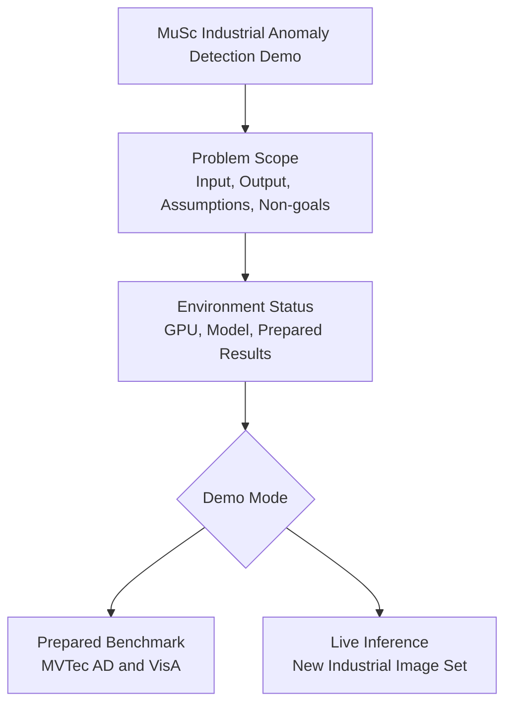
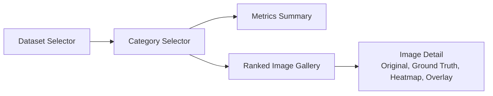
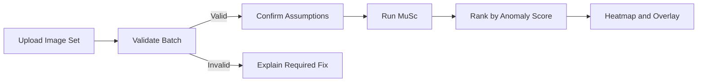
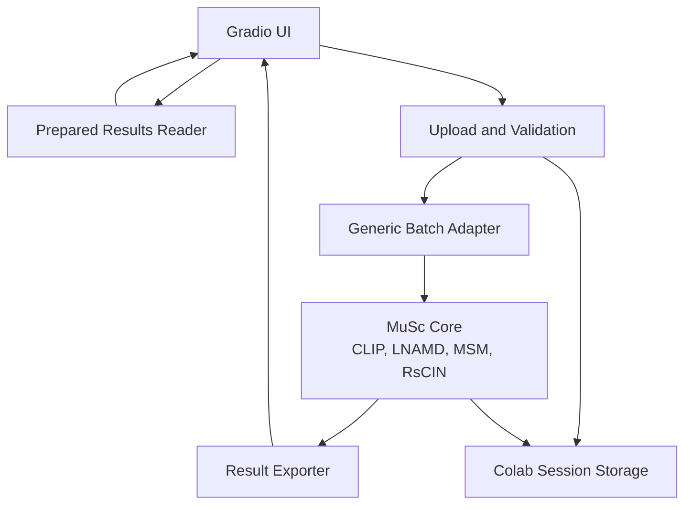

# MuSc Classroom Demo App Design

**Date:** 2026-10-18
**Status:** Approved design
**Implementation target:** `DiiKhanh/cs2203-musc-reproduction`
**Runtime target:** Google Colab with a Tesla T4 GPU
**UI framework:** Gradio with a temporary share link

## 1. Purpose

Build a classroom demo that explains and demonstrates MuSc without presenting it as a general-purpose defect detector. The app must make the research problem, input, output, assumptions, and non-goals visible before the instructor interacts with the model.

The demo has two complementary modes:

1. **Prepared Benchmark** provides immediate, reproducible results from completed MVTec AD and VisA experiments.
2. **Live Inference** runs MuSc on a newly uploaded, unlabeled image set from one industrial product category.

Prepared results protect the presentation from GPU or network failures. Live inference demonstrates that the pipeline can process a new category without training on that category.

## 2. Problem Statement

MuSc performs training-free, transductive industrial anomaly detection and localization. It compares images within the provided set, so the input is a set of images rather than one independent image.

### Input

- One unlabeled set of JPEG or PNG images.
- All images represent the same industrial product category.
- Images come from a reasonably consistent visual inspection setting.
- Recommended batch size: 40 to 200 images.

The same category means the same product type. The set may contain normal samples and multiple unknown defect types.

### Output

- A relative image-level anomaly score for every image.
- A pixel-level anomaly heatmap.
- An overlay showing suspected anomalous regions.
- A gallery ranked from most suspicious to least suspicious.

For custom uploads, the app does not output a scientifically calibrated normal/defect label and does not report benchmark metrics without ground truth.

### Non-goals

- Processing one isolated image.
- Processing a batch that mixes product categories.
- Verifying automatically that all images belong to one category.
- Verifying automatically that the images come from an industrial domain.
- Claiming validated performance on medical or dental images.
- Providing a clinical diagnosis.
- Reporting AUROC, AP, F1, or AUPRO for an unlabeled upload.
- Presenting the demo as a production-ready inspection system.

## 3. Scientific Guardrails

- MuSc is transductive. The score of one image may change when the other images in the batch change.
- A custom batch does not have a calibrated deployment threshold.
- The UI uses the terms **relative anomaly score** and **suspected anomalous region**.
- The app does not invent ground truth or convert rankings into definitive labels.
- Medical or dental images may technically pass through the network, but the industrial benchmark evidence does not validate those domains. They remain out of scope.
- The app asks the user to attest that the batch contains one industrial product category. This is an explicit assumption, not an automated model capability.

## 4. Batch Contract

| Condition | App behavior |
|---|---|
| Fewer than 5 valid images | Block inference because MuSc reference selection is not technically reliable in this range |
| 5 to 39 valid images | Allow an experimental run with a prominent stability warning |
| 40 to 200 valid images | Treat as the recommended range |
| More than 200 valid images | Block inference and request a smaller batch to control runtime and GPU memory |
| Corrupt or unsupported files | Identify the files and exclude them from the valid count |
| Exact duplicate images | Keep the first file, exclude later byte-identical copies from inference and the valid count, and identify every excluded filename |

Supported upload paths:

- Multiple JPEG or PNG files.
- One ZIP archive containing JPEG or PNG files, including files in nested folders.

Before the run button is enabled, the user must confirm:

> I confirm that the image set represents one industrial product category captured under a reasonably consistent visual inspection setting.

## 5. Information Architecture

The app uses one page with a persistent scope card and two tabs.

The interface copy is primarily Vietnamese. Standard terms such as `category`, `anomaly score`, `heatmap`, `ground truth`, and `live inference` remain in English.

### Persistent header and scope card

The top of the app always shows:

- The task definition.
- The input contract.
- The output contract.
- Unsupported uses.
- The transductive scoring warning.
- GPU availability.
- Model initialization state.
- Prepared-results availability.
- A model initialization control.

## 6. Prepared Benchmark Mode

This mode reads immutable experiment artifacts. It does not rerun inference.

### Controls

- Dataset selector: MVTec AD or VisA.
- Category selector: only categories with locally available artifacts.
- Experiment/run selector: metrics, scores, and visualizations must retain their original experiment identity.
- Example selector: ranked gallery plus curated success and failure cases.

### Content

- Dataset and category description.
- Counts of normal and anomalous images when recorded in the artifact manifest.
- Defect types and ground-truth mask availability.
- Only metrics that were actually computed in the corresponding experiment.
- Original image, ground truth, predicted heatmap, and overlay.
- A visible `Prepared result - not live inference` label.

The app must never substitute paper-reported numbers for missing reproduced results.
It must also never present metrics from one experiment beside visualizations from another experiment as though they came from the same run. Any intentionally linked cross-run comparison must show both run identifiers and the reason the artifacts are comparable.

## 7. Live Inference Mode

### Upload and validation

The app previews the batch and reports:

- Valid image count.
- File formats and image dimensions.
- Corrupt or unreadable files.
- Exact duplicate files.
- Batch-size status.
- The required same-category and industrial-context attestation.

### Inference progress

The UI reports real pipeline stages:

1. Image normalization.
2. CLIP feature extraction.
3. LNAMD.
4. MSM.
5. RsCIN.
6. Heatmap and overlay generation.

Only one GPU inference job may run at a time. The UI warns that a live run on a T4 can take several minutes.

### Results

- Gallery ranked by the RsCIN-adjusted anomaly score.
- Raw anomaly score before RsCIN.
- RsCIN-adjusted anomaly score.
- Original image, heatmap, and overlay.
- Downloadable CSV containing filenames and scores.
- Downloadable ZIP containing the CSV and generated visualizations.

Live heatmaps use one batch-wide min-max normalization so color intensity remains comparable across images in the same run. The export records this normalization policy. If every anomaly-map value in the batch is equal, the rendered heatmaps are zero-valued and the UI reports that the batch has no score contrast.

If all raw image-level scores are equal, RsCIN normalization is undefined. In that case, the app preserves the raw scores as the adjusted scores and displays a warning instead of emitting `NaN` values.

For an uploaded batch, the app does not display ground truth, benchmark metrics, or definitive normal/defect labels.

## 8. Technical Architecture

### Proposed modules

- `app.py`: Gradio layout, user-visible state, and event wiring.
- `inference.py`: unlabeled-batch MuSc inference, separated from benchmark metrics.
- `dataset_adapter.py`: generic image-set loading independent of benchmark directory layouts.
- `validation.py`: file, image, duplicate, and batch-contract checks.
- `visualization.py`: heatmap normalization and overlay rendering.
- `prepared_results.py`: manifest-driven loading of completed experiment artifacts.
- `export.py`: CSV and ZIP export.

### Integration principles

- Preserve the MuSc algorithm and reuse its CLIP, LNAMD, MSM, and RsCIN implementation.
- Pin the official MuSc source at commit `b76b93da8bd3096a99964a96ae29d46f197a0651` unless a documented compatibility patch is required.
- Decouple inference from benchmark loaders, masks, labels, and metric computation.
- Load the model once per Colab session and reuse the GPU-resident model.
- Use an isolated temporary directory for each live run.
- Remove temporary live-upload data when the Colab session ends.
- Keep prepared artifacts independent from the live-inference path.

For a custom category, the default RsCIN neighbor configuration must be disclosed in the implementation and recorded in exports. The UI shows both raw and adjusted scores so the adjustment remains observable.

## 9. Prepared Artifact Contract

Prepared results use a small manifest rather than hard-coded UI entries. Each run records:

- Dataset and category.
- Experiment ID and timestamp.
- Source commit and configuration.
- Environment summary.
- Available metrics.
- Image-level score table.
- Paths to original images, ground-truth masks, heatmaps, and overlays when distributable.
- Curated success and failure example identifiers.

The manifest groups every metric, score table, and visual asset under one experiment/run identifier. Cross-run references are explicit links rather than implicit file reuse.

If licensing prevents bundling original benchmark images, the manifest may reference a mounted Google Drive directory, while derived results remain separate. Missing optional assets must degrade gracefully.

## 10. Error Handling

| Failure | User-visible behavior |
|---|---|
| GPU unavailable | Disable live inference and keep Prepared Benchmark available |
| Model not initialized | Require initialization before enabling inference |
| Invalid ZIP or no valid images | Explain the accepted archive and image formats |
| Batch outside supported size | Explain the applicable minimum, warning range, or maximum |
| Corrupt files | List filenames and request correction |
| CUDA out of memory | Clear the failed run state and recommend a smaller batch |
| Pipeline-stage failure | Show the failed stage and a concise recovery action; retain technical logs in Colab |
| Gradio or Colab reconnect | Allow the app to restart with Prepared Benchmark as the fallback |

Raw notebook tracebacks must not be displayed in the main app interface.

## 11. Presentation Flow

1. Start Colab and initialize the model before class.
2. Use the persistent scope card to state the problem, input, output, and limitations.
3. Open one prepared benchmark category.
4. Show a reproduced metric table, a successful example, and a failure case.
5. Switch to Live Inference.
6. Upload a prevalidated industrial batch.
7. Explain CLIP, LNAMD, MSM, and RsCIN while inference runs.
8. Inspect the ranked gallery, heatmap, and overlay.
9. Accept an instructor-provided category only when it satisfies the displayed input contract.
10. Use Prepared Benchmark if GPU, network, or live inference fails.

## 12. Acceptance Criteria

- The app launches from a fresh Colab runtime using documented commands.
- It accepts multiple JPEG/PNG files and one ZIP archive.
- It blocks batches with fewer than 5 or more than 200 valid images.
- It warns for batches containing 5 to 39 valid images.
- It requires the input-contract attestation before live inference.
- It loads the model once per Colab session.
- Prepared results work without live inference.
- Live inference produces scores, heatmaps, and overlays for all valid images.
- The gallery order matches the exported adjusted scores.
- The CSV and ZIP downloads match the displayed run.
- Custom uploads never display unsupported metrics or definitive class labels.
- Prepared mode remains usable when GPU initialization or inference fails.
- The layout is readable on a laptop and projector without clipped controls or images.

## 13. End-to-End Test Scenarios

1. Open a prepared MVTec AD category and inspect its metrics and visualizations.
2. Run a valid 40-image live batch.
3. Run a 5-image experimental batch and verify the warning.
4. Upload one image and verify that inference is blocked.
5. Upload a batch containing a corrupt file, an unsupported file, and an exact duplicate.
6. Launch without a GPU and verify Prepared Benchmark fallback behavior.
7. Download the CSV and ZIP, then compare their contents with the UI.
8. Project the app at presentation resolution and visually inspect every state.

## 14. Success Definition

The app succeeds when it demonstrates the reproduced method faithfully, accepts a defensible new industrial-category input, communicates uncertainty and scope before interaction, and remains presentable when live infrastructure fails. Real-time inference and cross-domain generalization are not success criteria.
