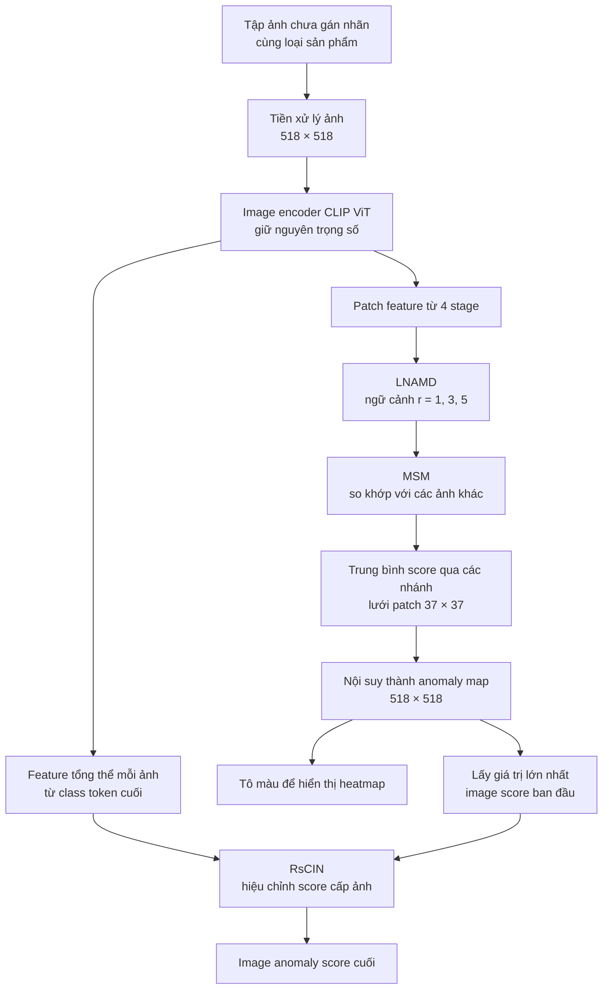

# MuSc từ đầu: tài liệu nhập môn để hiểu và thuyết trình CS2203

Tài liệu giải thích các khái niệm phía sau [outline](2026-10-18-musc-presentation-outline-vi.md) và [bộ slide MuSc](2026-10-17-musc-reproduction-slides-vi.pdf), ưu tiên trực giác trước công thức. Phần đối chiếu chi tiết từng slide nằm trong [ghi chú ôn 17 slide](2026-11-02-musc-presentation-study-notes-vi.md).

**Ý tưởng cần nắm trước:** MuSc cho nhiều ảnh sản phẩm cùng loại tham chiếu lẫn nhau. Vùng bình thường thường tìm được vùng tương tự ở nhiều ảnh khác; vùng khó tìm đối sánh được chấm là đáng nghi. MuSc dùng đặc trưng của mô hình đã học sẵn để thực hiện việc so sánh này.

Ví dụ xuyên suốt là kiểm tra bề mặt da: có ảnh da bình thường, có ảnh dính một vết keo. Các vector, khoảng cách và score nhỏ trong ví dụ dưới đây đều là **số minh họa tự đặt**, không phải kết quả thực nghiệm.

## Mục lục

1. [MuSc giải quyết bài toán gì?](#1-musc-giải-quyết-bài-toán-gì)
2. [Đầu vào và đầu ra thực sự là gì?](#2-đầu-vào-và-đầu-ra-thực-sự-là-gì)
3. [Pixel, patch, token khác nhau thế nào?](#3-pixel-patch-token-khác-nhau-thế-nào)
4. [Vector, feature và embedding là gì?](#4-vector-feature-và-embedding-là-gì)
5. [CLIP là gì?](#5-clip-là-gì)
6. [ViT, backbone, encoder và layer là gì?](#6-vit-backbone-encoder-và-layer-là-gì)
7. [Pipeline MuSc từ đầu đến cuối](#7-pipeline-musc-từ-đầu-đến-cuối)
8. [LNAMD: nhìn một vùng cùng hàng xóm](#8-lnamd-nhìn-một-vùng-cùng-hàng-xóm)
9. [MSM: chấm điểm bằng đối sánh liên ảnh](#9-msm-chấm-điểm-bằng-đối-sánh-liên-ảnh)
10. [Từ patch score đến heatmap và image score](#10-từ-patch-score-đến-heatmap-và-image-score)
11. [RsCIN: hiệu chỉnh điểm cấp ảnh](#11-rscin-hiệu-chỉnh-điểm-cấp-ảnh)
12. [Zero-shot, training-free và transductive](#12-zero-shot-training-free-và-transductive)
13. [Dataset, batch và ground truth](#13-dataset-batch-và-ground-truth)
14. [Đọc các metric trên slide](#14-đọc-các-metric-trên-slide)
15. [Phần nào thuộc paper, phần nào thuộc đồ án?](#15-phần-nào-thuộc-paper-phần-nào-thuộc-đồ-án)
16. [Nối kiến thức với slide và luyện trả lời](#16-nối-kiến-thức-với-slide-và-luyện-trả-lời)

## 1. MuSc giải quyết bài toán gì?

Trong kiểm định sản phẩm, **normal** là trạng thái bình thường; **anomaly** là bất thường cần phát hiện, chẳng hạn vết keo trên da, vết xước trên chai hoặc thiếu chân linh kiện. Loại lỗi thực tế còn phụ thuộc tiêu chuẩn kiểm định.

Một bài toán phân loại thông thường có thể học từ nhiều ảnh đã được ghi rõ “bình thường”, “xước”, “dính keo”. Khó khăn là lỗi mới có thể chưa từng xuất hiện; thu thập đủ ảnh của mọi kiểu lỗi rất khó.

MuSc khai thác một quan sát khác: nhiều bề mặt da có kết cấu tương tự nhau. Nếu một vùng da có vết keo khác thường, vùng đó có thể khó tìm được đối sánh trong các ảnh còn lại.

| Câu hỏi | Tên trong bài | Đầu ra trực tiếp |
|---|---|---|
| Cả ảnh đáng nghi đến mức nào? | Anomaly classification, cấp ảnh | Một anomaly score |
| Vị trí nào đáng nghi? | Anomaly segmentation, cấp pixel | Một anomaly map |

Trong bài này, classification không có nghĩa nhận diện tên lỗi “keo” hay “xước”. MuSc gốc tạo điểm bất thường, không tự sinh lời giải thích bằng ngôn ngữ hay phân loại kiểu lỗi.

## 2. Đầu vào và đầu ra thực sự là gì?

### 2.1. Đầu vào của phương pháp

Đầu vào là **một tập nhiều ảnh test chưa gán nhãn thuộc cùng một loại sản phẩm**. Ví dụ: một tập ảnh `leather`, gồm cả ảnh bình thường và ảnh lỗi nhưng MuSc không được biết trước ảnh nào thuộc nhóm nào. Đây là protocol của bài và outline. [Nguồn MuSc](https://arxiv.org/html/2401.16753v1).

- `leather`, `bottle`, `pcb4` là **product category**.
- `normal/anomaly` là trạng thái cần đánh giá.
- `glue`, `scratch` là ví dụ tên kiểu lỗi trong dữ liệu.

Ba loại thông tin này không đồng nghĩa với nhau. Xử lý riêng category `leather` không có nghĩa thuật toán đã được cung cấp nhãn lỗi của từng ảnh.

**Không đưa vào để tính score:** đáp án normal/anomaly, mask vùng lỗi hoặc text prompt như “a damaged leather surface”. Chúng không phải điều kiện đầu vào của MuSc gốc.

**Vì sao cần nhiều ảnh?** MuSc cần các ảnh khác làm nguồn đối sánh. Một ảnh đứng riêng không đủ cho cơ chế mutual scoring gốc. Trộn chai, da và PCB vào cùng tập cũng làm thay đổi protocol và nguồn tham chiếu.

### 2.2. Đầu vào của riêng CLIP

Trước khi đi qua encoder, ảnh được resize và chuẩn hóa. Cấu hình đồ án dùng ảnh RGB kích thước **518 × 518**. Ở mức dữ liệu máy tính, một ảnh có thể được lưu thành tensor hình dạng `3 × 518 × 518`: ba kênh màu, chiều cao và chiều rộng.

**Tensor** là mảng số có nhiều chiều. Một nhóm `B` ảnh đưa qua encoder thường có hình dạng `B × 3 × 518 × 518`. Không cần hiểu phép toán tensor nâng cao để nắm ý tưởng: máy nhận các số mô tả ảnh, không nhận một “tấm hình” theo cách con người nhìn.

### 2.3. Đầu ra cho mỗi ảnh

- **Anomaly map:** lưới số thể hiện mức đáng nghi tại từng vị trí.
- **Image anomaly score:** một số tổng hợp cho toàn ảnh.

Để biến score thành quyết định “lỗi/không lỗi”, cần thêm **threshold**, tức ngưỡng quyết định. Ví dụ minh họa: nếu ngưỡng là 0,6 thì score 0,8 bị xếp vào phía lỗi.

Score 0,8 **không tự có nghĩa xác suất lỗi 80%**. Nó là điểm do phương pháp tính, chưa phải xác suất đã được hiệu chuẩn.

## 3. Pixel, patch, token khác nhau thế nào?

### 3.1. Pixel: một điểm ảnh

Ảnh kỹ thuật số là một lưới pixel. Mỗi pixel RGB có ba giá trị biểu diễn màu đỏ, xanh lá và xanh dương. Một pixel riêng lẻ thường không đủ để nói đó là “vết keo”; cần nhìn cấu trúc của một vùng.

### 3.2. Patch: một ô nhỏ lấy từ ảnh

**Patch** là một vùng ảnh nhỏ. Có thể hình dung ảnh được phủ bởi các ô vuông, mỗi ô là một patch. Patch không phải một vật thể hoàn chỉnh: một ô có thể chứa nền da, rìa vết keo hoặc cả hai.

Với backbone `ViT-L/14`, cạnh patch đầu vào là **14 pixel**. Trong cấu hình 518 × 518:

$$
518/14=37,\qquad 37\times37=1369.
$$

Mỗi ảnh vì vậy có **1.369 patch**, xếp trên lưới 37 × 37. Số lượng này thuộc cấu hình đang dùng, không phải hằng số của mọi ViT.

### 3.3. Token: biểu diễn để transformer xử lý

ViT biến nội dung mỗi patch thành một vector số, bổ sung thông tin vị trí rồi xử lý bằng transformer. Vector gắn với vị trí patch được gọi là **patch token**.

Phân biệt ba thứ:

| Khái niệm | Bản chất | Ví dụ dễ nhớ |
|---|---|---|
| Patch | Vùng pixel của ảnh | Một ô vuông trên bề mặt da |
| Patch embedding/token | Vector biểu diễn vùng đó | Dãy số encoder dùng để xử lý ô |
| Patch anomaly score | Một số đánh giá độ đáng nghi | Điểm sau bước so khớp MSM |

**Token không phải tên gọi khác của score.** Một vector biểu diễn có nhiều số; score bất thường là một số được tính từ việc so sánh các biểu diễn.

Sau các transformer block, patch token đã kết hợp ngữ cảnh từ các vị trí khác. Vì vậy, dù còn gắn với một ô trên lưới, nó không chỉ chứa thông tin của đúng 14 × 14 pixel ban đầu. Đây là điểm cần nhớ khi giải thích localization. Nền tảng chia ảnh thành patch được trình bày trong [bài ViT](https://research.google/pubs/an-image-is-worth-16x16-words-transformers-for-image-recognition-at-scale/).

## 4. Vector, feature và embedding là gì?

### 4.1. Vector: một dãy số

Ví dụ `[0,2; -0,4; 0,9]` là vector ba chiều. “Chiều” ở đây là số phần tử, không phải chiều rộng hay chiều cao của ảnh.

### 4.2. Feature: đặc trưng mô tả nội dung

Một người có thể mô tả vùng da bằng màu sắc, độ nhám, hoa văn. Encoder tạo một biểu diễn số hữu ích cho so sánh; biểu diễn này được gọi là **feature**.

Không nên hiểu mỗi chiều feature luôn tương ứng rõ ràng với “màu”, “độ nhám”, “có keo”. Các chiều được học cùng nhau và thường không có nhãn diễn giải đơn giản.

### 4.3. Embedding: đưa nội dung vào không gian số

**Embedding** là cách ánh xạ dữ liệu thành vector trong một không gian biểu diễn; từ này cũng thường chỉ chính vector kết quả. Trong ngữ cảnh bài này, “feature vector” và “embedding” có thể cùng nói tới biểu diễn số của một ảnh hoặc vùng ảnh, tùy vị trí trong pipeline.

Ví dụ minh họa bằng hai chiều:

| Vùng ảnh | Vector giả định |
|---|---|
| Da bình thường A | `[0,20; 0,30]` |
| Da bình thường B | `[0,22; 0,31]` |
| Vùng dính keo C | `[0,80; 0,90]` |

A và B gần nhau hơn A và C. MuSc mong rằng biểu diễn pretrained giữ được các quan hệ tương tự hữu ích như vậy. Thực tế vector có nhiều chiều hơn và không bảo đảm mọi lỗi đều tách biệt rõ.

**Feature extraction** là lấy các biểu diễn này từ dữ liệu. Nó chưa phải bước kết luận có lỗi. CLIP tạo feature; các bước sau của MuSc dùng feature để tính độ bất thường.

### 4.4. Khoảng cách và độ tương tự

- **Distance:** vector cách nhau bao xa; nhỏ thường là giống hơn.
- **Similarity:** mức giống nhau; lớn thường là giống hơn.
- **Euclidean distance:** khoảng cách đường thẳng trong không gian vector.
- **Cosine similarity:** so hướng của hai vector.
- **L2 normalization:** đưa độ dài vector về 1 để so sánh trên cùng quy ước độ dài.

Không cần thuộc công thức để trình bày pipeline. Điều cần phân biệt là **MSM dùng khoảng cách**, còn **RsCIN dùng độ tương tự cấp ảnh**. Không được đọc hai đại lượng theo cùng một chiều lớn/nhỏ.

## 5. CLIP là gì?

**CLIP** viết tắt của *Contrastive Language-Image Pre-training*. Nó được huấn luyện trước bằng dữ liệu ảnh đi kèm văn bản. Hai thành phần chính là image encoder và text encoder, tạo biểu diễn để liên hệ nội dung ảnh với mô tả tương ứng. [Radford và cộng sự, ICML 2021](https://proceedings.mlr.press/v139/radford21a.html).

Trực giác của **contrastive learning**: học làm biểu diễn của cặp ảnh và mô tả phù hợp gần nhau hơn so với các cặp không phù hợp. Ví dụ khái niệm: ảnh chó đi với mô tả về chó phù hợp hơn mô tả về ô tô.

**Pretrained** nghĩa là mô hình đã học trước khi được dùng cho bài toán hiện tại. Nhờ đó, image encoder đã có khả năng trích xuất biểu diễn thị giác mà MuSc có thể tận dụng.

### CLIP có hai nhánh, vậy MuSc có nhập văn bản không?

**Không.** Trong cấu hình bài này, MuSc sử dụng nhánh **image encoder** của CLIP để lấy patch feature và image feature. Nó không cần gọi text encoder với câu “normal leather” hay “damaged leather”. Việc CLIP từng học từ văn bản và việc MuSc có cần văn bản lúc chạy là hai giai đoạn khác nhau. [Mã pipeline chính thức](https://github.com/xrli-U/MuSc/blob/b76b93da8bd3096a99964a96ae29d46f197a0651/models/musc.py).

CLIP cũng không tự biết vùng nào là lỗi theo tiêu chuẩn nhà máy. Nó cung cấp biểu diễn; mutual scoring bổ sung cách suy ra mức bất thường từ tập ảnh đang xét.

## 6. ViT, backbone, encoder và layer là gì?

| Thuật ngữ | Nghĩa dễ hiểu trong bài |
|---|---|
| Encoder | Bộ biến ảnh thành biểu diễn số |
| Backbone | Mạng nền được dùng làm bộ trích xuất đặc trưng |
| ViT | Vision Transformer, một kiến trúc xử lý ảnh qua các token |
| Transformer block/layer | Một tầng xử lý, cập nhật biểu diễn token |
| Self-attention | Cơ chế để token kết hợp thông tin từ các token trong cùng ảnh |
| Patch token | Biểu diễn gắn với một vị trí, phục vụ định vị |
| Class token, thường ghi `[CLS]` | Token dùng tổng hợp thông tin cấp ảnh |

**Self-attention không phải MSM:** self-attention trong backbone trao đổi thông tin giữa token của một ảnh; MSM so khớp feature giữa nhiều ảnh.

**Class token không phải nhãn class.** Nó vẫn là vector. Trong MuSc, biểu diễn cấp ảnh từ class token cuối, sau phép chiếu của encoder, được dùng để so độ tương tự ảnh cho RsCIN.

### Đọc tên `CLIP ViT-L/14@336`

- `ViT`: kiến trúc Vision Transformer.
- `L`: biến thể Large.
- `/14`: patch đầu vào có kích thước 14 × 14 pixel.
- `@336`: biến thể pretrained gắn với độ phân giải 336, không bắt buộc mọi lần suy luận phải dùng 336.

MuSc trong đồ án chạy input 518 × 518. Backbone có nhiều tầng, và cấu hình lấy feature sau block **6, 12, 18, 24**. Các index `[5, 11, 17, 23]` trên slide/config đếm từ 0 nên chỉ đúng các block đó. [Ghi chú cấu hình trong repo](../2026-09-21-musc-method-note.md).

Bốn stage là bốn mức biểu diễn của cùng ảnh. Trong backbone này chúng giữ cùng lưới patch; không phải bốn kích thước ảnh đầu vào, cũng không phải bốn category.

## 7. Pipeline MuSc từ đầu đến cuối

**Pipeline** là chuỗi các bước xử lý, trong đó đầu ra của bước trước đi vào bước sau. MuSc có hai nhánh feature: nhánh patch để tạo bản đồ, nhánh cấp ảnh để hiệu chỉnh image score.

Sơ đồ bám luồng của implementation được ghim trong đồ án. Heatmap là đầu ra để quan sát, không phải ảnh màu đưa ngược vào tính image score. RsCIN không có mũi tên quay lại sửa anomaly map. [Nguồn pipeline](https://github.com/xrli-U/MuSc/blob/b76b93da8bd3096a99964a96ae29d46f197a0651/models/musc.py).

| Bước | Nhận gì? | Tạo gì? | Câu hỏi bước đó trả lời |
|---|---|---|---|
| CLIP ViT | Ảnh đã tiền xử lý | Feature patch và feature ảnh | Nội dung được biểu diễn bằng số thế nào? |
| LNAMD | Patch feature | Biểu diễn có thêm ngữ cảnh | Vùng này trông thế nào khi nhìn cùng hàng xóm? |
| MSM | Feature của nhiều ảnh | Score cho từng patch | Vùng này có dễ tìm đối sánh ở ảnh khác không? |
| Nội suy | Lưới patch score | Anomaly map | Điểm được trải ra các vị trí ảnh thế nào? |
| Maximum pooling | Anomaly map | Image score ban đầu | Điểm đáng nghi mạnh nhất trong ảnh là bao nhiêu? |
| RsCIN | Image score và image feature | Image score hiệu chỉnh | Điểm ảnh này có thể điều chỉnh từ nhóm ảnh giống nó không? |

## 8. LNAMD: nhìn một vùng cùng hàng xóm

**LNAMD** là *Local Neighborhood Aggregation with Multiple Degrees*: tổng hợp thông tin lân cận ở nhiều mức. Trực giác là vừa xem một ô riêng, vừa xem ô đó cùng vùng xung quanh. [Module chính thức](https://github.com/xrli-U/MuSc/blob/b76b93da8bd3096a99964a96ae29d46f197a0651/models/modules/_LNAMD.py).

| Mức | Phạm vi trên lưới feature | Trực giác |
|---|---|---|
| `r = 1` | Một vị trí | Giữ mức cục bộ nhất |
| `r = 3` | Lân cận 3 × 3 | Bổ sung vùng xung quanh gần |
| `r = 5` | Lân cận 5 × 5 | Bổ sung ngữ cảnh rộng hơn |

Vết keo nhỏ có thể dễ nổi bật khi giữ chi tiết; vùng biến dạng lớn có thể cần ngữ cảnh rộng. Vì không biết lỗi sẽ có kích thước nào, MuSc giữ nhiều biểu diễn rồi kết hợp các score.

**Aggregation** nghĩa là gộp/tổng hợp. LNAMD dùng phép tổng hợp trung bình trên biểu diễn lân cận. Nó không nối nhiều ảnh gốc thành một ảnh.

Điểm dễ nhầm: `r = 3` là lân cận trên **lưới feature sau encoder**, không đổi patch input từ 14 × 14 thành 3 × 3 pixel, cũng không thay cửa sổ self-attention. `r = 1` không thêm lân cận, nhưng feature đó đã có ngữ cảnh từ transformer.

Bốn stage kết hợp ba mức tạo **12 nhánh tính score**. Đây không phải 12 mô hình được huấn luyện độc lập.

## 9. MSM: chấm điểm bằng đối sánh liên ảnh

**MSM** là *Mutual Scoring Mechanism*, cơ chế chấm điểm lẫn nhau. Đây là phần cốt lõi để biến feature thành anomaly score. Các bước sau tương ứng [module MSM chính thức](https://github.com/xrli-U/MuSc/blob/b76b93da8bd3096a99964a96ae29d46f197a0651/models/modules/_MSM.py).

### 9.1. Chọn một patch đang xét

Ví dụ chọn patch P trên ảnh da A. **Query** là đối tượng đang cần tìm đối sánh, ở đây là P. **Reference** là nguồn đem ra so, ở đây là các patch của những ảnh khác.

### 9.2. Mỗi ảnh khác đóng góp một khoảng cách

Trong ảnh B, so feature của P với feature của mọi patch B, rồi giữ khoảng cách nhỏ nhất. Làm tương tự với C, D và các ảnh còn lại.

Điểm quan trọng: MuSc tìm patch giống nhất ở **bất kỳ vị trí nào trong ảnh tham chiếu**, không bắt buộc cùng tọa độ. Chính ảnh A bị loại khỏi tập tham chiếu để không cho P tự khớp với nó.

### 9.3. Lấy trung bình 30% khoảng cách nhỏ nhất

Giả sử có A và **10 ảnh khác**. Với một query patch, sau bước trên có 10 khoảng cách. Lấy 30% nhỏ nhất nghĩa là chọn 3 khoảng cách nhỏ nhất, rồi tính trung bình.

| Query patch | 10 khoảng cách đã sắp xếp, minh họa | Trung bình 3 giá trị đầu |
|---|---|---|
| Da bình thường | 0,10; 0,12; 0,14; 0,20; 0,23; 0,28; 0,35; 0,40; 0,48; 0,60 | 0,12 |
| Vùng keo khó tìm đối sánh | 0,70; 0,75; 0,80; 0,82; 0,85; 0,90; 0,95; 1,00; 1,10; 1,20 | 0,75 |

**Vì sao không lấy tất cả?** Bề mặt bình thường có thể khác nhau về vị trí, hình dạng, điều kiện chụp. Một patch normal không nhất thiết giống mọi ảnh; có nhiều đối sánh tốt trong một nhóm đủ lớn đã là bằng chứng hữu ích.

**30% ở đây không phải:** lấy 30% pixel, lấy 30% patch trong mỗi ảnh, hay chọn một nhóm ảnh cố định cho toàn category. Nhóm khoảng cách được chọn lại cho **từng query patch**. Với số ảnh không chia đẹp, code lấy số lượng theo phép chuyển sang số nguyên; ví dụ 10 ảnh khác ở trên được chọn để tránh vấn đề làm tròn.

### 9.4. Lặp lại và kết hợp

Tính cho các patch, các stage và các mức LNAMD. Trung bình score từ các nhánh tạo ra một điểm cuối cho mỗi vị trí patch.

### 9.5. Vì sao ý tưởng có thể thất bại?

Đây là suy luận từ cơ chế, không phải cam kết mọi tình huống đều xảy ra:

- Một kiểu lỗi giống nhau lặp lại ở nhiều ảnh có thể tìm được nhiều đối sánh gần, nên bị đánh giá ít lạ hơn.
- Một kiểu ngoại quan normal hiếm có thể khó tìm đối sánh, nên bị chấm cao.
- Feature không phân biệt tốt cấu trúc lỗi hoặc thay đổi góc chụp quá lớn có thể làm so khớp kém tin cậy.

“Hiếm” cần hiểu ở mức **pattern vùng ảnh**. Nhiều ảnh bị lỗi vẫn có thể chứa phần lớn vùng bình thường; không được suy ra MuSc bắt buộc đa số ảnh test phải normal.

## 10. Từ patch score đến heatmap và image score

### 10.1. Anomaly map và nội suy

Sau khi kết hợp score, mỗi ảnh có lưới **37 × 37** giá trị. Nội suy bilinear phóng lưới này lên **518 × 518**, tạo map ở độ phân giải ảnh đầu vào.

**Upsampling/nội suy** là ước lượng giá trị ở lưới dày hơn từ lưới đã có. Nó không tạo lại chi tiết thật đã mất. Có đầu ra cấp pixel không đồng nghĩa mô hình đã đo độc lập từng pixel hoặc chắc chắn bám chính xác ranh giới vết keo.

### 10.2. Heatmap, overlay và mask

| Tên | Ý nghĩa |
|---|---|
| Anomaly map | Mảng score dạng số |
| Heatmap | Tô màu các score để quan sát |
| Overlay | Chồng heatmap lên ảnh gốc |
| Predicted mask | Vùng dự đoán sau khi áp ngưỡng lên map |
| Ground-truth mask | Vùng lỗi được người gán nhãn, dùng làm đáp án đánh giá |

Màu nóng thường biểu diễn score cao trong thang hiển thị. Nếu mỗi ảnh được chuẩn hóa màu riêng, một ảnh ít đáng nghi vẫn có thể có điểm màu đỏ ở vị trí cao nhất của chính nó. Không thể chỉ so độ đỏ giữa hai hình để kết luận ảnh nào lỗi nặng hơn.

### 10.3. Maximum pooling

**Pooling** là gộp nhiều giá trị thành ít giá trị hơn. Maximum pooling lấy giá trị lớn nhất trong anomaly map làm image score ban đầu.

Ví dụ minh họa: các giá trị `[0,10; 0,12; 0,15; 0,90]` cho max bằng `0,90`. Trực giác là chỉ cần một vùng đáng nghi mạnh cũng có thể khiến cả sản phẩm cần kiểm tra.

Đánh đổi là một đáp ứng nhiễu đơn lẻ cũng có thể làm score tăng. Một câu hỏi tiếp theo là dùng thông tin từ các ảnh giống nhau để hiệu chỉnh score này.

## 11. RsCIN: hiệu chỉnh điểm cấp ảnh

**RsCIN** là *Re-scoring with Constrained Image-level Neighborhood*: chấm lại điểm bằng một nhóm ảnh lân cận có giới hạn trong không gian feature. [Module chính thức](https://github.com/xrli-U/MuSc/blob/b76b93da8bd3096a99964a96ae29d46f197a0651/models/modules/_RsCIN.py).

Các bước trực giác:

1. Dùng feature cấp ảnh từ CLIP để đo cosine similarity giữa các ảnh.
2. Giữ các ảnh tương tự nhất theo kích thước neighborhood đã cấu hình.
3. Sau chuẩn hóa score ban đầu, kết hợp score trong nhóm bằng trọng số từ similarity.
4. Kết hợp các mức neighborhood để có score cuối.

**Neighborhood** ở đây là nhóm ảnh gần nhau theo feature, không phải các ô đứng cạnh nhau trong một ảnh. Ngược lại, neighborhood của LNAMD là lân cận không gian trên lưới feature.

Ví dụ giả định: một ảnh normal có điểm cao do nhiễu, trong khi các ảnh giống nó có điểm thấp. Sự kết hợp có thể kéo điểm ảnh đó xuống. Nhưng nếu một ảnh lỗi giống tổng thể các ảnh normal, cơ chế này cũng có thể kéo thấp điểm lỗi. Vì vậy RsCIN không bảo đảm luôn cải thiện.

Trong cấu hình đồ án, danh sách neighborhood của MVTec AD là `[1, 2, 3]`, của VisA là `[1, 8, 9]`. Nhánh `k = 1` thường giữ chính ảnh đó; không nên diễn giải các số này là số “ảnh khác” thuần túy. [Đối chiếu paper và code trong method note](../2026-09-21-musc-method-note.md).

**RsCIN chỉ sửa image score.** Nó không sửa heatmap hay anomaly map, nên không làm thay đổi metric cấp pixel khi map được giữ nguyên.

## 12. Zero-shot, training-free và transductive

| Thuật ngữ | Nghĩa đúng trong MuSc của bài |
|---|---|
| Training | Quá trình học/cập nhật tham số mô hình từ dữ liệu |
| Pretraining | CLIP đã học ở giai đoạn trước |
| Fine-tuning | Cập nhật tiếp trọng số cho bài toán hoặc dữ liệu mới |
| Frozen backbone | Giữ nguyên trọng số backbone khi chạy MuSc |
| Inference | Chạy phương pháp để tính đầu ra từ dữ liệu hiện tại |
| Training-free | MuSc không thêm giai đoạn huấn luyện dành riêng cho anomaly detection |
| Zero-shot | Không cần ảnh train của category đích theo setting đang trình bày |
| Prompt-free | Không cần text prompt khi suy luận MuSc |
| Transductive | Dự đoán của một ảnh phụ thuộc các ảnh test chưa gán nhãn khác |

Zero-shot không có nghĩa CLIP chưa từng học, và không phải bảo đảm chưa từng thấy bất cứ nội dung liên quan nào trong pretraining. “Không huấn luyện trên dataset đích” cũng không có nghĩa “không dùng ảnh đích”: MuSc dùng chính ảnh test làm nguồn tham chiếu khi suy luận.

**Hệ quả thực tế:** thêm hoặc bớt ảnh trong tập tham chiếu có thể làm score một ảnh thay đổi dù ảnh đó giữ nguyên. Nó có thể đổi các đối sánh của MSM và neighborhood của RsCIN. Vì vậy demo trên một nhóm nhỏ không mặc nhiên có cùng score với lần chạy toàn category.

## 13. Dataset, batch và ground truth

### 13.1. Dataset và benchmark

**Dataset** là tập dữ liệu. **Benchmark** gồm dữ liệu cùng cách đánh giá chuẩn để so sánh các phương pháp. Trong đồ án:

- **MVTec AD:** 15 product category, gồm cả vật thể và texture.
- **VisA:** 12 product category; protocol tái lập dùng 2.162 ảnh test.
- Tổng cộng **27 category**, không phải 27 kiểu lỗi.

Các số này và phạm vi tái lập được ghi trong slide 9 cùng [báo cáo đồ án](../2026-10-15-musc-final-report-draft-vi.md). Không cần học thuộc tổng số ảnh toàn bộ dataset để hiểu pipeline; cần biết thuật toán đang dùng split nào và nhóm ảnh nào.

### 13.2. Batch size 4 có nghĩa chỉ so 4 ảnh không?

**Không.** Batch size là số ảnh encoder xử lý trong một lượt. Trong baseline, feature từ các lượt được gom lại để mutual scoring trên tập category đang xét.

Phân biệt **batch size** với **tập tham chiếu của MSM**. Thay batch size không tự đồng nghĩa thay tập tham chiếu. Chia category thành các tập con để chấm riêng, chẳng hạn thay `divide_num`, mới làm thay đổi các ảnh có thể tham chiếu lẫn nhau. [Method note](../2026-09-21-musc-method-note.md).

### 13.3. Không dùng nhãn thì đánh giá bằng cách nào?

Benchmark vẫn có ground truth. Quy trình đúng là tạo score/map mà không dùng đáp án, rồi mới so đầu ra với đáp án để tính metric.

Một chương trình có thể đọc nhãn và mask từ cùng dataloader để lưu cho đánh giá. Điều cần kiểm tra là các dữ liệu đó có được đưa vào phép tính score hay không, không chỉ là file nhãn có xuất hiện trong chương trình hay không.

## 14. Đọc các metric trên slide

### 14.1. Cấp ảnh và cấp pixel

- **Image metric:** mỗi ảnh đóng góp một score và một nhãn normal/anomaly.
- **Pixel metric:** mỗi pixel đóng góp một score và nhãn vùng normal/anomaly.

Một phương pháp có thể biết “ảnh này có lỗi” nhưng khoanh vùng chưa chính xác. Do đó cần đọc cả hai cấp và xem hình định tính.

### 14.2. Các tên cần hiểu

| Metric/khái niệm | Cách hiểu nhập môn | Điểm cần tránh |
|---|---|---|
| AUROC | Đo khả năng xếp hạng mẫu lỗi cao hơn mẫu normal khi xét nhiều ngưỡng | Không phải accuracy |
| Precision | Trong các dự đoán lỗi, bao nhiêu phần thực sự lỗi | Precision cao vẫn có thể bỏ sót nhiều lỗi |
| Recall | Trong các lỗi thật, phát hiện được bao nhiêu phần | Recall cao vẫn có thể báo nhầm nhiều |
| AP, Average Precision | Tóm tắt precision-recall khi thay đổi ngưỡng | Không đồng nghĩa AUROC |
| F1 | Trung bình điều hòa của precision và recall | Phụ thuộc ngưỡng quyết định |
| F1-max | F1 tốt nhất khi quét ngưỡng trên tập đánh giá | Không phải ngưỡng triển khai đã biết trước |
| PRO | Xem mức bao phủ theo từng vùng lỗi; benchmark tổng hợp theo miền false positive rate quy định | Không chỉ là tỷ lệ toàn bộ pixel đoán đúng |

**False positive (FP)** là báo lỗi trên đối tượng normal. **False negative (FN)** là bỏ sót đối tượng lỗi. “Đối tượng” là ảnh hoặc pixel tùy cấp đánh giá.

AUROC cao có thể đi kèm ranh giới heatmap chưa tốt, nhất là khi nhiều pixel normal được xếp hạng dễ dàng. Pixel AUROC tính trên một ảnh minh họa cũng không thay thế metric toàn category.

### 14.3. Chênh lệch và trung bình

Nếu AUROC từ 95% lên 96%, đó là tăng **1 điểm phần trăm**. Trong bảng so sánh, `delta` là hiệu của hai giá trị theo thứ tự được ghi.

Mean qua category cho biết kết quả tổng hợp. Một mean tăng không chứng minh mọi category đều tăng; cần đọc các lớp và failure case. Khi đối chiếu tái lập, cần xác định mốc là bảng paper hay bảng repository, vì không được mặc nhiên xem chúng là cùng một bộ raw output.

## 15. Phần nào thuộc paper, phần nào thuộc đồ án?

### 15.1. MuSc gốc và việc tái lập

CLIP feature extraction, LNAMD, MSM, maximum pooling và RsCIN thuộc phương pháp MuSc gốc. Đồ án **tái lập và phân tích** phương pháp trên MVTec AD và VisA, không nhận các module đó là đóng góp mới.

**Baseline** là cấu hình/mốc tham chiếu để so. **Reproduction/tái lập** là chạy lại theo protocol và kiểm tra kết quả có phù hợp mốc đó không. Sai lệch nhỏ chưa đủ chứng minh hai lần chạy giống hệt từng bit.

### 15.2. Thử nghiệm top 1% pooling

Thay vì lấy một giá trị lớn nhất, biến thể thử lấy trung bình nhóm 1% giá trị cao nhất trong map. Trực giác là giảm độ nhạy với một điểm nóng đơn lẻ; đánh đổi có thể là làm loãng tín hiệu lỗi rất nhỏ.

Ví dụ minh họa bằng top 2 trên 5 giá trị để dễ tính, **không phải top 1% thật**: `[0,10; 0,12; 0,15; 0,40; 0,90]` cho max `0,90`, còn trung bình top 2 là `(0,90 + 0,40)/2 = 0,65`.

Chỉ thay cách tổng hợp image score thì anomaly map vẫn giữ nguyên. Vì thế không thể nói top 1% làm heatmap bớt nóng hoặc cải thiện segmentation.

Trong kết quả đồ án trên MVTec AD, ba delta image metric trung bình sau RsCIN của top 1% so với maximum đều âm. Đây là kết quả của thí nghiệm đã chạy, không phải bằng chứng mọi cách top-k pooling đều kém trên mọi dữ liệu. [Kết quả E04](../2026-10-17-musc-e04-result.md).

**Ablation** là thay hoặc bỏ một thành phần có kiểm soát để đo ảnh hưởng. So trước/sau RsCIN trong cùng run trả lời câu hỏi khác với so run tái lập với bảng official; không được lấy phép so thứ nhất để khẳng định nguyên nhân của phép so thứ hai.

## 16. Nối kiến thức với slide và luyện trả lời

### 16.1. Mỗi nhóm slide cần nắm gì?

| Slide | Kiến thức nền liên quan | Ý cần tự giải thích được |
|---|---|---|
| 1-2 | Mục 1 | Vì sao khó thu đủ ví dụ của mọi kiểu lỗi? |
| 3 | Mục 2 | Input gồm gì, output gồm gì, label/mask dùng lúc nào? |
| 4 | Mục 5, 12 | Vì sao zero-shot vẫn có pretraining và vẫn dùng ảnh test? |
| 5 | Mục 3-7 | Theo được đường đi của ảnh qua toàn pipeline |
| 6 | Mục 8 | `r` là lân cận feature, khác patch input thế nào? |
| 7 | Mục 9 | Mỗi ảnh đóng góp khoảng cách nào; 30% lấy trên gì? |
| 8 | Mục 11 | RsCIN nhận gì, sửa gì, có rủi ro gì? |
| 9 | Mục 6, 13-14 | Cấu hình, dataset, batch và metric khác nhau ra sao? |
| 10-11 | Mục 14-15 | Mốc so sánh nào, delta và mean nghĩa là gì? |
| 12-13 | Mục 10, 14 | Phân biệt ảnh gốc, ground truth, heatmap và overlay |
| 14 | Mục 11, 15 | Vì sao ảnh hưởng RsCIN có thể khác nhau theo category? |
| 15 | Mục 15 | Top 1% thay image score và giữ nguyên map |
| 16-17 | Toàn bài | Tách đóng góp, bằng chứng, giới hạn và nguồn |

### 16.2. Bản diễn giải pipeline khoảng một phút

> MuSc giải quyết phát hiện và định vị bất thường trên ảnh công nghiệp. Đầu vào là nhiều ảnh chưa gán nhãn của cùng loại sản phẩm. Đầu tiên, image encoder của CLIP biến ảnh thành các vector đặc trưng, gồm biểu diễn từng vùng và biểu diễn tổng thể. LNAMD bổ sung ngữ cảnh ở nhiều mức cho từng vùng. Sau đó MSM tìm vùng giống nhất trong từng ảnh khác, rồi tổng hợp các khoảng cách tốt nhất để chấm độ bất thường. Vùng bình thường thường có nhiều đối sánh gần, còn vùng bất thường khó tìm đối sánh hơn. Các điểm vùng tạo thành anomaly map. Giá trị lớn nhất của map tạo điểm cấp ảnh ban đầu; RsCIN dùng các ảnh tương tự để hiệu chỉnh điểm này. Ground truth chỉ dùng khi đánh giá, và RsCIN không sửa bản đồ vùng lỗi.

### 16.3. Câu hỏi thường gặp và đáp án ngắn

**CLIP với MuSc có phải cùng một mô hình không?** CLIP là backbone pretrained để lấy feature trong cấu hình này; MuSc là phương pháp dùng feature đó để tính bất thường bằng LNAMD, MSM và RsCIN.

**Embedding có phải một ảnh thu nhỏ không?** Không. Nó là vector số biểu diễn nội dung; không có nghĩa nhìn vào vector sẽ đọc được trực tiếp hình ảnh hoặc tên lỗi.

**Tại sao không so pixel RGB trực tiếp?** Feature pretrained cung cấp biểu diễn thị giác để so các cấu trúc tương tự, thay vì chỉ đòi màu từng pixel khớp nhau. Tuy vậy feature vẫn có thể bị ảnh hưởng bởi góc chụp, ánh sáng hoặc nội dung ngoài lỗi.

**MSM có cần biết trước ảnh nào sạch không?** Không cần nhãn normal. Ngay trong ảnh lỗi vẫn có nhiều vùng normal để ảnh khác đối sánh.

**Tại sao không lấy khoảng cách nhỏ nhất duy nhất trên toàn tập?** Một đối sánh rất gần duy nhất có thể chưa đại diện. Cách lấy trung bình một nhóm đối sánh tốt tận dụng bằng chứng từ nhiều ảnh.

**Nếu gửi một ảnh mới vào demo thì sao?** Cần xem demo cấp tập ảnh tham chiếu nào cho nó. Giao diện nhận một ảnh không có nghĩa cơ chế gốc chỉ dùng một ảnh độc lập.

**Mô hình có tự học lại sau mỗi ảnh không?** Baseline giữ nguyên trọng số. Tập tham chiếu ảnh hưởng phép tính score, không đồng nghĩa có gradient cập nhật backbone.

**Heatmap đỏ có chắc là lỗi không?** Không. Đó là điểm tương đối cao trong thang màu đang hiển thị; có thể là nhiễu, normal hiếm hoặc lỗi thật.

**Vì sao AUROC cao mà hình khoanh vùng chưa đẹp?** Xếp hạng pixel và bám sát ranh giới là hai yêu cầu khác nhau. Cần xem thêm metric khác cùng hình định tính.

**RsCIN có luôn kéo điểm xuống không?** Không. Nó kết hợp score theo nhóm ảnh tương tự; một ảnh có thể được tăng hoặc giảm điểm. Không thể giả định luôn có lợi.

### 16.4. Tự kiểm tra trước buổi thuyết trình

1. Mô tả được cả pipeline mà không chỉ đọc tên viết tắt.
2. Phân biệt được pixel, patch, patch token, class token và anomaly score.
3. Giải thích được CLIP có học từ văn bản nhưng MuSc không cần text prompt.
4. Tính lại được 37 × 37 patch từ input 518 × 518 và patch size 14.
5. Nói rõ 30% của MSM được chọn sau bước nào và trên tập giá trị nào.
6. Chỉ đúng nhánh tạo map và nhánh RsCIN chỉ sửa image score.
7. Phân biệt batch encoder với tập ảnh tham chiếu của mutual scoring.
8. Giải thích được zero-shot, transductive, AUROC và F1-max bằng lời đơn giản.
9. Nêu được một tình huống normal bị báo nhầm và một tình huống lỗi có thể bị bỏ sót.
10. Phân biệt được đóng góp paper gốc với thực nghiệm tái lập và thử nghiệm top 1% của đồ án.

## Nguồn và cách đối chiếu

Phần nền tảng dùng các công trình dưới đây; chi tiết MuSc bám implementation đã ghim và tài liệu đồ án. Các ví dụ số trong tài liệu là minh họa. Không chạy lại inference hoặc tạo số liệu thực nghiệm mới cho tài liệu nhập môn này.

1. **MuSc:** Xurui Li, Ziming Huang, Feng Xue, Yu Zhou. *MuSc: Zero-Shot Industrial Anomaly Classification and Segmentation with Mutual Scoring of the Unlabeled Images*. ICLR 2024. [Bản proceedings](https://proceedings.iclr.cc/paper_files/paper/2024/file/096b1019463f34eb241e87cfce8dfe16-Paper-Conference.pdf); [bản arXiv v1 có HTML](https://arxiv.org/html/2401.16753v1). Bản arXiv dùng để đọc cơ chế, không dùng thay mốc số liệu tái lập của repo.
2. **Implementation MuSc:** [Repository tại commit `b76b93da8bd3096a99964a96ae29d46f197a0651`](https://github.com/xrli-U/MuSc/tree/b76b93da8bd3096a99964a96ae29d46f197a0651), nhất là `models/musc.py` và ba module `_LNAMD.py`, `_MSM.py`, `_RsCIN.py`.
3. **CLIP:** Alec Radford, Jong Wook Kim, Chris Hallacy và cộng sự. *Learning Transferable Visual Models From Natural Language Supervision*. ICML 2021, PMLR 139, tr. 8748-8763. [Trang xuất bản](https://proceedings.mlr.press/v139/radford21a.html).
4. **ViT:** Alexey Dosovitskiy, Lucas Beyer, Alexander Kolesnikov và cộng sự. *An Image is Worth 16x16 Words: Transformers for Image Recognition at Scale*. ICLR 2021. [Trang công trình của Google Research](https://research.google/pubs/an-image-is-worth-16x16-words-transformers-for-image-recognition-at-scale/).
5. **Tài liệu trong repo:** [Method note](../2026-09-21-musc-method-note.md), [outline](2026-10-18-musc-presentation-outline-vi.md), [LaTeX slide](2026-10-15-musc-reproduction-slides-vi.tex), [ghi chú ôn 17 slide](2026-11-02-musc-presentation-study-notes-vi.md), [đính chính hình](../2026-11-02-musc-qualitative-figure-correction.md) và [kết quả top 1%](../2026-10-17-musc-e04-result.md). Khi diễn giải hình, ưu tiên bản đính chính thay mô tả cũ.
